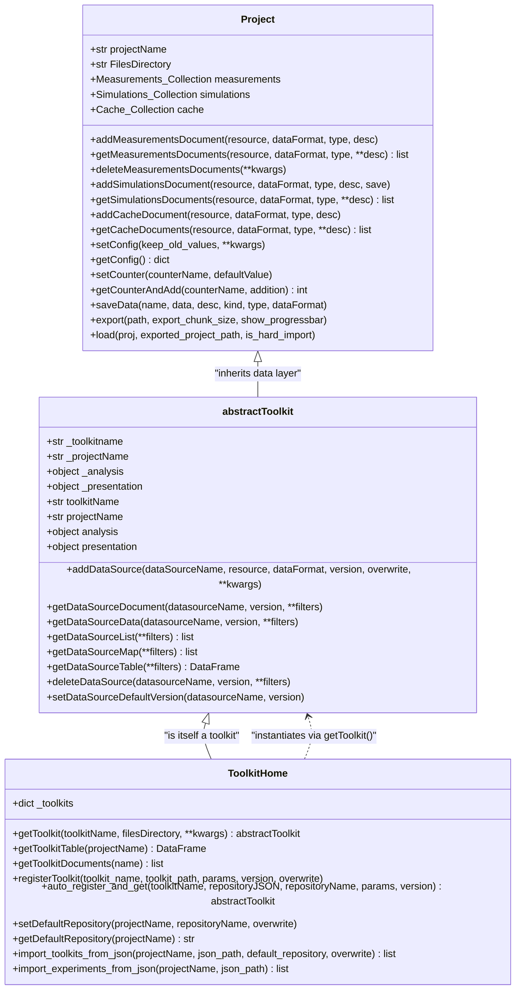
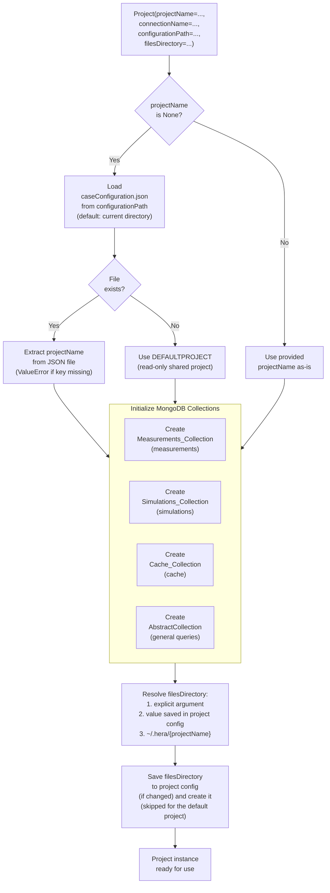
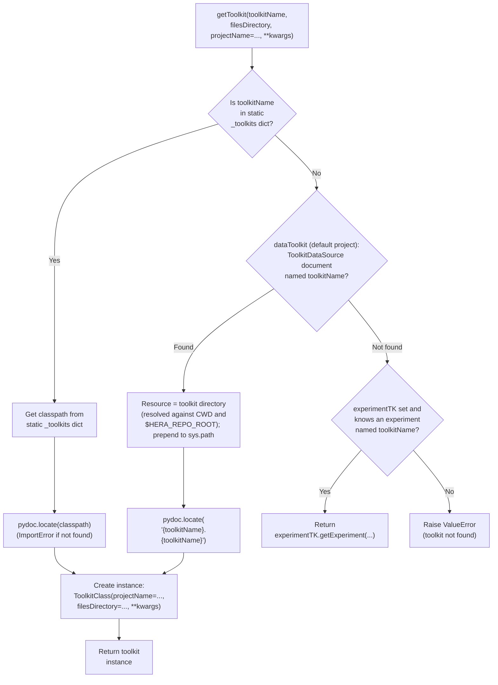
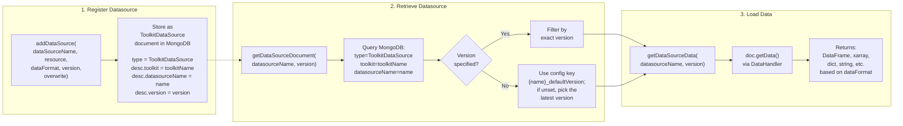
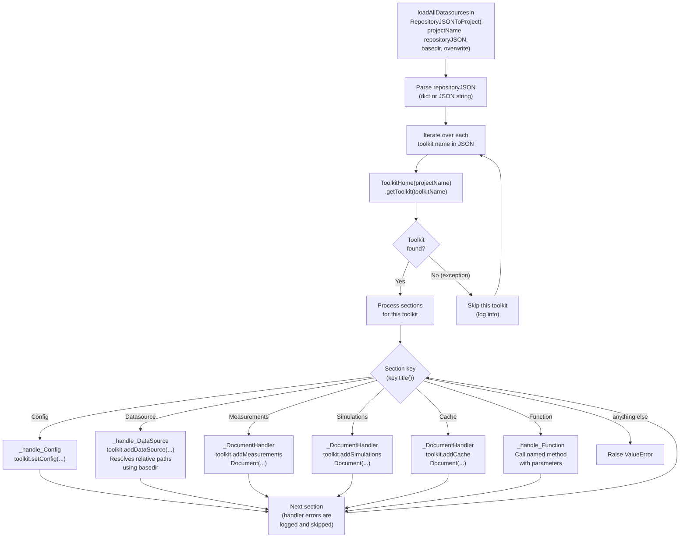

# Core Concepts

This page provides a deep technical reference for the three foundational classes in Hera: **Project**, **ToolkitHome**, and **abstractToolkit**. Understanding these is essential for working with any part of the system.

---

## Class Hierarchy Overview

The diagram below shows the **core hierarchy** — `Project` at the base, `abstractToolkit` adding datasource management on top, and `ToolkitHome` (itself an `abstractToolkit` subclass) acting as the registry/factory.



| Class | Role | Key methods |
|-------|------|------------|
| `Project` | Central data access layer — CRUD for measurements, simulations, cache | `addMeasurementsDocument`, `getMeasurementsDocuments`, `setConfig`, `getCounterAndAdd`, `saveData`, `export` |
| `abstractToolkit` | Base for all domain toolkits — adds datasource management, analysis/presentation layers | `addDataSource`, `getDataSourceData`, `getDataSourceList`, `deleteDataSource`, `setDataSourceDefaultVersion` |
| `ToolkitHome` | Registry/factory — resolves toolkit names to classes | `getToolkit`, `getToolkitTable`, `registerToolkit`, `getToolkitDocuments`, `import_toolkits_from_json` |

### Concrete Toolkit Hierarchy

All domain toolkits extend `abstractToolkit`, either directly or through an intermediate base (`VectorToolkit` for GIS vector toolkits, `hermesWorkflowToolkit` for workflow-based simulation toolkits). The diagram below shows the main inheritance tree including the special `dataToolkit` that manages repositories.

```mermaid
classDiagram
    class abstractToolkit {
        +str toolkitName
        +object analysis
        +object presentation
        +addDataSource()
        +getDataSourceData()
    }

    class dataToolkit {
        +addRepository(repositoryName, repositoryPath, overwrite)
        +getRepository(repositoryName) dict
        +getRepositoryTable() DataFrame
        +loadAllDatasourcesInRepositoryToProject(projectName, repositoryName, overwrite)
        +loadAllDatasourcesInAllRepositoriesToProject(projectName, overwrite)
        +loadAllDatasourcesInRepositoryJSONToProject(projectName, repositoryJSON, basedir, overwrite, auto_register_missing)
        +exportDocumentsToRepository(toolkitName, repositoryName, ...)
        +resolveDataSourcePaths(repositoryJSON, basedir) dict
        +loadRepositoryFromPath(json_path) dict
    }

    class TopographyToolkit {
        +getPointElevation(lat, long, dataSourceName) float
        +getPointListElevation(pointList, dataSourceName, inputCRS)
        +getElevation(minx, miny, maxx, maxy, dxdy, inputCRS) xarray
        +getElevationOfXarray(xarray_dataset) xarray
        +createElevationSTL(minx, miny, maxx, maxy, dxdy, ...)
        +convertPointsCRS(points, inputCRS, outputCRS)
    }

    class lowFreqToolKit {
        +analysis analysis
        +presentation presenation
        +str docType
    }

    class HighFreqToolKit {
        +analysis RawdataAnalysis
        +str docType
        +parseData(path, fromTime, toTime, parser)
        +loadData(name, path, outputDirectory, ...)
    }

    class VectorToolkit {
        GIS vector base class
    }

    class DemographyToolkit {
        +projectPolygonOnPopulation(shapelyPolygon, dataSourceOrData, populationTypes)
        +loadData(regionaName, dataOrFileName, version, metadata, overwrite)
        +setDefaultDirectory(fileDirectory, create)
        +analysis.calculatePopulationInPolygon(shapelyPolygon, dataSourceOrData)
        +analysis.createNewArea(shapeNameOrData, dataSourceOrData)
    }

    class LandCoverToolkit {
        +getLandCoverAtPoint(lon, lat, inputCRS) int
        +getLandCover(minx, miny, maxx, maxy, dxdy, inputCRS) xarray
        +getRoughnessAtPoint(lon, lat, inputCRS)
        +getRoughness(minx, miny, maxx, maxy, dxdy, ...) xarray
    }

    class BuildingsToolkit {
        +getBuildingsFromRectangle(minx, miny, maxx, maxy, dataSourceName, inputCRS, withElevation)
        +buildingsGeopandasToSTLRasterTopography(buildingData, ...)
    }

    class hermesWorkflowToolkit {
        Hermes/Luigi workflow base class
    }

    class OFToolkit {
        +runOFSimulation(nameOrWorkflowFileOrJSONOrResource, scheduler, ...)
        +analysis Analysis
        +presentation Presentation
    }

    class LSMToolkit {
        +analysis analysis
    }

    class RiskToolkit {
        +analysis analysis
        +presentation casualtiesPlot
    }

    abstractToolkit <|-- dataToolkit : "repository management"
    abstractToolkit <|-- TopographyToolkit : "GIS raster"
    abstractToolkit <|-- lowFreqToolKit : "meteorology"
    abstractToolkit <|-- HighFreqToolKit : "meteorology"
    abstractToolkit <|-- VectorToolkit : "GIS vector"
    VectorToolkit <|-- DemographyToolkit
    VectorToolkit <|-- BuildingsToolkit
    abstractToolkit <|-- LandCoverToolkit : "GIS raster"
    abstractToolkit <|-- hermesWorkflowToolkit : "workflows"
    hermesWorkflowToolkit <|-- OFToolkit
    abstractToolkit <|-- LSMToolkit : "simulations"
    abstractToolkit <|-- RiskToolkit : "risk assessment"
```



| Toolkit class | Domain | Key capabilities |
|--------------|--------|-----------------|
| `dataToolkit` | Data | Repository management, loading data sources into projects |
| `TopographyToolkit` | GIS (raster) | Elevation data, STL generation, CRS conversion |
| `BuildingsToolkit` | GIS (vector, via `VectorToolkit`) | Building footprints, 3D STL for CFD |
| `DemographyToolkit` | GIS (vector, via `VectorToolkit`) | Population calculations within polygons |
| `LandCoverToolkit` | GIS (raster) | Land cover classification, roughness estimation |
| `lowFreqToolKit` | Meteorology | Hourly/daily station data with analysis + presentation |
| `HighFreqToolKit` | Meteorology | High-frequency sonic anemometer data |
| `OFToolkit` | Simulations (via `hermesWorkflowToolkit`) | OpenFOAM lifecycle (templates, running, post-processing) |
| `LSMToolkit` | Simulations | Lagrangian Stochastic Model |
| `RiskToolkit` | Risk | Agent-based hazard and casualty modeling |

---

## Project

**Source:** `hera/datalayer/project.py`

The `Project` class is the central data access layer. Every interaction with stored data — measurements, simulations, cached results — goes through a `Project` instance.

### Responsibilities

1. **Document CRUD** — Add, query, and delete documents across three MongoDB collections: Measurements, Simulations, and Cache.
2. **Configuration** — Per-project key-value config stored as a special Cache document (type = `<projectName>__config__`).
3. **Counters** — Atomic counters for generating sequential IDs (stored inside the config document under `desc.counters`).
4. **File Management** — Each project has a `filesDirectory` where physical files (parquet, netcdf, etc.) are stored on disk. It defaults to `~/.hera/<projectName>` and is persisted in the project config.
5. **Import/Export** — Projects can be exported to a zip file and loaded into another MongoDB instance.

### Initialization Flow



!!! note "The Default Project"
    When `projectName=None` and no `caseConfiguration.json` exists, Hera uses a special `"defaultProject"` (`Project.DEFAULTPROJECT`). It is **read-only**: `add*Document` raises unless `_allowWritingToDefaultProject` is set, and `setConfig`/`getConfig` always raise. The `dataToolkit` uses it to store repository registrations and dynamically registered toolkits without polluting user projects.

### Key Methods

| Method | Description |
|--------|-------------|
| `addMeasurementsDocument(resource, dataFormat, type, desc)` | Insert a new measurement document into MongoDB |
| `getMeasurementsDocuments(resource, dataFormat, type, **desc)` | Query measurement documents; extra keyword arguments filter on `desc` fields |
| `deleteMeasurementsDocuments(**kwargs)` | Remove matching measurement documents |
| `setConfig(keep_old_values=True, **kwargs)` | Update project configuration (per-key updates; `keep_old_values=False` replaces the whole config) |
| `getConfig()` | Return the full config dict |
| `setCounter(counterName, defaultValue=0)` | Define a named counter (force-sets its value) |
| `getCounterAndAdd(counterName, addition=1)` | Atomically increment a counter and return the new value (returns `0` and creates the counter on first call) |
| `saveData(name, data, desc, kind, type=None, dataFormat=None)` | Auto-detect format, save to disk, and create a document (`kind` is `"Measurements"`, `"Simulations"` or `"Cache"`; see also `saveMeasurementData` / `saveSimulationData` / `saveCacheData`) |
| `export(path)` | Export all project documents to a zip file |
| `Project.load(proj, exported_project_path, is_hard_import)` | Import documents from an exported zip (static method) |

### Document Structure

Every document in Hera has the following top-level fields:

```python
{
    "projectName": "MY_PROJECT",
    "_cls": "Metadata.Measurements",   # or .Simulations / .Cache
    "type": "ToolkitDataSource",        # application-defined type tag
    "resource": "/path/to/data.parquet",
    "dataFormat": "parquet",
    "desc": {                           # free-form metadata dict
        "toolkit": "MeteoLowFreq",
        "datasourceName": "YAVNEEL",
        "version": [0, 0, 1],
        ...
    }
}
```

---

## ToolkitHome

**Source:** `hera/toolkit.py` (class `ToolkitHome`)

`ToolkitHome` is the **central registry** for all available toolkits. A singleton instance `toolkitHome` is exposed by `hera/__init__.py`; it is created lazily on first access of `hera.toolkitHome` (so `import hera` stays cheap).

### Responsibilities

1. **Static Registry** — A dict mapping toolkit names (e.g., `"MeteoLowFreq"`) to their full Python class paths.
2. **Dynamic Registry** — Toolkits registered at runtime via `registerToolkit(toolkit_name, toolkit_path)` are stored as `ToolkitDataSource` documents (resource = the toolkit directory) in the default project, through `dataToolkit`. On load, the directory is put on `sys.path` and the class `<toolkit_name>.<toolkit_name>` is imported.
3. **Instantiation** — `getToolkit(toolkitName, projectName=...)` resolves the class, imports it, and returns a new instance. If `projectName` is not given, the `ToolkitHome` instance's own project is used.
4. **Auto-Registration** — `auto_register_and_get()` reads a `Registry.classpath` (or `Registry.cls`) hint from a repository JSON, registers the toolkit and returns an instance.

### Toolkit Resolution Flow



Note: in master `ToolkitHome.experimentTK` is initialised to `None` and never assigned, so the experiment fallback branch is currently never taken. Experiments are reached through `getToolkit(toolkitHome.EXPERIMENT, ...)` (the static `experiment` entry) and then `experimentHome.getExperiment(experimentName, filesDirectory=None)`.

!!! warning "Singleton Pattern"
    `hera/__init__.py` instantiates `ToolkitHome()` once (lazily, on first access) and exposes it as `toolkitHome`. All code should use this singleton rather than creating new instances. The static registry dict is populated in `ToolkitHome.__init__`.

!!! bug "Known issue in master"
    `auto_register_and_get()` calls `registerToolkit(toolkitclass=..., datasource_name=..., repositoryName=...)`, but `registerToolkit` takes `toolkit_name` and `toolkit_path` (`hera/toolkit.py`). The call therefore fails with a `TypeError`. Use `registerToolkit(toolkit_name, toolkit_path)` directly instead.

### Static Toolkit Registry

The `_toolkits` dict is structured as:

```python
{
    "GIS_Raster_Topography": {
        "cls": "hera.measurements.GIS.raster.topography.TopographyToolkit",
        "desc": None,
        "type": "measurements"
    },
    "MeteoLowFreq": {
        "cls": "hera.measurements.meteorology.lowfreqdata.toolkit.lowFreqToolKit",
        "desc": None,
        "type": "measurements"
    },
    # ... 17 built-in toolkits total
}
```

The built-in names are exposed as constants on `ToolkitHome` (use these instead of literal strings):

| Constant | Name | Class |
|----------|------|-------|
| `GIS_BUILDINGS` | `GIS_Buildings` | `hera.measurements.GIS.vector.buildings.toolkit.BuildingsToolkit` |
| `GIS_TILES` | `GIS_Tiles` | `hera.measurements.GIS.raster.tiles.TilesToolkit` |
| `GIS_VECTOR_TOPOGRAPHY` | `GIS_Vector_Topography` | `hera.measurements.GIS.vector.topography.TopographyToolkit` |
| `GIS_RASTER_TOPOGRAPHY` | `GIS_Raster_Topography` | `hera.measurements.GIS.raster.topography.TopographyToolkit` |
| `GIS_DEMOGRAPHY` | `GIS_Demography` | `hera.measurements.GIS.vector.demography.DemographyToolkit` |
| `GIS_LANDCOVER` | `GIS_LandCover` | `hera.measurements.GIS.raster.landcover.LandCoverToolkit` |
| `RISKASSESSMENT` | `RiskAssessment` | `hera.riskassessment.riskToolkit.RiskToolkit` |
| `LSM` | `LSM` | `hera.simulations.LSM.toolkit.LSMToolkit` |
| — | `OF_LSM` | `hera.simulations.openFoam.lagrangian.LSM.toolkit.OFLSMToolkit` |
| `METEOROLOGY_HIGHFREQ` | `MeteoHighFreq` | `hera.measurements.meteorology.highfreqdata.toolkit.HighFreqToolKit` |
| `METEOROLOGY_LOWFREQ` | `MeteoLowFreq` | `hera.measurements.meteorology.lowfreqdata.toolkit.lowFreqToolKit` |
| `SIMULATIONS_WORKFLOWS` | `hermesWorkflows` | `hera.simulations.hermesWorkflowToolkit.hermesWorkflowToolkit` |
| `SIMULATIONS_OPENFOAM` | `OpenFOAM` | `hera.simulations.openFoam.toolkit.OFToolkit` |
| `WINDPROFILE` | `WindProfile` | `hera.simulations.windProfile.toolkit.WindProfileToolkit` |
| `GAUSSIANDISPERSION` | `GaussianDispersion` | `hera.simulations.gaussian.toolkit.gaussianToolkit` |
| `MACHINELEARNING_DEEPLEARNING` | `machine_deep_learning` | `hera.simulations.machineLearningDeepLearning.toolkit.machineLearningDeepLearningToolkit` |
| `EXPERIMENT` | `experiment` | `hera.measurements.experiment.experiment.experimentHome` |

`ToolkitHome.DATA` (`"heraData"`) is also defined but is not an entry in the static registry; use `hera.utils.data.toolkit.dataToolkit` directly.


### Save Modes

`ToolkitHome` defines standard save-mode constants used throughout the system:

| Constant | Value | Meaning |
|----------|-------|---------|
| `TOOLKIT_SAVEMODE_NOSAVE` | `None` | Do not persist |
| `TOOLKIT_SAVEMODE_ONLYFILE` | `"File"` | Save to disk only |
| `TOOLKIT_SAVEMODE_ONLYFILE_REPLACE` | `"File_overwrite"` | Save to disk, overwrite |
| `TOOLKIT_SAVEMODE_FILEANDDB` | `"DB"` | Save to disk + MongoDB document |
| `TOOLKIT_SAVEMODE_FILEANDDB_REPLACE` | `"DB_overwrite"` | Save to disk + MongoDB, overwrite |

---

## abstractToolkit

**Source:** `hera/toolkit.py` (class `abstractToolkit`)

`abstractToolkit` is the **base class for all domain toolkits**. It inherits from `Project`, meaning every toolkit instance **is** a project — it has full access to measurements, simulations, cache, config, and counters.

!!! info "Design Decision: Inheritance over Composition"
    `abstractToolkit` inherits from `Project` rather than wrapping it. This means every toolkit call like `toolkit.getMeasurementsDocuments(...)` goes directly to the `Project` implementation. The toolkit adds a **datasource management layer** on top, where each datasource is a measurement document tagged with `type="ToolkitDataSource"` and the toolkit's name.

### What It Adds Over Project

1. **Toolkit Identity** — `toolkitName` property, automatically injected into every document created by the toolkit.
2. **Datasource Versioning** — Each datasource has a name + version tuple `(major, minor, patch)`, default `(0, 0, 1)`. The system supports multiple versions and a default-version mechanism (stored in the project config as `<datasourceName>_defaultVersion`; without it the latest version is returned).
3. **Analysis & Presentation Layers** — `self._analysis` and `self._presentation` hold domain-specific logic (e.g., statistical calculations, plotting).
4. **Automatic Tagging** — `addMeasurementsDocument`, `addSimulationsDocument`, and `addCacheDocument` are overridden to inject the toolkit name into every document's `desc` (as `desc["toolkit"]`, unless already set).

### Datasource Lifecycle



### Key Methods

| Method | Description |
|--------|-------------|
| `addDataSource(dataSourceName, resource, dataFormat, version=(0, 0, 1), overwrite=False, **kwargs)` | Register a new datasource (versioned); raises `ValueError` if it exists and `overwrite=False`. Extra kwargs go into `desc` |
| `getDataSourceDocument(datasourceName, version=None, **filters)` | Get the MongoDB document for a datasource (or `None`) |
| `getDataSourceData(datasourceName=None, version=None, **filters)` | Load and return the actual data (or `None`) |
| `getDataSourceList(**filters)` | List all datasource names |
| `getDataSourceMap(**filters)` | List of datasource names and versions |
| `getDataSourceTable(**filters)` | DataFrame of all datasources with metadata |
| `deleteDataSource(datasourceName, version=None, **filters)` | Remove a datasource document |
| `setDataSourceDefaultVersion(datasourceName, version)` | Set which version is returned by default (raises `ValueError` if that version does not exist) |

### Concrete Toolkit Example

A concrete toolkit like `lowFreqToolKit` extends `abstractToolkit` and provides:

- **`analysis`** — Methods like `addDatesColumns()`, `calcHourlyDist()`, `resampleSecondMoments()`
- **`presentation`** — Plot generators like `dailyPlots.plotScatter()`, `seasonalPlots.plotProbContourf_bySeason()`
- **`docType`** — A string identifying the data type this toolkit handles

```python
from hera import toolkitHome

# Instantiate via the registry
lf = toolkitHome.getToolkit(toolkitHome.METEOROLOGY_LOWFREQ, projectName="MY_PROJECT")

# Access data
df = lf.getDataSourceData("YAVNEEL")

# Use analysis
enriched = lf.analysis.addDatesColumns(df, datecolumn="datetime")

# Use presentation
ax = lf.presentation.dailyPlots.plotScatter(enriched, plotField="RH")
```

---

## dataToolkit

**Source:** `hera/utils/data/toolkit.py`

`dataToolkit` extends `abstractToolkit` (toolkit name `heradata`) and serves as the **repository management layer**. It operates on the `defaultProject` (read-only for normal users) and manages the mapping between repository JSON files and project datasources.

### Responsibilities

1. **Repository Registration** — `addRepository(repositoryName, repositoryPath, overwrite=False)` stores a reference to a repository JSON file as a datasource in the default project.
2. **Repository Loading** — `loadAllDatasourcesInRepositoryJSONToProject()` iterates through a parsed repository JSON and, for each toolkit section, dispatches to specialized handlers. `loadAllDatasourcesInRepositoryToProject()` and `loadAllDatasourcesInAllRepositoriesToProject()` do the same for one / all registered repositories.
3. **Export** — `exportDocumentsToRepository(toolkitName=..., repositoryName=..., ...)` writes project documents back into a repository JSON.
4. **Static Helpers** — `resolveDataSourcePaths()` and `loadRepositoryFromPath()` allow working with repository JSONs without MongoDB.

!!! note
    `loadAllDatasourcesInRepositoryJSONToProject()` still accepts `auto_register_missing`, but in master it is ignored: toolkits that `getToolkit()` cannot resolve are skipped.

### Repository JSON Loading Pipeline



### Handler Dispatch Table

| JSON Section Key | Handler Method | Action |
|-----------------|----------------|--------|
| `Config` | `_handle_Config` | Calls `toolkit.setConfig(**docTypeDict)` |
| `Datasource` | `_handle_DataSource` | Adds each item as a versioned datasource |
| `Measurements` | `_DocumentHandler` | Adds raw measurement documents |
| `Simulations` | `_DocumentHandler` | Adds simulation documents |
| `Cache` | `_DocumentHandler` | Adds cache documents |
| `Function` | `_handle_Function` | For each key, calls the method of that name **on the `dataToolkit`** with the given dict (or list of dicts) as kwargs plus `overwrite` |

Section keys are normalised with `str.title()` before lookup (so `DataSource` and `datasource` both match `Datasource`); an unknown key raises `ValueError`.

---

## API Reference

The full auto-generated reference for these classes lives in the [Core API](../developer_guide/api/core.md) page:

- [`ToolkitHome`](../developer_guide/api/core.md#toolkithome)
- [`abstractToolkit`](../developer_guide/api/core.md#abstracttoolkit)
- [`Project`](../developer_guide/api/core.md#project)
- [`dataToolkit`](../developer_guide/api/utils.md#data-utilities)
