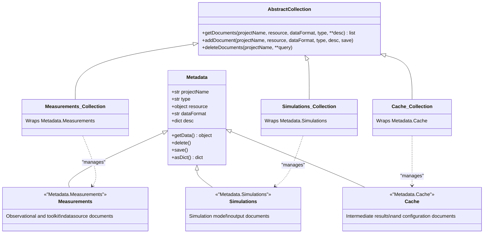
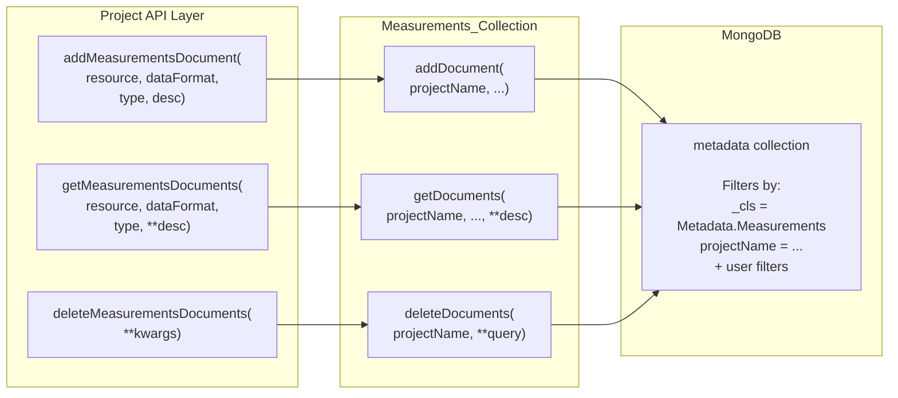
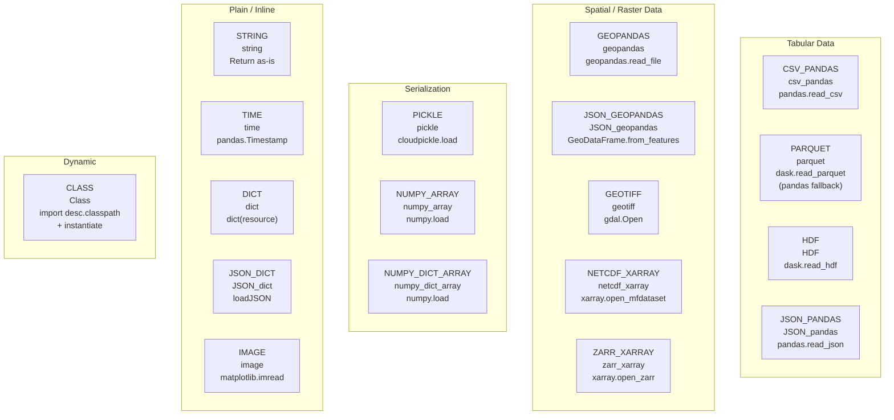
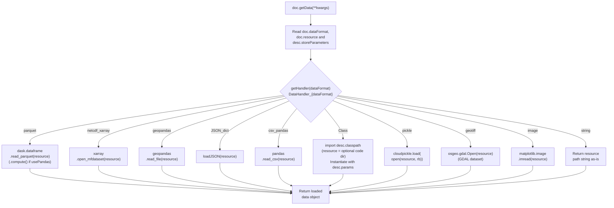
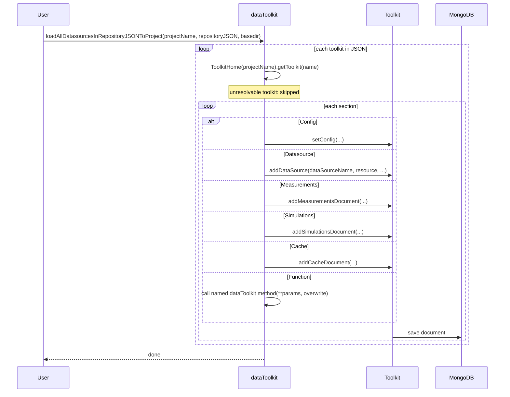
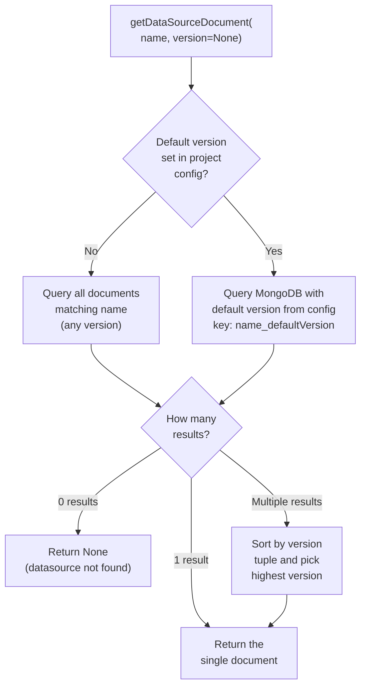
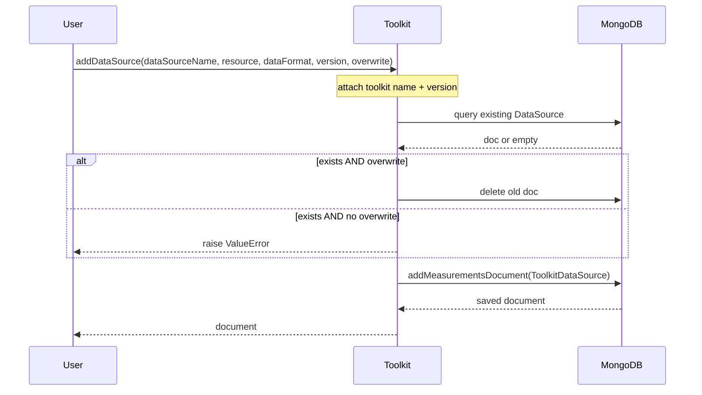
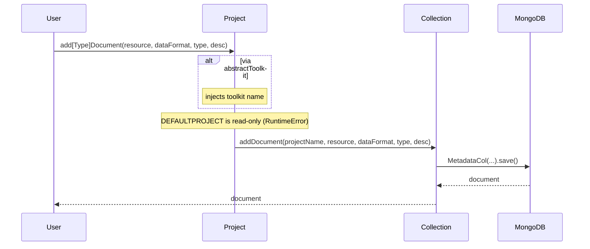
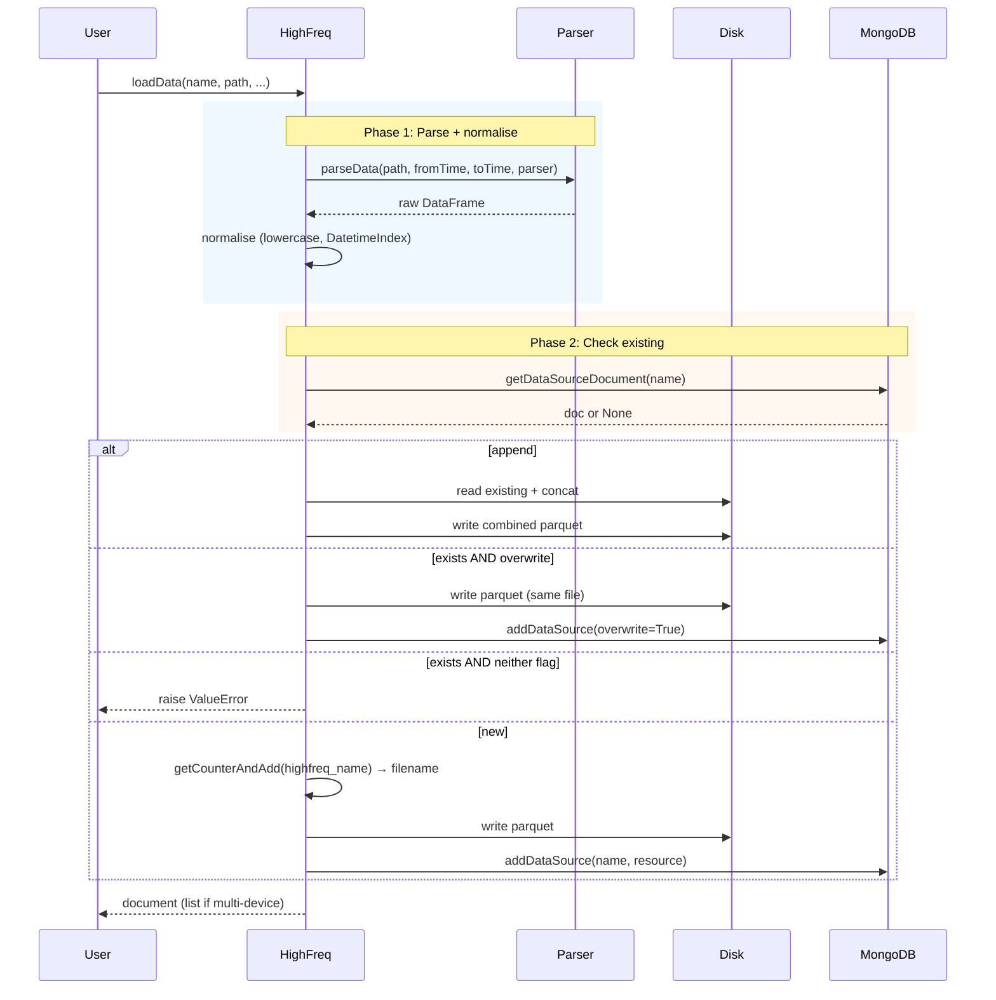

# Data Layer

This page covers the MongoDB document model, the `datatypes` system for format dispatch, and the repository JSON pipeline that loads data into projects.

---

## MongoDB Document Model

Hera stores all metadata in MongoDB using a single base model (`Metadata`) with three subtypes. Each document represents a pointer to data — the actual data lives on disk (or inline for small values).



### Document Fields

| Field | Type | Description |
|-------|------|-------------|
| `projectName` | `str` | The project this document belongs to |
| `_cls` | `str` | Discriminator: `"Metadata.Measurements"`, `"Metadata.Simulations"`, or `"Metadata.Cache"` |
| `type` | `str` | Application-defined type tag (e.g., `"ToolkitDataSource"`, `"Experiment_rawData"`) |
| `resource` | any (`DynamicField`) | Path to the data file on disk, or inline value for small data (string, dict, timestamp, ...) |
| `dataFormat` | `str` | One of the `datatypes` constants (see below) |
| `desc` | `dict` | Free-form metadata dictionary — toolkit name, version, parameters, etc. |

### Collection Architecture

Each collection type wraps a MongoEngine document class and provides the standard CRUD interface:



!!! note "Three Parallel APIs"
    The `Project` class exposes identical method sets for all three collection types: `addMeasurementsDocument` / `addSimulationsDocument` / `addCacheDocument`, and similarly for get and delete. Under the hood, each delegates to its own `Collection` instance which filters by the `_cls` discriminator.

---

## The datatypes System

**Source:** `hera/datalayer/datahandler.py` (class `datatypes`)

The `datatypes` class defines all supported data format constants and provides the dispatch logic to read and write data in each format.

### Supported Formats



| Constant | Value | Description |
|----------|-------|-------------|
| `STRING` | `"string"` | Plain text / path string |
| `TIME` | `"time"` | Timestamp stored inline; returned as `pandas.Timestamp` |
| `CSV_PANDAS` | `"csv_pandas"` | CSV file read via pandas |
| `HDF` | `"HDF"` | HDF5 file read via dask; `resource` is a dict `{"path": ..., "key": ...}` (read-only, saving not implemented) |
| `NETCDF_XARRAY` | `"netcdf_xarray"` | NetCDF file(s) read via `xarray.open_mfdataset` |
| `ZARR_XARRAY` | `"zarr_xarray"` | Zarr archive read via xarray |
| `JSON_DICT` | `"JSON_dict"` | JSON file (or JSON string) parsed to dict via `hera.utils.jsonutils.loadJSON` |
| `JSON_PANDAS` | `"JSON_pandas"` | JSON file read via pandas |
| `JSON_GEOPANDAS` | `"JSON_geopandas"` | GeoJSON file read via geopandas |
| `GEOPANDAS` | `"geopandas"` | Shapefile / GeoPackage read via geopandas |
| `GEOTIFF` | `"geotiff"` | GeoTIFF raster opened with GDAL (`osgeo.gdal.Open`, returns a GDAL dataset; read-only) |
| `PARQUET` | `"parquet"` | Parquet file read via dask (computed to pandas when `usePandas=True`; pandas fallback) |
| `IMAGE` | `"image"` | Image file read via matplotlib |
| `PICKLE` | `"pickle"` | Python pickle file (written/read with `cloudpickle`) |
| `DICT` | `"dict"` | Inline dictionary (stored in resource) |
| `NUMPY_ARRAY` | `"numpy_array"` | NumPy `.npy` file |
| `NUMPY_DICT_ARRAY` | `"numpy_dict_array"` | Dict of NumPy arrays (`.npz`, no auto-detection) |
| `CLASS` | `"Class"` | Dynamic Python class: imports `desc["classpath"]` (falling back to code under the `resource` directory) and instantiates it with `desc["params"]`/`desc["parameters"]` unless `desc["instantiate"]` is `False` (read-only) |

### Format Dispatch Flow

When `document.getData(**kwargs)` is called, the system resolves the handler `DataHandler_<dataFormat>` via `getHandler(dataFormat)` (unknown formats raise `ValueError`) and passes `desc["storeParameters"]` merged with the caller's kwargs:



!!! tip "Auto-Detection"
    The `datatypes.getDataFormatName(data)` static method can auto-detect the format from a Python object (pandas/dask DataFrame -> `"parquet"`, GeoDataFrame -> `"geopandas"`, pandas Series -> `"JSON_pandas"`, xarray.DataArray -> `"netcdf_xarray"`, numpy array -> `"numpy_array"`, str -> `"string"`; dict, list, bytes and anything unmapped, including `xarray.Dataset`, -> `"pickle"`). `Project.saveData()` uses it (together with `getDataFormatExtension`) to choose the format and file extension when `dataFormat` is not given, and writes the file to `<filesDirectory>/cache/<name>_<counter>.<ext>`.

---

## Repository JSON Structure

A **repository JSON** is the standard way to declare and load data into a Hera project. It maps toolkit names to their configuration, datasources, and documents. Valid section keys (matched after `str.title()`) are `Config`, `Datasource`, `Measurements`, `Simulations`, `Cache` and `Function`; any other key raises `ValueError`. See also the [Repository JSON schema reference](../reference/repository_schema.md).

### Format

```json
{
    "<ToolkitName>": {
        "Config": {
            "key1": "value1",
            "key2": "value2"
        },
        "Datasource": {
            "<datasource_name>": {
                "isRelativePath": "True",
                "item": {
                    "resource": "relative/path/to/data.parquet",
                    "dataFormat": "parquet",
                    "version": [0, 0, 1],
                    "<extraKey>": "..."
                }
            }
        },
        "Measurements": {
            "<measurement_name>": {
                "item": {
                    "resource": "relative/path/to/file.shp",
                    "dataFormat": "geopandas",
                    "type": "SomeType",
                    "desc": { ... }
                }
            }
        }
    }
}
```

Each `Datasource` item is passed to `toolkit.addDataSource(dataSourceName=<datasource_name>, overwrite=..., **item)`, so any key other than `resource`, `dataFormat` and `version` becomes a top-level field of the document's `desc`. Instead of `resource`, a `Datasource` item may give `resourceFilePath`: a JSON file whose parsed contents become the resource. Each `Measurements` / `Simulations` / `Cache` item is passed as keyword arguments to `add<Type>Document(resource, dataFormat, type, desc)`; an existing document matching its `type`/`desc` is skipped unless `overwrite=True`.

### Loading Pipeline



### Path Resolution

**`Datasource` items** must carry an `isRelativePath` flag next to `item` (an `assert` fails otherwise):

- **`"True"` / `true`** — The `resource` (or `resourceFilePath`) is relative to the repository's base directory. The loader joins it with `basedir`.
- **`"False"` / `false`** — The `resource` is used as-is.

**`Measurements` / `Simulations` / `Cache` items** do not use the outer flag: the `resource` is always joined with `basedir` (via `os.path.join`, so an absolute `resource` stays absolute). Do not put `isRelativePath` inside `item`: the item is passed as keyword arguments to `add<Type>Document`, which does not accept it, and the item is then skipped with a logged error.

!!! warning "String Booleans"
    For `Datasource` items `isRelativePath` accepts the strings `"True"`/`"False"` and JSON booleans `true`/`false`; any other value fails the assertion. Always be explicit.

### Static Loading (No MongoDB)

For testing or lightweight scripts, `dataToolkit` provides two static methods that work without MongoDB:

```python
from hera.utils.data.toolkit import dataToolkit

# Load and resolve all paths in one call
repo = dataToolkit.loadRepositoryFromPath("/path/to/repository.json")

# Or resolve paths on an already-parsed dict
resolved = dataToolkit.resolveDataSourcePaths(repo_dict, basedir="/data/root")
```

These methods perform a deep copy of the JSON and resolve every `resource` whose `isRelativePath` is `"True"`/`true` (read from the entry or from its `item`) to an absolute path, but do **not** insert anything into MongoDB.

---

## ToolkitDataSource Documents

When a datasource is registered via `abstractToolkit.addDataSource()`, it creates a special document:

```python
{
    "projectName": "MY_PROJECT",
    "_cls": "Metadata.Measurements",
    "type": "ToolkitDataSource",
    "resource": "/data/meteorology/YAVNEEL.parquet",
    "dataFormat": "parquet",
    "desc": {
        "toolkit": "MeteoLowFreq",
        "datasourceName": "YAVNEEL",
        "version": [0, 0, 1]
    }
}
```

!!! info "Querying Datasources"
    The `abstractToolkit` datasource getters (`getDataSourceDocument`, `getDataSourceData`, ...) always filter by `type="ToolkitDataSource"` and `toolkit=self.toolkitName`. This ensures that each toolkit only sees its own datasources, even though all documents share the same MongoDB collection.

### Version Resolution

When `getDataSourceDocument(datasourceName)` is called without a version (no default version is ever written implicitly; use `setDataSourceDefaultVersion()`):



### addDataSource Swimlane

The full call chain when a toolkit registers a new data source — from the toolkit API down through the data layer to MongoDB:



### add[Type]Document Swimlane

The call chain for adding documents to each collection (Measurements, Simulations, Cache). All three follow the same pattern — only the collection class differs:



### loadData Swimlane (HighFreqToolKit)

The complete flow for ingesting raw sensor data — from parsing through to data source registration:



---

## Connection Management (`document/__init__.py`)

### How connections are established

Connections are opened **lazily**: the first call to `getDBObject()` (i.e. the first time a collection, and so a `Project`, is created) runs `_ensure_connections()`, which connects to every database defined in `~/.pyhera/config.json`:

```python
# document/__init__.py — runs once, on first getDBObject() call
def _ensure_connections():
    ...
    try:
        for user in getDBNamesFromJSON():
            createDBConnection(
                connectionName=user,
                mongoConfig=getMongoConfigFromJson(connectionName=user),
            )
    except Exception:
        pass  # missing/malformed config: the error surfaces on the first real query
```

If `~/.pyhera/config.json` does not exist, `getMongoJSON()` writes a template file with placeholder values and raises `IOError`. Each entry has the keys `username`, `password`, `dbIP` and `dbName`; the default connection name is the current OS user name (`getpass.getuser()`).

### Dynamic class creation

MongoDB document classes are created **dynamically at runtime** using Python's `type()` builtin. This allows each database connection to have its own set of MongoEngine document classes with the correct `db_alias`:

```python
# Creates a new class: Metadata(DynamicDocument, MetadataFrame)
new_Metadata = type('Metadata', (DynamicDocument, MetadataFrame), {
    'meta': {
        'db_alias': f'{dbName}-alias',  # binds to specific DB
        'allow_inheritance': True,       # enables Measurements/Simulations/Cache subtypes
        'auto_create_indexes': True,
        'indexes': ['projectName']       # index for fast project queries
    }
})

# Subtypes inherit from the dynamic Metadata class
new_Measurements = type('Measurements', (new_Metadata,), {})
new_Simulations = type('Simulations', (new_Metadata,), {})
new_Cache = type('Cache', (new_Metadata,), {})
```

### The `dbObjects` registry

All connections and document classes are stored in a module-level dictionary:

```python
dbObjects = {
    "connectionName1": {
        "connection": <mongoengine connection>,
        "Metadata": <dynamic Metadata class>,
        "Measurements": <dynamic Measurements class>,
        "Simulations": <dynamic Simulations class>,
        "Cache": <dynamic Cache class>,
    },
    "connectionName2": { ... },
}
```

`getDBObject(objectName, connectionName=None)` retrieves a class from this registry (`connectionName=None` means the OS user name). Collections use it to get their MongoEngine document class:

```python
# Inside AbstractCollection.__init__(self, ctype=None, connectionName=None):
self._metadataCol = getDBObject('Metadata', connectionName) if self.type is None \
                    else getDBObject(ctype, connectionName)   # 'Measurements' / 'Simulations' / 'Cache'
```

### Multi-database support

Each connection name maps to a separate MongoDB database. This enables:
- Different projects on different servers
- Shared "public" databases alongside local ones
- Parallel connections with different aliases

---

## MetadataFrame (`document/metadataDocument.py`)

### getData() dispatch

`MetadataFrame.getData()` is the bridge between metadata and actual data:

```python
def getData(self, **kwargs):
    storeParametersDict = self.desc.get("storeParameters", {})
    storeParametersDict.update(kwargs)
    return getHandler(self.dataFormat).getData(
        resource=self.resource, desc=self.desc, **storeParametersDict
    )
```

1. Reads `storeParameters` from the document's `desc` — these were saved when the data was written (e.g., `usePandas=True` for parquet)
2. Merges with any kwargs passed by the caller
3. Calls `getHandler(dataFormat)` to find the right `DataHandler_*` class
4. Delegates to the handler's `getData(resource, desc, **params)`

### nonDBMetadataFrame

A wrapper for data that isn't stored in MongoDB, so callers can treat in-memory results like documents. It is returned, for example, by `DemographyToolkit.analysis.createNewArea(...)` when `saveMode` is `TOOLKIT_SAVEMODE_NOSAVE`, by `RiskToolkit` when an agent is given as a description instead of a stored name, and by the LSM / OpenFOAM-LSM toolkits for in-memory results:

```python
class nonDBMetadataFrame:
    def __init__(self, data, projectName=None, type=None, resource=None, dataFormat=None, **desc):
        self._data = data   # the actual Python object

    def getData(self, **kwargs):
        return self._data   # just returns the object, no handler dispatch
```

---

## DataHandler Pattern (`datahandler.py`)

### How handlers work

Each `DataHandler_*` class is a static utility with two methods:

```python
class DataHandler_parquet:
    @staticmethod
    def saveData(resource, fileName, **kwargs):
        # Save the data object to disk
        if isinstance(resource, pandas.DataFrame):
            resource.to_parquet(fileName, **kwargs)
            return dict(usePandas=True)    # store parameters returned to caller
        kwargs.setdefault('partition_size', "100MB")   # dask DataFrame
        resource.to_parquet(fileName, **kwargs)
        return dict(usePandas=False)

    @staticmethod
    def getData(resource, desc=None, usePandas=False, **kwargs):
        # Load data from disk
        try:
            df = dask.dataframe.read_parquet(resource, **kwargs)
            if usePandas:
                df = df.compute()
        except ValueError:
            df = pandas.read_parquet(resource, **kwargs)
        return df
```

Key pattern:
- `saveData` writes to disk and returns a dict of **store parameters** — these are saved in `desc.storeParameters` so `getData` can reproduce the exact same load behavior
- `getData` reads from disk using `resource` (file path) and `desc` for metadata

### Handler dispatch

```python
@staticmethod
def getHandler(objectType):          # datatypes.getHandler; module-level getHandler() wraps it
    dataHandlerModule = importlib.import_module("hera.datalayer.datahandler")
    handlerName = f"DataHandler_{objectType}"
    if not hasattr(dataHandlerModule, handlerName):
        raise ValueError(f"The data handler for the type {objectType} is not known")
    return getattr(dataHandlerModule, handlerName)
```

`objectType` is the `dataFormat` string (e.g., `"parquet"` → `DataHandler_parquet`).

### Auto-detection

When saving data with `Project.saveData()`, the format is auto-detected:

```python
datatypes.typeDatatypeMap = {
    "str": dict(typeName=STRING, ext="txt"),
    "pandas.core.frame.DataFrame": dict(typeName=PARQUET, ext="parquet"),
    "pandas.core.series.Series": dict(typeName=JSON_PANDAS, ext="json"),
    "dask_expr._collection.DataFrame": dict(typeName=PARQUET, ext="parquet"),
    "geopandas.geodataframe.GeoDataFrame": dict(typeName=GEOPANDAS, ext="gpkg"),
    "xarray.core.dataarray.DataArray": dict(typeName=NETCDF_XARRAY, ext="zarr"),
    "dict": dict(typeName=PICKLE, ext="pckle"),
    "list": dict(typeName=PICKLE, ext="pckle"),
    "bytes": dict(typeName=PICKLE, ext="pckle"),
    "object": dict(typeName=PICKLE, ext="pckle"),   # fallback
    "numpy.ndarray": dict(typeName=NUMPY_ARRAY, ext="npy"),
}
```

`datatypes.getDataFormatName(obj)` looks up the fully-qualified class name in this map (falling back to `"object"`) and returns the format string; `datatypes.getDataFormatExtension(obj)` returns the matching extension.

### Adding a new handler

1. Create a class `DataHandler_myformat` in `datahandler.py`:
   ```python
   class DataHandler_myformat:
       @staticmethod
       def saveData(resource, fileName, **kwargs):
           # write resource to fileName
           return {}

       @staticmethod
       def getData(resource, desc={}, **kwargs):
           # read and return data from resource
           pass
   ```

2. Add a constant to `datatypes`:
   ```python
   MYFORMAT = "myformat"
   ```

3. Optionally add to `typeDatatypeMap` for auto-detection:
   ```python
   "mypackage.MyClass": {"typeName": "myformat", "ext": "myext"}
   ```

---

## Function Caching (`autocache.py`)

### How `@cacheFunction` works

The `cacheFunction` decorator caches function return values in the project database:

```python
from hera import cacheFunction, datatypes

@cacheFunction(returnFormat=datatypes.PARQUET, projectName="MY_PROJECT")
def expensive_computation(x, y):
    # ... long computation ...
    return result_df
```

Signature: `cacheFunction(_func=None, *, returnFormat=None, projectName=None, postProcessFunction=None, getDataParams=None, storeDataParams=None, returnDoc=False)`. It can also be used bare (`@cacheFunction`). `clearFunctionCache(functionName, projectName=None)` and `clearAllFunctionsCache(projectName=None)` delete the cached documents.

!!! bug "Known issue in master"
    The wrapper ends with `return ret, doc if self.returnDoc else ret` (`hera/datalayer/autocache.py`), which Python parses as `return (ret, (doc if self.returnDoc else ret))`. A decorated function therefore always returns a **2-tuple** — `(result, result)` by default, `(result, doc)` with `returnDoc=True` — instead of the bare result.

### Cache lookup flow

```
1. Function called with (args, kwargs)
    ↓
2. Bind args to function signature (defaults applied) → dict of all parameters
   ('self' is renamed to 'context')
    ↓
3. Convert to JSON (ConfigurationToJSON) with standardized MKS units
    ↓
4. Serialize non-BSON values to base64 text
    ↓
5. Add function's fully-qualified name
    ↓
6. Query Cache collection: type="functionCacheData" + all serialized params
    ↓
7a. Cache HIT → doc.getData(**getDataParams) → return
    (if loading fails, the stale document is deleted and treated as a miss)
7b. Cache MISS → execute function → if result is not None:
    Project.saveCacheData(name=functionName, type="functionCacheData", ...) → return
```

### Argument serialization

Each function argument is checked for BSON compatibility:

```python
for key, value in call_info_JSON.items():
    serializable = cacheDecorators.is_mongo_serializable(value)   # tries BSON.encode
    serialized_value = value if serializable else cacheDecorators.obj_to_txt(value)  # base64(pickle)
    call_info_serialized[key] = (serializable, serialized_value)
```

This handles complex objects (numpy arrays, custom classes) that MongoDB can't store natively.

### Unit standardization

Arguments with physical units (pint Quantities or Unum) are converted to MKS before querying. This means `5 * ureg.km` and `5000 * ureg.m` produce the same cache key — the cache is unit-aware.

---

## API Reference

The auto-generated reference for these classes lives in the API pages (rendered there only, to avoid duplicate objects):

- [`datatypes`](../developer_guide/api/datalayer.md#datatypes) and the collection / document classes — [Data Layer API](../developer_guide/api/datalayer.md)
- [`cacheFunction` / `autocache`](../developer_guide/api/datalayer.md#caching)
- [`dataToolkit`](../developer_guide/api/utils.md#data-utilities)
