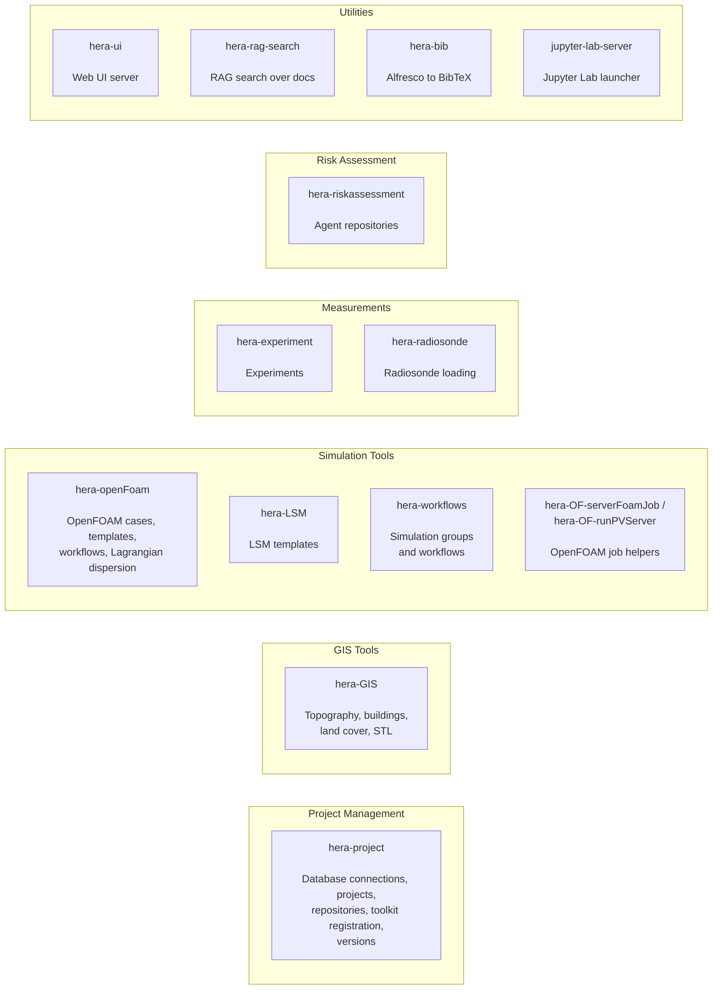

# CLI Reference

Hera provides a set of command-line tools in `hera/bin/` for managing projects, repositories, GIS operations, simulations, experiments and risk assessment workflows. `setup.py` installs every `hera/bin/hera-*` script (except `*.old` files) plus `hera/bin/jupyter-lab-server` as `scripts`, so after `pip install -e .` they are on your `PATH`. Otherwise activate the virtual environment and add `hera/bin/` to your `PATH`.

All Python CLIs use `argparse` (with `argcomplete` tab-completion), except `hera-rag-search`, which uses `typer`. Running a command without a sub-command prints its help.

!!! note "Project name resolution"
    Most commands take an optional `--projectName`. When it is omitted, the workflow, openFoam and LSM commands read the `projectName` key from `caseConfiguration.json` in the current directory; the `hera-project` and `hera-GIS` commands fall back to the default project (`Project()` with no name).

---

## Overview



| Tool | Category | Description |
|------|----------|-------------|
| `hera-project` | Project Management | Database connections, project CRUD, repositories (incl. export), toolkit registration, datasource versions |
| `hera-GIS` | GIS Tools | Topography (raster/vector), buildings, land cover, STL generation |
| `hera-openFoam` | Simulation Tools | OpenFOAM case setup, templates, workflows, Lagrangian dispersion, object utilities |
| `hera-workflows` | Simulation Tools | Solver-agnostic simulation group and workflow management |
| `hera-LSM` | Simulation Tools | Lagrangian Stochastic Model template management |
| `hera-OF-serverFoamJob` | Simulation Tools | Runs an OpenFOAM application in the background (OpenFOAM `foamJob` script) |
| `hera-OF-runPVServer` | Simulation Tools | Starts a parallel ParaView `pvserver` through `hera-OF-serverFoamJob` |
| `hera-experiment` | Measurements | Experiment creation, loading and data access |
| `hera-radiosonde` | Measurements | Radiosonde data loading |
| `hera-riskassessment` | Risk Assessment | Agent repository creation |
| `hera-ui` | Utilities | Starts the Hera web UI API server |
| `hera-rag-search` | Utilities | RAG index/search/serve over the docs and source (needs the `rag` extra) |
| `hera-bib` | Utilities | Builds a `.bib` file from Alfresco documents |
| `jupyter-lab-server` | Utilities | Jupyter Lab server launcher |

!!! note "No `hera-toolkit` command"
    There is no `hera-toolkit` script in master. The toolkit helpers (`toolkit_list`, `toolkit_register`, `toolkit_load`, `toolkit_import_json`, ...) exist in `hera/utils/data/CLI.py` but are not wired to any entry point (and `toolkit_register` would fail anyway: it references the undefined names `toolkit_name`/`toolkit_path`). To register a toolkit from the shell use [`hera-project addToolkit`](#toolkit-registration); for everything else use the Python API (`toolkitHome`).

---

## hera-project

The primary CLI for managing database connections, projects, repositories, and datasource versions.

```
hera-project db         list | create | remove
hera-project project    list | create | dump | load | updateRepositories | populate
                        | version {display,update} | measurements list | simulations list | cache list
hera-project repository list | add | remove | show | load | export
hera-project addToolkit <toolkit_name> <toolkit_path>
```

### Database Management

```bash
# List all database connections
hera-project db list
hera-project db list --onlyName

# Create (or update) a database connection - all four options are required
hera-project db create myConnection \
    --username admin \
    --password secret \
    --IP localhost:27017 \
    --databaseName hera_db

# Remove a database connection
hera-project db remove myConnection
```

### Project Management

```bash
# List all projects
hera-project project list
hera-project project list --connectionName myConnection   # default: the user name
hera-project project list --onlyName

# Create a new project (directory defaults to ./<projectName>)
hera-project project create MY_PROJECT
hera-project project create MY_PROJECT --directory /data/myproject
hera-project project create MY_PROJECT --noRepositories     # do not load the registered repositories
hera-project project create MY_PROJECT --dont-overwrite     # load repositories without overwriting existing datasources

# Dump project documents (positional key=value query terms filter the documents)
hera-project project dump MY_PROJECT                         # --format defaults to table
hera-project project dump MY_PROJECT --format json --fileName project_dump.json
hera-project project dump MY_PROJECT type=ToolkitDataSource

# Load dumped documents into a project
hera-project project load MY_PROJECT project_dump.json

# Load all registered repositories into a project
# (without --projectName the name is read from caseConfiguration.json)
hera-project project updateRepositories
hera-project project updateRepositories --projectName MY_PROJECT --overwrite

# Load all registered repositories into all projects (or one project)
hera-project project populate --overwrite
hera-project project populate --projectName MY_PROJECT --overwrite
```

### Measurements, Simulations, and Cache

`--project` is optional; without it the default project is used. These commands query the **Measurements** collection, filtered by `type`.

```bash
# List measurement documents in a project
hera-project project measurements list --project MY_PROJECT
hera-project project measurements list --project MY_PROJECT --type ToolkitDataSource
hera-project project measurements list --project MY_PROJECT --contains YAVNEEL   # substring of datasourceName/resource

# Shortcuts for common document types
hera-project project measurements list --project MY_PROJECT --shortcut ds     # type=ToolkitDataSource
hera-project project measurements list --project MY_PROJECT --shortcut exp    # type=Experiment_rawData
hera-project project measurements list --project MY_PROJECT --shortcut sim    # type=Simulation_rawData
hera-project project measurements list --project MY_PROJECT --shortcut cache  # type=Cache_rawData
hera-project project measurements list --project MY_PROJECT --shortcut all    # no type filter

# Aliases (same handler with --shortcut sim / --shortcut cache preset)
hera-project project simulations list --project MY_PROJECT
hera-project project simulations list --project MY_PROJECT --contains windProfile

hera-project project cache list --project MY_PROJECT
hera-project project cache list --project MY_PROJECT --contains functionCache
```

### Repository Management

```bash
# List registered repositories
hera-project repository list

# Register a repository (argument: path to the repository JSON file;
# it is registered under the file's base name, here "myRepository")
hera-project repository add /path/to/myRepository.json
hera-project repository add /path/to/myRepository.json --overwrite

# Unregister a repository
hera-project repository remove myRepository

# Show repository contents
hera-project repository show myRepository

# Load repository data into a project
# Takes the PATH to the repository JSON file (not the registered name);
# relative resources resolve against that file's directory.
hera-project repository load /path/to/myRepository.json MY_PROJECT
hera-project repository load /path/to/myRepository.json MY_PROJECT --overwrite

# Export project documents into a repository JSON file
hera-project repository export myRepository --toolkitName MeteoLowFreq
hera-project repository export /path/to/out.json --toolkitName MeteoLowFreq \
    --projectName MY_PROJECT \
    --documentId <id1> --documentId <id2> \
    --idStrategy objectId \
    --mode override \
    --no-register \
    --overwrite
```

`repository export` options:

| Option | Default | Description |
|--------|---------|-------------|
| `repositoryName` (positional) | | Registered repository name or path of the output `.json` file |
| `--toolkitName` | required | Top-level toolkit key for the exported documents |
| `--projectName` | default project | Source project |
| `--documentId` | all documents | Document id to export (repeatable) |
| `--idStrategy` | `contentHash` | Duplicate identity: `contentHash` or `objectId` |
| `--mode` | `add` | `add` = merge; `override` = merge, then deduplicate the whole file |
| `--no-register` | off | Do not register the resulting repository file |
| `--overwrite` | off | Overwrite existing entries on identity match |

### Toolkit Registration

```bash
# Register a toolkit by name and path (toolkit class or descriptor)
hera-project addToolkit myToolkit /path/to/toolkit/directory
hera-project addToolkit myToolkit /path/to/toolkit/directory --version "1,0,0"      # default "0,0,1"
hera-project addToolkit myToolkit /path/to/toolkit/directory --params '{"key": "value"}'
hera-project addToolkit myToolkit /path/to/toolkit/directory --overwrite
```

### Version Management

```bash
# Display datasource versions
hera-project project version display MY_PROJECT
hera-project project version display MY_PROJECT --datasource YAVNEEL
hera-project project version display MY_PROJECT --default True   # takes a value; any non-empty value shows default versions only

# Set the default version for a datasource
hera-project project version update MY_PROJECT YAVNEEL "0,0,2"
```

---

## hera-GIS

Geographic Information System operations: topography, buildings, and land cover. Coordinates and `--dxdy` are passed as strings.

### Topography (Raster)

```bash
# List topography datasources (default project)
hera-GIS topography_raster list

# Create an STL file from elevation data
hera-GIS topography_raster toSTL \
    --minx 35.0 --miny 32.0 --maxx 35.1 --maxy 32.1 \
    --dxdy 30 \
    --inputCRS 4326 \
    --fileName topography.stl \
    --projectName MY_PROJECT
```

| Option | Default | Description |
|--------|---------|-------------|
| `--minx --miny --maxx --maxy` | required | Bounding box |
| `--fileName` | required | Output STL (`.stl` is appended if missing) |
| `--dxdy` | `30` | Mesh resolution [m] |
| `--inputCRS` | WGS84 (4326) | CRS of the input coordinates (integer EPSG) |
| `--dataSourceName` | toolkit default | Elevation datasource |
| `--solidName` | `Topography` | STL solid name |
| `--projectName` | default project | Project |

### Topography (Vector)

```bash
# List vector topography datasources
hera-GIS topography_vector list
```

### Buildings

```bash
# List building datasources
hera-GIS buildings list

# Create buildings STL
hera-GIS buildings toSTL \
    --minx 35.0 --miny 32.0 --maxx 35.1 --maxy 32.1 \
    --fileName buildings.stl
```

`buildings toSTL` also accepts `--dxdy` (default `30`), `--inputCRS`, `--outputCRS`, `--dataSourceName` and `--solidName` (default `Topography`), but in master the handler ignores them: it always fetches buildings (with elevation) from the default buildings datasource of the default project and writes the `BLDG_HT` heights. There is no `--projectName` option.

### Land Cover

```bash
# Get land cover (or roughness) data for an area and save it as CSV
hera-GIS landcover getLandcover \
    --minx 35.0 --miny 32.0 --maxx 35.1 --maxy 32.1 \
    --dxdy 30 \
    --filePath landcover_output.csv \
    --projectName MY_PROJECT
```

| Option | Default | Description |
|--------|---------|-------------|
| `--minx --miny --maxx --maxy` | required | Bounding box |
| `--dxdy` | required | Resolution [m] |
| `--filePath` | required | Output CSV |
| `--roughness` | `True` | Return the roughness (`z0`) field instead of the land-cover type |
| `--isBuilding` | `False` | Area includes urban areas (requires `--windDirection` and `--resolution`) |
| `--windDirection` | | Meteorological wind direction |
| `--resolution` | | Size of the squares |
| `--inputCRS` | WGS84 (4326) | CRS of the input coordinates |
| `--outputCRS` | | Accepted but unused |
| `--dataSourceName` | toolkit default | Land-cover datasource |
| `--projectName` | default project | Project |

!!! warning "Boolean flags"
    `--roughness` and `--isBuilding` are declared with `type=bool`, so any non-empty value (including `False`) is parsed as `True`. You cannot get the plain land-cover type with `--roughness False`; use the Python API (`LandCoverToolkit.getLandCover`). Passing `--windDirection` currently fails (the handler reads a misspelled attribute).

---

## hera-openFoam

Manages OpenFOAM simulation cases, templates, workflows and the stochastic Lagrangian dispersion solver.

```
hera-openFoam <solver> {case,templates,executeWorkflow,list,delete} ...
hera-openFoam buoyantReactingFoam {blockMesh,IC} ...          # extra mesh / IC commands
hera-openFoam stochasticLagrangian {dispersionFlow,dispersion,injectors,postProcess} ...
hera-openFoam objects createVerticesAndBoundary ...
hera-openFoam buildExecute <workflow> ...
```

Solvers: `simpleFoam`, `pimpleFoam`, `oguraPhillipShallowConvectionFOAM`, `buoyantReactingFoam`, `scalarTransportFoam`, `homogenousWindLogProfile`, `stochasticLagrangian` (solver name `StochasticLagrangianSolver`).

### Case Management

```bash
# Create an empty case with the given fields
hera-openFoam simpleFoam case createEmpty myCase --fields U p k epsilon
hera-openFoam simpleFoam case createEmpty myCase --fieldsDescription fields.json --projectName MY_PROJECT

# Write a field-description JSON file
hera-openFoam simpleFoam case writeFieldDescription fields.json --fields U p
```

### Templates

```bash
# List templates for a solver
hera-openFoam simpleFoam templates list --projectName MY_PROJECT

# Create a case from a template
hera-openFoam simpleFoam templates get templateName \
    --projectName MY_PROJECT \
    --groupName myGroup \
    --projectPath /path/to/project
```

### Simulation Workflows

```bash
# Add a workflow to the DB and execute it
hera-openFoam simpleFoam executeWorkflow myGroup_1.json --projectName MY_PROJECT
hera-openFoam simpleFoam executeWorkflow myGroup_1.json \
    --workflowGroup myGroup --overwrite --assignName --allowDuplicate
hera-openFoam simpleFoam executeWorkflow myGroup_1.json --noDB      # run without adding to the DB

# List the groups and simulations of the solver
hera-openFoam simpleFoam list --projectName MY_PROJECT
hera-openFoam simpleFoam list --longTable --transpose --format csv --file sims.csv   # format: pandas|json|latex|csv

# Delete workflows (optionally exporting them first)
hera-openFoam simpleFoam delete myGroup_1 myGroup_2 --export --overwrite

# Solver-independent build + execute
hera-openFoam buildExecute myGroup_1.json --projectName MY_PROJECT --overwrite --noDB --assignName --workflowGroup myGroup
```

`executeWorkflow` and `buildExecute` also accept the Luigi scheduler options:

| Option | Default | Description |
|--------|---------|-------------|
| `--scheduler` | `local` | `local` (runs with `--local-scheduler`) or `central` (connects to a running `luigid`) |
| `--scheduler-host` | Luigi default (localhost) | Central scheduler host |
| `--scheduler-port` | Luigi default (8082) | Central scheduler port |
| `--dispatch-id` | random uuid4 | Execution id propagated to all nodes |

### Mesh and Initial Conditions (buoyantReactingFoam)

```bash
hera-openFoam buoyantReactingFoam blockMesh setBoundsFromFile templateName topography.stl \
    --dx 10 --dy 10 --dz 5 --Z 500 --projectName MY_PROJECT
hera-openFoam buoyantReactingFoam blockMesh setDomainHeight templateName 500
hera-openFoam buoyantReactingFoam IC hydrostaticPressure myCase --startTime 0
```

### Stochastic Lagrangian

```bash
# Dispersion flow from an existing flow (name / directory / workflow file)
hera-openFoam stochasticLagrangian dispersionFlow create flowName myDispersionFlow \
    --dispersionDuration 3600 --parameters params.json --projectName MY_PROJECT --overwrite
hera-openFoam stochasticLagrangian dispersionFlow writeTemplate dispersionFlowTemplate.json

# Dispersion case
hera-openFoam stochasticLagrangian dispersion create myDispersion myDispersionFlow --overwrite

# Injectors
hera-openFoam stochasticLagrangian injectors positionFile cylinder myDispersion \
    --center 0 0 0 --height 10 --radius 5 --particles 10000
hera-openFoam stochasticLagrangian injectors positionFile createReleaseRateFile

# Post-processing (defaults: --outputDirectory VTK, --cloudName kinematicCloud)
hera-openFoam stochasticLagrangian postProcess toParquet myDispersion --overwrite
hera-openFoam stochasticLagrangian postProcess toVTK myDispersion --outputDirectory VTK --cloudName kinematicCloud
```

`stochasticLagrangian` also has the standard `case`, `templates`, `executeWorkflow`, `list` and `delete` sub-commands.

### Objects

```bash
# Create the vertices and boundaries for the blockMesh and changeDictionary nodes
hera-openFoam objects createVerticesAndBoundary object.stl --fields U p
```

### hera-OF-serverFoamJob / hera-OF-runPVServer

`hera-OF-serverFoamJob` is a copy of OpenFOAM's `foamJob` shell script: it runs an OpenFOAM application in the background and writes its output to `log` in the case directory.

```bash
hera-OF-serverFoamJob [-case <dir>] [-parallel] [-screen] [-append] [-wait] [-version <ver>] <application> ...
```

`hera-OF-runPVServer` takes no arguments and runs `hera-OF-serverFoamJob -parallel -screen -wait pvserver`.

---

## hera-workflows

General simulation workflow management (solver-agnostic). All commands accept `--projectName`.

```bash
# List workflow groups
hera-workflows list groups --projectName MY_PROJECT
hera-workflows list groups --projectName MY_PROJECT --solver simpleFoam --workflowName   # also show simulation names

# List the workflows in a group
hera-workflows list workflows myGroup --projectName MY_PROJECT
hera-workflows list workflows myGroup --nodes          # list the nodes of each simulation
hera-workflows list workflows myGroup --parameters     # nodes with their parameters

# Add a workflow to the DB
hera-workflows add myGroup_1.json --workflowGroup myGroup --overwrite --assignName --allowDuplicate --execute

# Add and execute (accepts --scheduler/--scheduler-host/--scheduler-port/--dispatch-id, see hera-openFoam)
hera-workflows buildExecute myGroup_1.json --projectName MY_PROJECT

# Compare workflows (a group name, or several simulation names / files)
hera-workflows compare myGroup
hera-workflows compare sim1 sim2 --longTable --transpose --format latex --file cmp.tex   # format: pandas|json|latex|csv

# Delete / export
hera-workflows delete myGroup_1 --export --overwrite
hera-workflows export myGroup_1 myGroup_2 --overwrite

# Compare the DB version to the file on disk, and sync disk -> DB
hera-workflows compareToDisk myGroup_1
hera-workflows sync myGroup_1 --force --quiet           # also --f / --q

# Create variations of a workflow from a variation JSON (alias: var)
hera-workflows variation myGroup_1.json variations.json --dry-run --overwrite --naming-scheme index

# Delete all workflows of a group (alias: bigdelete)
hera-workflows batch-delete --groupName myGroup --hard
hera-workflows batch-delete --workflow myGroup_1        # use this workflow's group, excluding it
```

---

## hera-LSM

Lagrangian Stochastic Model template management.

```bash
# Set up a template after loading its repository (creates the required symbolic links)
hera-LSM setup templateName /path/to/code --templateVersion 1 --projectName MY_PROJECT

# List the templates in the project
hera-LSM list --projectName MY_PROJECT
```

!!! warning "Broken in master"
    `hera/bin/hera-LSM` calls `parser.parse_args()()`, so every invocation currently fails with `TypeError: 'Namespace' object is not callable`. Use the `LSMToolkit` Python API until this is fixed.

---

## hera-riskassessment

Risk assessment tools for agent-based modeling.

```bash
# Create an agent repository from the agent JSON files in a directory (default: current directory)
hera-riskassessment agents createRepository myRepo --path /path/to/agents/
```

---

## hera-experiment

Experiment management. `--projectName` defaults to the project in `caseConfiguration.json`.

```bash
# List / tabulate the experiments in a project
hera-experiment list --projectName MY_PROJECT
hera-experiment table --projectName MY_PROJECT

# Get the data of a device type in an experiment
hera-experiment data myExperiment Sonic --projectName MY_PROJECT
hera-experiment data myExperiment Sonic --deviceName Sonic01 --perDevice True

# Create a new experiment directory (optionally from an Argos zip)
hera-experiment create myExperiment --path /data/experiments --zip argos_export.zip --relative True

# Load an experiment directory (default: current directory) into a project
hera-experiment load MY_PROJECT --experiment /data/experiments/myExperiment --overwrite
```

`--perDevice` and `--relative` are `type=bool`: any non-empty value is parsed as `True`.

---

## Utility Tools

### hera-ui

Starts the Hera UI API server (`ui/server/server.py`). It exits with a message if `fastapi` is not installed. Arguments are passed through to the server:

| Option | Default | Description |
|--------|---------|-------------|
| `--host` | `0.0.0.0` | Bind address (`127.0.0.1` for local-only) |
| `--port` | `8000` | API port; if busy, the next free port is used |
| `--jupyter-port` | `8888` | Embedded Jupyter server port (`0` disables it) |
| `--cors ORIGINS` | off | Enable CORS: `all`, `remote` (this machine's hostname and LAN IP), or a comma-separated list of IPs. Also exposes Jupyter beyond localhost |
| `--debug` | off | Start `debugpy` on port 5678 |
| `-y`, `--yes` | off | Skip confirmation prompts (e.g. for `--cors all`) |

```bash
hera-ui --port 8000 --jupyter-port 0
```

### hera-radiosonde

```bash
hera-radiosonde load <projectName> <locationName> <date> <filePath> [--coords "(lat, lon)"]
```

!!! warning "Broken in master"
    The handler imports `hera.measurements.meteorology.radiosonde.DataLayer`, which subclasses the removed `datalayer.ProjectMultiDBPublic`, so the command fails at import time.

### hera-rag-search

Typer CLI for the RAG toolkit (`pip install -e .[rag]`).

```bash
hera-rag-search index [--docs docs/] [--code hera/] [--clean|-c] [--docs-only] [--batch-size 64]
hera-rag-search search "query" [--top-k|-k 5] [--raw] [--type|-t TYPE] [--source|-s PREFIX]
hera-rag-search watch [--root docs/] [--debounce 2.0]
hera-rag-search serve [--host HOST] [--port PORT] [--reload] [--with-watcher] [--watch-root docs/]
hera-rag-search download-models [--model|-m NAME]
```

`search` without `--raw` streams an answer from the configured Ollama model. `download-models` refuses to run when `RAG_OFFLINE_MODE` is enabled. See [Environment Variables](../configuration/env_vars.md) for the `RAG_*` settings.

### hera-bib

Builds `<user>_output.bib` from all the Alfresco documents visible to the current user (`$USER`). The Alfresco URL is hard-coded (`http://mathsrv23:8020/alfresco`).

```bash
hera-bib --password <password>
```

### jupyter-lab-server

Takes no arguments; runs `jupyter-lab --ip <this machine's IP> --no-browser`.

---

## Common Patterns

### Working with a New Project

```bash
# 1. Create the project (loads all registered repositories unless --noRepositories)
hera-project project create MY_PROJECT --directory /data/myproject

# 2. Load a repository
hera-project repository load /path/to/myRepo.json MY_PROJECT --overwrite

# 3. Verify loaded data
hera-project project measurements list --project MY_PROJECT --shortcut ds
```

### Exporting and Importing Projects

```bash
# Export
hera-project project dump MY_PROJECT --format json --fileName backup.json

# Import into another project
hera-project project load OTHER_PROJECT backup.json
```
