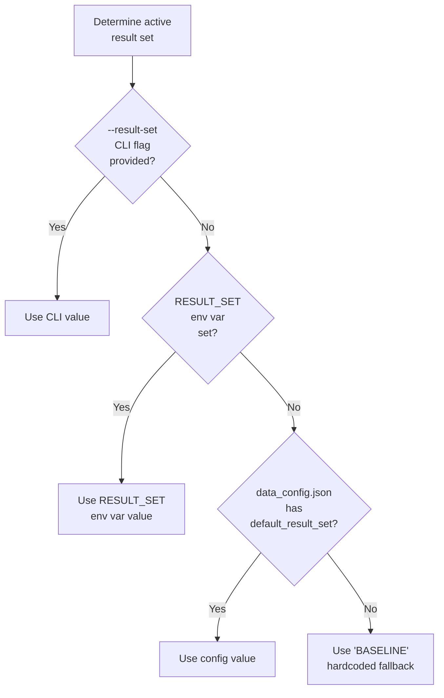

# Environment Variables Reference

This page documents all environment variables used by the Hera system, organized by context.

---

## Runtime Variables

These variables affect how Hera operates in normal production use.

| Variable | Required | Default | Description |
|----------|----------|---------|-------------|
| `HOME` | Yes (OS) | OS default | Used to locate the MongoDB config file at `~/.pyhera/config.json` (`hera/datalayer/document/__init__.py`), the log directory `~/.pyhera/log` and the default project files directory `~/.hera/<projectName>`. This is a standard OS variable and is always set. |
| `LOGNAME` / `USER` | Yes (OS) | OS default | Read through `getpass.getuser()`: the current user name is the **default connection name** looked up in `~/.pyhera/config.json`. `hera-bib` also uses `USER` as the Alfresco user name. |
| `HERA_REPO_ROOT` | No | unset | Extra base directory for resolving **relative** toolkit paths of dynamically registered toolkits (`hera/toolkit.py`) and relative experiment paths (`hera/measurements/experiment/experiment.py`). Tried after the raw path and the path relative to the current directory. Set automatically by `activate_hera.sh` (which also exports `PYHERA_DIR` and prepends the repo to `PYTHONPATH` and `hera/bin` to `PATH`; `PYHERA_DIR` is used only by the shell setup scripts). |
| `MPLBACKEND` | No | system default | Matplotlib backend selection (read by matplotlib, not by Hera). Set to `Agg` for headless (no GUI) operation, e.g., on servers or in CI/CD pipelines (the CI workflows set it). |

### MongoDB Configuration

The MongoDB connection is not configured via environment variables but through the JSON config file at `~/.pyhera/config.json`. Each top-level key is a connection name; the connection named after the current OS user is used by default. If the file does not exist, importing the data layer creates a template and raises an `IOError` asking you to fill it in. `hera-project db create/remove` edits this file.

```json
{
    "connectionName": {
        "username": "your_username",
        "password": "your_password",
        "dbIP": "localhost:27017",
        "dbName": "hera_db"
    }
}
```

See [Installation](../user_guide/installation.md) for setup instructions.

### RAG Search Settings

The optional RAG toolkit (`hera/utils/rag/config.py`, used by `hera-rag-search` and the MkDocs plugin) reads its settings with `pydantic-settings`: every field can be set by an environment variable with the `RAG_` prefix (case-insensitive) or in a `.env` file in the current directory.

| Variable | Default | Description |
|----------|---------|-------------|
| `RAG_CASSANDRA_HOSTS` | `["localhost"]` | Cassandra hosts (JSON list) |
| `RAG_CASSANDRA_PORT` | `9042` | Cassandra port |
| `RAG_CASSANDRA_KEYSPACE` | `hera_rag` | Cassandra keyspace |
| `RAG_QDRANT_HOST` | `localhost` | Qdrant host |
| `RAG_QDRANT_PORT` | `6333` | Qdrant port |
| `RAG_QDRANT_COLLECTION` | `hera_docs` | Qdrant collection |
| `RAG_OLLAMA_BASE_URL` | `http://localhost:11434` | Ollama server URL |
| `RAG_OLLAMA_MODEL` | `llama3` | Ollama model used for answers |
| `RAG_OLLAMA_TIMEOUT` | `120` | Ollama request timeout [s] |
| `RAG_EMBED_MODEL` | `BAAI/bge-small-en-v1.5` | HuggingFace embedding model |
| `RAG_EMBED_DIM` | `384` | Embedding dimension |
| `RAG_OFFLINE_MODE` | `false` | Refuse network fetches; models must already be cached |
| `RAG_MODELS_CACHE_DIR` | `~/.pyhera/rag_models` | Local embedding-model cache |
| `RAG_CHUNK_SIZE` | `1000` | Chunk size (characters) |
| `RAG_CHUNK_OVERLAP` | `150` | Chunk overlap |
| `RAG_MIN_CHUNK_CHARS` | `80` | Minimum chunk length |
| `RAG_TOP_K` | `5` | Default number of retrieved chunks |
| `RAG_RAG_PROMPT_TEMPLATE` | built-in prompt | LLM prompt template (`{context}`, `{question}`) |
| `RAG_API_HOST` | `0.0.0.0` | REST API bind host |
| `RAG_API_PORT` | `8765` | REST API port |
| `RAG_RAG_ENABLED` | `false` | Enable the search widget in the MkDocs plugin |
| `RAG_RAG_API_URL` | `http://localhost:8765` | API URL used by the MkDocs plugin |

### UI Client (build time)

| Variable | Default | Description |
|----------|---------|-------------|
| `VITE_API_PORT` | `8000` | Port of the Hera UI API server that the React client calls (`ui/client/src/shared/baseurl.ts`). Read by Vite at build/dev time. |

---

## Testing Variables

These variables control the behavior of the Pytest test suite.

| Variable | Required | Default | Description |
|----------|----------|---------|-------------|
| `TEST_HERA` | No | `~/hera_unittest_data` | Root directory containing the test data repository. This directory should contain `test_repository.json`, `data_config.json`, `measurements/`, and `expected/` subdirectories. |
| `RESULT_SET` | No | `BASELINE` | Name of the expected-output result set to compare against. Must correspond to a directory under `expected/` in the test data root. |
| `PREPARE_EXPECTED_OUTPUT` | No | unset | Documented in the `hera/tests/conftest.py` docstring as switching the suite into **generation mode** (write current outputs as the new baselines), but in master no test code reads it (the `compare_outputs` / `save_expected_output` helpers exist in `conftest.py` but no test calls them), so setting it has no effect. |
| `GDF_TOL_AREA` | No | `1e-7` | Tolerance for geometry comparison in GeoDataFrame tests. The comparison uses `symmetric_difference().area` and checks that the area is below this threshold. |
| `HERA_FULL_LOGGING_TESTS` | No | unset | When set (to any value), runs the full logging tests in `hera/utils/logging/test_helpers.py`. When unset, those tests are skipped. |
| `HERA_DB_USER` / `HERA_DB_PASS` / `HERA_DB_NAME` | CI only | set in `ci.yml` | Used only by `.github/workflows/ci.yml` to write `~/.pyhera/config.json` for the CI MongoDB service. Hera itself does not read them. |
| `PYARGOS_PATH` | No | unset | Optional developer-set path to a local `pyargos-master` (PyArgos) installation. Used only by `hera/tests/dynamic_loading_tests_pack/test_experiment_cli_shortcuts.py`, which prepends this directory to `PYTHONPATH` so the experiment toolkit CLI can locate PyArgos. If unset or the path does not exist, the related tests fall back to the default environment. |

### Usage Examples

```bash
# Run tests with default settings
pytest hera/tests/ -v

# Run tests against a specific result set (must exist under $TEST_HERA/expected/)
RESULT_SET=MY_RESULT_SET pytest hera/tests/ -v
pytest hera/tests/ -v --result-set MY_RESULT_SET   # the CLI flag overrides RESULT_SET

# Use custom test data location
TEST_HERA=/data/test_data pytest hera/tests/ -v

# Headless matplotlib for CI
MPLBACKEND=Agg pytest hera/tests/ -v

# Combine multiple settings
MPLBACKEND=Agg RESULT_SET=BASELINE TEST_HERA=/data/test pytest hera/tests/ -v
```

---

## Variable Resolution Priority

For the result set selection, the system uses the following priority chain:



---

## Test Data Directory Structure

The `TEST_HERA` directory should follow this layout:

```
$TEST_HERA/                          # Default: ~/hera_unittest_data
├── data_config.json                 # Metadata and result set defaults
├── test_repository.json             # Hera repository JSON mapping
├── measurements/                    # Test data files
│   ├── GIS/
│   │   ├── raster/                  # HGT, TIF files
│   │   └── vector/                  # SHP, GeoJSON files
│   └── meteorology/
│       ├── lowfreqdata/             # Parquet station data
│       └── highfreqdata/            # High-frequency parquet data
└── expected/                        # Expected output result sets
    ├── BASELINE/                    # Default result set
    │   ├── *.parquet                # DataFrame outputs
    │   ├── *.json                   # Dict/scalar outputs
    │   ├── *.nc                     # xarray outputs
    │   └── *.npz                    # NumPy array outputs
    └── <OTHER_RESULT_SET>/          # Optional additional result sets (select with RESULT_SET)
```

---

## Setting Variables Permanently

### Linux / macOS

Add to your shell profile (`~/.bashrc`, `~/.zshrc`, etc.):

```bash
# Hera test configuration
export TEST_HERA="$HOME/hera_unittest_data"
export MPLBACKEND="Agg"
```

### Per-Project (.env file)

If using tools like `direnv` or IDE-specific env files:

```ini
TEST_HERA=/home/user/hera_unittest_data
MPLBACKEND=Agg
RESULT_SET=BASELINE
```

### In pytest.ini

The repository's `pytest.ini` does not set any environment variables, and the `pytest-env` plugin is not a Hera dependency. If you install `pytest-env` yourself, you can add:

```ini
[pytest]
env =
    MPLBACKEND=Agg
```
