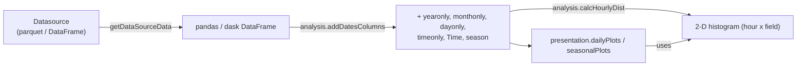
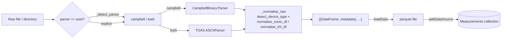

# Meteorology toolkits

Implementation details for the meteorology package (`hera/measurements/meteorology/`).

For user-facing documentation, see [Low-frequency meteorology](../../toolkits/measurements/meteorology/lowfreq.md) and [High-frequency meteorology](../../toolkits/measurements/meteorology/highfreq.md).

---

## Package structure

```
hera/measurements/meteorology/
    lowfreqdata/
        toolkit.py             # lowFreqToolKit
        analysis.py            # analysis — date/season columns, distributions, resampling
        presentationLayer.py   # presenation, DailyPlots, SeasonalPlots
    highfreqdata/
        toolkit.py             # HighFreqToolKit — parse, normalise, store raw sonic/TRH data
        analysis/
            analysislayer.py        # RawdataAnalysis — calculator factory
            abstractcalculator.py   # AbstractCalculator — shared calculator infrastructure
            turbulencestatistics.py # singlePointTurbulenceStatistics
            meandatacalculator.py   # AveragingCalculator, MeanDataCalculator
        parsers/
            __init__.py        # normalise_sonic_df, normalise_trh_df, detect_device_type
            CampbellBinary.py  # Parser (TOB1 binary), CampbellBinaryInterface
            TOA5.py            # ASCIIParser (TOA5 ASCII)
    analysis.py                # Legacy shared analysis (static addDatesColumns, calcHourlyDist)
    radiosonde.py              # Radiosonde DataLayer (used by hera-radiosonde)
    GFS.py                     # GFS forecast-file readers
```

| Toolkit | `toolkitHome` constant | Registry name | Class | `toolkitName` passed to base |
|---------|------------------------|---------------|-------|------------------------------|
| Low frequency | `toolkitHome.METEOROLOGY_LOWFREQ` | `MeteoLowFreq` | `lowfreqdata.toolkit.lowFreqToolKit` | `lowFreqMeteorology` |
| High frequency | `toolkitHome.METEOROLOGY_HIGHFREQ` | `MeteoHighFreq` | `highfreqdata.toolkit.HighFreqToolKit` | `highFreqMeteorology` |

Both inherit directly from `abstractToolkit`, so datasource management (`addDataSource`, `getDataSourceData`, `setDataSourceDefaultVersion`, ...) comes from the base class.

---

## lowFreqToolKit

**Source:** `lowfreqdata/toolkit.py`

A thin toolkit: it adds no ingestion methods of its own (the old `loadData`/parser code is commented out), so station data is registered as ordinary datasources (typically `parquet`) and read with `getDataSourceData`. It exposes `docType` (`"<toolkitName>_LowFreqData"`) and the `STATIONNAME = 'StationName'` column constant.

The toolkit follows the standard analysis + presentation pattern:

| Layer | Class | Key methods |
|-------|-------|------------|
| Toolkit | `lowFreqToolKit` | standard datasource API (`getDataSourceData`, `addDataSource`, ...) |
| Analysis | `analysis` (`lowfreqdata/analysis.py`) | `addDatesColumns(data, datecolumn=None, monthcolumn=None)`, `calcHourlyDist(data, Field, bins=30, normalization='density')`, `resampleSecondMoments(data, SamplingWindow, fieldsFirstMoments, fieldsSecondMoments)` |
| Presentation | `presenation` (`lowfreqdata/presentationLayer.py`; note the spelling) | `dailyPlots.plotScatter`, `dailyPlots.dateLinePlot`, `dailyPlots.plotProbContourf`, `seasonalPlots.plotProbContourf_bySeason` |

Data flow:



Implementation notes:

- `lowfreqdata/analysis.py` defines the season constants (`WINTER`, `SPRING`, `SUMMER`, `AUTUMN`) and the `seasonsdict` month mapping used by `SeasonalPlots`.
- `calcHourlyDist` delegates to `hera.utils.statistics.calcDist2d`.
- `DailyPlots` and `SeasonalPlots` both derive from `Plots`, which holds the shared contour/colormap helpers (`_getCountourDict`, `_getContourfDict`, `_getcmap`). Add new plot families as another `Plots` subclass and expose it as a property on `presenation`.

---

## HighFreqToolKit

**Source:** `highfreqdata/toolkit.py`

Manages 10-20 Hz sonic anemometer and TRH data. Unlike the low-frequency toolkit it owns the ingestion path: parse raw logger files, normalise columns, write parquet, register a versioned datasource.

| Method | Purpose |
|--------|---------|
| `parseData(path, fromTime=None, toTime=None, parser="auto")` | Parse a file or directory and return `list[(DataFrame, metadata)]`, one element per device |
| `loadData(name, path, outputDirectory, fromTime=None, toTime=None, parser="auto", version=(0, 0, 1), overwrite=False, append=False, metadata=None)` | Parse, write `<name>_<counter>.parquet` into `outputDirectory`, and register it with `addDataSource` (`parquet`). Multi-device files get `<name>_<deviceName>` datasources. `overwrite` and `append` are mutually exclusive |
| `campbelToParquet(...)`, `asciiToParquet(...)` | Deprecated (emit `DeprecationWarning`); use `parseData`/`loadData` |
| `docType` | `"<toolkitName>_HighFreqData"` |

`parser` is `"auto"`, `"campbell"` or `"toa5"`; `"auto"` sniffs the file content (`_detect_parser`).

### Ingestion flow



Normalised sonic frames have lowercase `u, v, w, T` columns and a `DatetimeIndex` (see `parsers/__init__.py`).

### Analysis layer (calculator architecture)

`HighFreqToolKit.analysis` is a `RawdataAnalysis` instance. It is a factory: each method resolves its data argument (a datasource name is loaded with `getDataSourceData`; a pandas/dask DataFrame is used as-is) and returns a calculator object.

| Layer | Class | Purpose |
|-------|-------|---------|
| Analysis | `RawdataAnalysis` | `singlePointTurbulenceStatistics(sonicData, samplingWindow, start, end, height, buildingHeight, averagedHeight, ...)`, `AveragingCalculator(deviceNameOrData, samplingWindow, start, end, height, buildingHeight, averagedHeight, ...)`, `MeanDataCalculator(TurbCalcOrData=None, compute_mode_turb='not_from_db_and_not_save', AverageCalcOrData=None, compute_mode_AverageCalc=None, **metadata)` |
| Calculator base | `AbstractCalculator` | Holds raw data, metadata, temporary columns and the in-memory averaged result; implements `compute(mode)` and DB persistence |
| Calculator | `singlePointTurbulenceStatistics` | Fluctuations and higher moments (`fluctuations`, `sigma`, `secondMoments`, `uu` ... `vw`, `wT`, `w3`, `w4`, `TKE`, ...) |
| Calculator | `AveragingCalculator` | Time-windowed means (`u_bar`, `v_bar`, ...) |
| Derived | `MeanDataCalculator` | Chained derived quantities from second moments + means (`Ustar`, `MOLength`, `zOverL`, `StabilityMOLength`, `anisotropyEigs`, `StrucFun_eps`, ...); not an `AbstractCalculator` subclass |
| Parsers | `Parser` (`CampbellBinary.py`), `ASCIIParser` (`TOA5.py`) | Raw data format parsers |

Calculator methods are chainable: each call adds columns to `_TemporaryData`, records `[name, {}]` in `_CalculatedParams`, and returns `self`; nothing is aggregated until `compute(mode)` is called. Supported modes:

| Mode | Behaviour |
|------|-----------|
| `not_from_db_and_not_save` (default) | Compute locally |
| `not_from_db_and_save` | Compute, then store in the Cache collection (`type='meteorology'`) |
| `from_db_and_not_save` | Look up a matching Cache document first, else compute |
| `from_db_and_save` | Look up first, else compute and store |

Saving requires `set_saveProperties(dataFormat, **kwargs)` first (`SaveDataHandler` supports HDF, `JSON_pandas` and parquet).

!!! warning "Known issues in master"
    - The DB-backed modes call `datalayer.Cache`, where `datalayer` is `hera.datalayer.collection` (`highfreqdata/analysis/abstractcalculator.py:4`). That module has no `Cache` attribute (it is defined in `hera.datalayer.__init__`), so only `not_from_db_and_not_save` works.
    - `MeanDataCalculator.__init__` checks `type(TurbCalcOrData) == pandas` / `== dask` (comparing against modules, `meandatacalculator.py:79-95`), so passing a DataFrame raises `ValueError`; pass a `singlePointTurbulenceStatistics` (and `AveragingCalculator`) instance instead.

### Extending

- **New statistic on raw data** — add a method to `singlePointTurbulenceStatistics` (or a new `AbstractCalculator` subclass) that writes a column to `self._TemporaryData`, appends `[name, {}]` to `self._CalculatedParams`, and returns `self`.
- **New derived quantity** — add a method to `MeanDataCalculator` operating on `self.MeanData`.
- **New raw format** — add a parser class with `parse(path, fromTime=None, toTime=None)` under `parsers/`, then wire it into `HighFreqToolKit._parse_raw` and `_detect_parser`.
