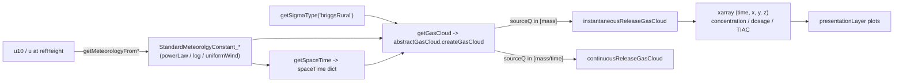

# Gaussian dispersion toolkit

Implementation details for the Gaussian dispersion package (`hera/simulations/gaussian/`).

The `gaussianToolkit` provides Gaussian puff models for atmospheric pollutant transport: a meteorology object (wind profile, stability class), a dispersion-coefficient (sigma) model, and a gas cloud that evaluates concentration / dosage / TIAC on a regular space-time grid as xarray objects.

For user-facing documentation, see [Toolkits > Simulations > Gaussian](../../toolkits/simulations/gaussian.md).

---

## Package structure

```
hera/simulations/gaussian/
    toolkit.py                       # gaussianToolkit + presentationLayer
    gasCloud.py                      # abstractGasCloud, instantaneousReleaseGasCloud, continuousReleaseGasCloud
    Sigma.py                         # AbstractSigma, BriggsRural
    Meteorology.py                   # StandardMeteorolgyConstant_* profiles, MeteorologyFactory
    MeshUtils.py                     # GaussianToMesh, GaussianIntegrationToMesh
    DropletCloud.py                  # droplet cloud position models (fixed, line, clipped, circle)
    FallingNonEvaporatingDroplets.py # settling (non-evaporating) droplet model
    source.py                        # unfinished stub (does not parse; not imported anywhere)
```

| Item | Value |
|------|-------|
| `toolkitHome` constant | `toolkitHome.GAUSSIANDISPERSION` (`"GaussianDispersion"`) |
| Class | `hera.simulations.gaussian.toolkit.gaussianToolkit` (inherits `abstractToolkit`) |
| `toolkitName` passed to base | `"gaussianToolkit"` |
| Constructor | `gaussianToolkit(projectName, filesDirectory=None)` (no `connectionName`) |
| Layers | `presentation` (`presentationLayer`); no analysis layer |

The toolkit does not store anything in the database; it is a computational front-end over the classes below.

---

## Toolkit API

| Method | Description |
|--------|-------------|
| `listSigmaTypes()` | Names in the sigma registry (`_sigmaDict`), currently `["briggsRural"]` |
| `getSigmaType(sigmaName)` | Instance of the sigma class; `ValueError` for unknown names |
| `getMeteorologyFromU10(u10, inversion, verticalProfileType="powerLaw", temperature=20 degC, stability="D", z0=0.1 m, ustar=0.3 m/s, skinSurfaceTemperature=35 degC)` | Meteorology object from the 10 m wind speed (via `MeteorologyFactory`) |
| `getMeteorologyFromURefHeight(u, refHeight, inversion, verticalProfileType="powerLaw", ...)` | Same, from the wind speed `u` at `refHeight` |
| `getSpaceTime(meteorology, sourceHeight, wind_profile_type, maxx, maxz, dt, dz, dxdy_multiplier, minimal_maxy, initialCloudSize)` | Build the grid dict (`minx`, `maxx`, `miny`, `maxy`, `minz`, `maxz`, `dxdy`, `dz`, `timeSpan`, `dt`). `dxdy = dt * u(sourceHeight) * dxdy_multiplier`; `timeSpan` is chosen so that `maxx` is 3 sigma behind the cloud centre |
| `getGasCloud(sourceQ, sourceHeight, initialCloudSize, meteorology, wind_profile_type, spaceTime, deposition_velocity, sigmaTypeName="briggsRural")` | Gas cloud object (see below) |

`wind_profile_type` is `"default"` (the meteorology's `getWindVelocity`) or `"HotSpot"` (`getWindVelocity_hotSpot`); anything else raises `ValueError`.

Note: `MeteorologyFactory`'s own default `verticalProfileType` is `"log"`, while the toolkit wrappers default to `"powerLaw"`.

## Data flow



---

## Meteorology (`Meteorology.py`)

`StandardMeteorolgyConstant_powerLaw(inversion, temperature=20, stability="D", z0=0.1, ustar=0.3, skinSurfaceTemperature=35, **kwargs)` takes either `u10` or `u` + `refHeight` in `kwargs`. It provides `getWindVelocity(height)`, `getWindVelocity_hotSpot(height)`, `getAirPressure`, `getAirTemperature`, `getAirDensity`, `getAirDynamicViscosity` and `getTKE` (all by height). Subclasses override `getWindVelocity`:

| Key in `MeteorologyFactory` | Class | Profile |
|-----------------------------|-------|---------|
| `powerLaw` | `StandardMeteorolgyConstant_powerLaw` | Power law with stability-dependent exponent (`wind_p`) |
| `log` | `StandardMeteorolgyConstant_log` | Logarithmic profile anchored at `u(refHeight)` with roughness `z0` |
| `uniformWind` | `StandardMeteorolgyConstant_uniformWind` | Height-independent wind |

`MeteorologyProfile` is a further `powerLaw` subclass that is not registered in the factory. `hera/simulations/evaporation/monaghan.py` also uses `StandardMeteorolgyConstant_powerLaw`.

## Dispersion coefficients (`Sigma.py`)

`AbstractSigma` implements `getVirtualDistance(sigma0, stability)` (distance that produces the initial cloud size) and `getSigma(x, stability, sigma0=None, ...)`. `BriggsRural` holds the Briggs rural coefficient tables for stability classes A-F; its `getSigma(x, stability, sigma0=None, units=True)` returns `sigmaX`, `sigmaY`, `sigmaZ`.

To add a new sigma model, subclass `AbstractSigma` and register it in `gaussianToolkit._sigmaDict` (set in `__init__`).

## Gas clouds (`gasCloud.py`)

`abstractGasCloud.createGasCloud(...)` converts `sourceQ` to pint and dispatches on its dimensions: mass → `instantaneousReleaseGasCloud`, mass per time → `continuousReleaseGasCloud`; otherwise `ValueError("Must be mass or mass per time!")`. The constructor resolves the transport speed `u` at `sourceHeight` from the meteorology.

The fields are built from separable terms on the `spaceTime` grid: downwind `(time, x)` (`_getTXterm`, or an erf-integrated `_getTXDosage`), crosswind `(x, y)` (`_getXYterm`) and vertical `(x, z)` with ground reflections summed over `-numOfReflections..numOfReflections` (`_getXZterm`). `getDF_xarray()` gives the dry-deposition depletion factor from `deposition_velocity`, applied when `DF=True`.

| Family (instantaneous) | Methods |
|------------------------|---------|
| Concentration | `getConcentration_inst`, `getConcentration_inst_noQ`, `getConcentration_inst_noQ_bounded(start_time, end_time, ...)` |
| Dosage | `getDosage_inst`, `getDosage_inst_noQ`, `getDosage_inst_NoERF`, `getDosage_inst_NoERF_noQ`, `getDosage_inst_NoERF_noQ_bounded`, `getDosageFromConcentration_inst_NoERF_noQ(C)` |
| TIAC (radiological) | `getTIAC_inst(specifitActivity, ...)`, `getTIAC_inst_noQ`, `getTIAC_inst_NoERF`, `getTIAC_inst_NoERF_noQ`, `getTIACFromConcentration_inst_NoERF(C, specifitActivity, ...)`, `getTIACFromConcentration_inst_NoERF_noQ(C)`, `getTIAC_inst_NoERF_noQ_bounded`, `get_TIAC_for_dist(data, y, z, dist_list)`, `concentrationConversion_mass_to_Bq(C, outputUnits, specificActivity)` |

`*_noQ` variants return the field per unit release; the others multiply by `sourceQ` (in mg) and record the units in `attrs['Q']` (e.g. `1 mg/m**3`), which the presentation layer reads for axis labels. `NoERF` variants integrate concentration over time with `trapezoidal_integration` instead of the analytical erf form.

`continuousReleaseGasCloud` defines `getConcentration_cont`, `getConcentration_cont_NoERF`, `getDosage_cont_NoERF` and `getDosage_cont_doubleNoERF`.

!!! warning "Known issue in master"
    The `continuousReleaseGasCloud` methods call `getDosage_inst_noQ` / `getDosage_inst_NoERF_noQ`, which exist only on `instantaneousReleaseGasCloud` (`gasCloud.py:596-638`), so they raise `AttributeError`. Only instantaneous releases work.

## Presentation layer

`presentationLayer` (module-level class in `toolkit.py`, no back-reference to the toolkit) plots slices of the xarray results with matplotlib: `plotMaxConcentrationOverTime`, `plotFixedPointConcentrationOverTime`, `plotDosagePerDistance`, `plotFixedPointDosageOverTime`, and the per-unit-release variants `plotMaxConcentrationOverTime_noQ`, `plotFixedPointConcentrationOverTime_noQ`, `plotTIACPerDistance_noQ`, `plotFixedPointTIACOverTime_noQ`. Coordinates may be pint or unum quantities.

## Other modules

- `MeshUtils.GaussianToMesh` evaluates a DataFrame of gaussians (`x`, `sigmaX`, `sigmaY` columns, names configurable) on a regular grid (`gaussianToMesh(gaussians, groupby=None, QName="Q", QUnits=ureg.kg)`); `GaussianIntegrationToMesh` integrates each gaussian over the cells with erf differences instead of point sampling.
- `DropletCloud` / `FallingNonEvaporatingDroplets` model settling droplets (terminal velocity, ground hit time via `solveToTime(T)`, ground footprint). They are not wired into `gaussianToolkit`.
