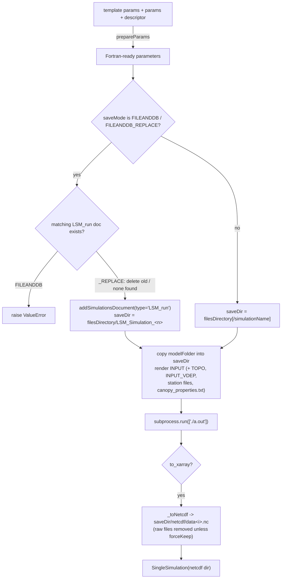

# LSM toolkit

Implementation details for the Lagrangian Stochastic Model toolkit (`hera/simulations/LSM/`).

For user-facing documentation, see [Toolkits > Simulations > LSM](../../toolkits/simulations/lsm.md). The OpenFOAM-coupled Lagrangian solver (`OFLSMToolkit`, registry name `OF_LSM`) is a different toolkit, documented in [OpenFOAM](openfoam.md).

---

## Architecture

| Component | Module | Purpose |
|-----------|--------|---------|
| Toolkit | `toolkit.py` | `LSMToolkit` — template (datasource) management, simulation queries, Slurm batch preparation; `analysis` layer |
| Template | `template.py` | `LSMTemplate` — wraps one template document and runs the Fortran model (`LSMTemplate.run`) |
| Single simulation | `singleSimulation.py` | `SingleSimulation` — wraps one run's NetCDF output (dosage / concentration) |
| CLI | `CLI.py` | `hera-LSM` handlers (`list_templates`, `setup_template`) |

| Item | Value |
|------|-------|
| `toolkitHome` constant | `toolkitHome.LSM` (`"LSM"`) |
| Class | `hera.simulations.LSM.toolkit.LSMToolkit` (inherits `abstractToolkit`) |
| `toolkitName` passed to base | `"LSM.old"` |
| Constructor | `LSMToolkit(projectName, filesDirectory=None, to_xarray=True, to_database=False, forceKeep=False, connectionName=None)` |
| Simulation document type | `"LSM_run"` (`LSMTemplate.doctype_simulation`), stored in the Simulations collection |

`to_xarray`, `to_database` and `forceKeep` are validated boolean properties that each `LSMTemplate` copies at construction:

- `to_xarray` — convert the raw Fortran output to NetCDF (`<saveDir>/netcdf/data<i>.nc`)
- `to_database` — stored on the template but not consulted by `run()`; DB registration is driven by `saveMode`
- `forceKeep` — keep the raw Lagrangian output files after NetCDF conversion

---

## Templates are datasources

An LSM template is a toolkit datasource (`dataFormat` `string`) whose `desc` holds the default `params`, the `modelFolder` (the directory containing the compiled model `a.out`), optional `units` and the `version`.

| Method | Description |
|--------|-------------|
| `loadData(fileNameOrData, saveMode=TOOLKIT_SAVEMODE_FILEANDDB, **kwargs)` | Load a template JSON file (must contain `name`) and register it as a datasource; returns an `LSMTemplate`. `TOOLKIT_SAVEMODE_NOSAVE` returns a template without touching the DB |
| `getTemplates(**query)` | List of `LSMTemplate` objects matching the query |
| `getTemplateByName(templateName, templateVersion=None)` | One `LSMTemplate`, or `None` |
| `getTemplatesTable(**query)` | Template descriptors and params as a DataFrame |

`LSMTemplate` exposes `templateName`, `version`, `params`, `dirPath` (the document resource) and `modelFolder` (made absolute against the toolkit `filesDirectory` if relative).

## Running a simulation

`LSMTemplate.run(topography=None, stations=None, canopy=None, params=dict(), depositionRates=None, saveMode=TOOLKIT_SAVEMODE_FILEANDDB, simulationName=None, saveDir=None, **descriptor)`:

- The simulations document is created before the model runs; its `resource` is `<saveDir>/netcdf/*` (`netcdf_xarray`) when `to_xarray` is set, otherwise the directory (`string`). The name defaults to `LSM_Simulation_<counter>`.
- The `INPUT` file is rendered from the `LSM_<version>` input template.
- No `topography` → homogeneous wind (`homogeneousWind=.TRUE.`); with topography the `TOPO` file is written and `flat=.FALSE.`.
- `stations` is a DataFrame (columns `x`, `y`, `u`, `direction`, `datetime`, `station`, and `h` when a canopy is used); it is resampled to 5 minutes and written as station files.
- The `saveDir` argument is deprecated and ignored; runs always go under the toolkit `filesDirectory`.

## Querying simulations

| Method | Description |
|--------|-------------|
| `getSimulations(simulationName=None, unitsTemplateVersion="v4-general", **query)` | List of `SingleSimulation` objects. Query values are matched against `params__<key>`; if the `unitsTemplateVersion` template declares `units`, pint/unum quantities are converted to those units first |
| `getSimulationsList(wideFormat=False, **query)` | Simulation parameters as a long (or wide) DataFrame |
| `singleSimulation` | Property returning the `SingleSimulation` class itself |

## SingleSimulation

`SingleSimulation(resource, chunks={'datetime': -1, 'x': 'auto', 'y': 'auto', 'z': 'auto'})` accepts a directory of `*.nc` files (or its `netcdf/` subdirectory), an xarray object, or a simulations document.

| Method | Description |
|--------|-------------|
| `getDosage(Q=1*ureg.kg, time_units=ureg.min, q_units=ureg.mg)` | Dosage field scaled to release mass `Q` |
| `getConcentration(Q=1*ureg.kg, time_units=ureg.min, q_units=ureg.mg)` | Concentration field |
| `getConcentrationAtPoint(x, y, datetime, Q=1*ureg.kg, time_units=ureg.min, q_units=ureg.mg)` | Concentration time series at a point |

## Batch runs on Slurm

`prepareSlurmLSMExecution(baseParameters, jsonVariations, templateName, filesDirectory=None, ..., slurmExecutionFileName="submit_all.sh", caseListFileName="cases.txt", allocateProcessorsPerRun=None, memoryInGB=None, jobName="lsm_cases", exclusive=False)` expands `baseParameters` with `JSONVariations`, writes one `run_sim.py` script per case plus the case list and the Slurm submit script (via `hera.utils.slurm`). Each generated script reopens the toolkit with `toolkitHome.getToolkit(ToolkitHome.LSM, ...)` and calls `template.run(...)`.

## Analysis layer

`LSMToolkit.analysis` is a module-level `analysis` class that currently only holds a `coordinateHandler` (`hera/simulations/utils/coordinateHandler.py`) and a back-reference to the toolkit.

## CLI

| Command | Handler | Purpose |
|---------|---------|---------|
| `hera-LSM list [--projectName P]` | `list_templates` | List templates (name, version, path, model folder) |
| `hera-LSM setup <templateName> <codeDir> [--templateVersion V] [--projectName P]` | `setup_template` | Create the `tozaot/` directories in the template's `modelFolder` and symlink `a.out` (and meteorology) from `codeDir` |

## Extension points

- New template types: add a template JSON (with `name`, `params`, `modelFolder`, optional `units`) to a repository and load it with `loadData` or the repository mechanism.
- New output analyses: add methods to `SingleSimulation` (operating on `self._finalxarray`) or to the toolkit `analysis` class.
