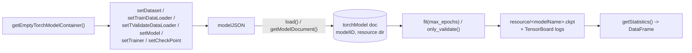

# Machine Learning / Deep Learning toolkit

The ML/DL toolkit (`machineLearningDeepLearningToolkit`, `hera/simulations/machineLearningDeepLearning/`) stores PyTorch Lightning model configurations as Simulations documents, so that a model (dataset, dataloaders, model class, trainer, checkpoint settings and their hyper-parameters) is identified by its full JSON description and gets a stable integer `modelID` and an output directory.

---

## Package structure

| Component | Module | Purpose |
|-----------|--------|---------|
| Toolkit | `toolkit.py` | `machineLearningDeepLearningToolkit` — model registry (query, pack/unpack), class-path helpers; `analysis` class (Morris sensitivity analysis) |
| PyTorch container | `torch/modelContainer.py` | `torchLightingModelContainer` — builds the model JSON, creates/loads its DB document, trains/validates, reads TensorBoard statistics, loads submodule weights from other checkpoints |
| Lightning mixin | `LightingModule.py` | `LightningModuleHera` — mixin that receives the container (`setModelContainer`) before training |
| Legacy helpers | `dataanalisys/ml.py`, `dataanalisys/stat.py` | Older scikit-learn style `ml` wrapper and a `stat(a, b, kind='rmse')` metric helper; not used by the toolkit |

| Item | Value |
|------|-------|
| `toolkitHome` constant | `toolkitHome.MACHINELEARNING_DEEPLEARNING` (`"machine_deep_learning"`) |
| Class | `hera.simulations.machineLearningDeepLearning.toolkit.machineLearningDeepLearningToolkit` (inherits `abstractToolkit`) |
| `toolkitName` passed to base | `"machineLearningDeepLearningToolkit"` |
| Constructor | `machineLearningDeepLearningToolkit(projectName, filesDirectory=None, connectionName=None)` |
| Document type | `torchLightingModelContainer.MODEL = "torchModel"` (Simulations collection) |
| Optional dependencies | `torch`, `pytorch_lightning`, `tensorboard`; `SALib` and `joblib` for sensitivity analysis |

## Model document

`torchLightingModelContainer.modelJSON` has the keys `dataset` (dict of named datasets), `trainDataset`, `validateDataset` (DataLoader configs), `model`, `trainer` and `checkpoint`. Each entry stores the class path (from `get_class_info`) and its constructor `parameters` (defaults from the class signature, overridden by the caller).

`getModelDocument()` queries `torchModel` documents whose `desc.model` matches the JSON exactly. If none exists it allocates `modelID` from the project counter `torchModel` and adds a document with `resource = <filesDirectory>/modelData/<modelName>_<modelID>` (`string`), `desc = {model, modelID}`. `modelName` is the model class path with `.` replaced by `_`.

## Toolkit API

| Method | Description |
|--------|-------------|
| `getEmptyTorchModelContainer()` | New `torchLightingModelContainer` bound to the toolkit |
| `getTorchModelFromJSON(modelJSON)` | Container initialised from a model JSON |
| `listTorchModels(modelObjectOrName=None, longFormat=True, **qry)` | Compare stored models' JSONs (`compareJSONS`), optionally filtered by model class (path or object) |
| `getTorchModelContainerByID(modelID, **qry)` | Loaded container for a `modelID`, or `None` |
| `packTorchModel(modelContainerOrListContainers, packFileName)` | Zip the model output directories plus one `<modelName>_<modelID>.json` per model (class `filepath` keys removed, `pathToData` made relative to `filesDirectory`) |
| `packTorchModelByID(modelIDorListID, packFileName)` | Same, by ID |
| `loadPackedModel(archiveFile, overwrite=False)` | Register each packed model in this project (re-resolving class file paths and `pathToData`) and extract its files into the new resource directory; existing directories are skipped unless `overwrite=True` |
| `get_model_fullname(modelCls)`, `get_class_info(modelClsOrName)`, `update_classes_filepath(modelJSON)`, `append_filesDirectory_to_pathToData(modelJSON)` | Class-path and path helpers used when saving/loading |

## torchLightingModelContainer

| Method | Description |
|--------|-------------|
| `setDataset(datasetName, datasetClass, **kwargs)` | Register a named dataset class + parameters |
| `setTrainDataLoader(datasetName, **kwargs)`, `setTValidateDataLoader(datasetName, **kwargs)` | `torch.utils.data.DataLoader` configs for a named dataset |
| `setModel(modelClass, **kwargs)`, `setTrainer(val_check_interval=1, **kwargs)`, `setCheckPoint(**kwargs)` | Model, `pl.Trainer`, `ModelCheckpoint` configs |
| `load()` | Get/create the DB document and set `modelID`, `modelResource` |
| `fit(max_epochs, continueTraining=True)` | Train; resumes from `checkpoint_path` when `continueTraining`, otherwise deletes it. If the model has its own `train_dataloader`, the stored train loader is not used |
| `only_validate(continueTraining=True)` | Run validation only |
| `loadOtherComponent(componentName, otherModelID, nameOnOtherModel)` | Before `fit`, initialise a submodule (or the whole model when `componentName == "torchModel"`) from another model's checkpoint via `load_submodule_from_ckpt` |
| `getStatistics()` | Scalars from `resource/version_0/events.out.tfevents.*` as a DataFrame (`tag`, `step`, `value`, `wall_time`, `max_epoch`) |
| `checkpoint_path`, `max_epoch` | `resource/<modelName>.ckpt` and the epoch stored in it + 1 |
| `getModel()`, `getTrainer(**kwargs)`, `getTrainDatasetLoader()`, `getValidateDatasetLoader()`, `getDataSet(datasetName, **kwargs)`, `getDatasetNames()` | Instantiate the configured objects |

Models that subclass `LightningModuleHera` receive the container in `fit()` (`model.setModelContainer(self)`), e.g. to rebuild datasets during training.

## Sensitivity analysis

`analysis.sensitivityAnalysis_morris(modelContainer, problemContainer, maxEpoch, sampleParameters=dict(), analysisParameters=dict(), parallel=True)` samples the parameter space defined by a SALib problem (built with `hera.utils.SALibUtils`), trains one model per sample (in parallel over GPUs with joblib `_evaluateSample` when more than one GPU is available and `parallel=True`, otherwise sequentially) and runs SALib's Morris analysis.

!!! warning "Known issues in master"
    - The toolkit never sets `self._analysis`, so `toolkit.analysis` is `None`; instantiate `analysis(toolkit)` from `machineLearningDeepLearning/toolkit.py` directly.
    - `packTorchModelByID` with a list of IDs raises `ValueError` when models *are* found (the check is `if len(modelContainer): raise`, `toolkit.py:115-116`).
