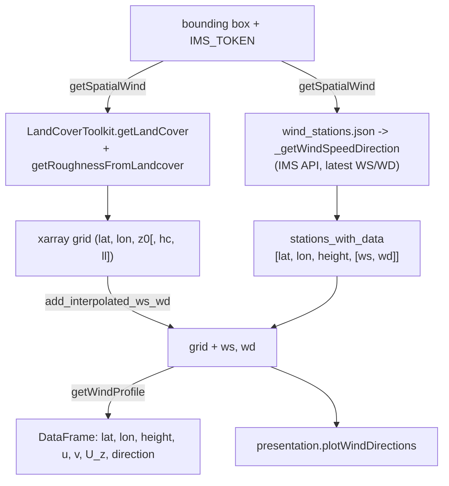

# Wind profile toolkit

The `WindProfileToolkit` handles vertical wind profile modeling: it builds a land-cover/roughness grid for a region, fetches the latest IMS station winds, interpolates them onto the grid, and extrapolates a vertical profile at every grid point using log-law (and an exponential canopy profile in urban areas).

For user-facing documentation, see [Toolkits > Simulations > Wind Profile](../../toolkits/simulations/windprofile.md).

---

## Package structure

```
hera/simulations/windProfile/
    toolkit.py           # WindProfileToolkit + presentation
    wind_stations.json   # IMS station metadata (id, lat/lon, height above sea)
```

| Item | Value |
|------|-------|
| `toolkitHome` constant | `toolkitHome.WINDPROFILE` (`"WindProfile"`) |
| Class | `hera.simulations.windProfile.toolkit.WindProfileToolkit` (inherits `abstractToolkit`) |
| `toolkitName` passed to base | `"WindProfileToolkit"` |
| Constructor | `WindProfileToolkit(projectName, filesDirectory=None, connectionName=None)` |
| Layers | `presentation` (`presentation` class); no analysis layer |

Dependencies: `toolkitHome.GIS_LANDCOVER` (land cover + roughness), `hera.simulations.utils.interpolations.spatialInterpolate` (station interpolation), `BETA` / `KARMAN` constants from `hera.measurements.GIS.utils`, and `toMathematicalAngle` from `hera.utils.angle`. Nothing is stored in the database.

---

## Data flow



## Methods

| Method | Description |
|--------|-------------|
| `getSpatialWind(minlat, minlon, maxlat, maxlon, IMS_TOKEN, dxdy=30, inputCRS=WSG84, landcover_DataSource=None)` | Returns `(xarray, stations_with_data)`: the land-cover grid with roughness from `GIS_LandCover`, and the latest valid IMS readings |
| `add_interpolated_ws_wd(xarray, stations)` | Adds `ws` and `wd` variables by interpolating the stations to each grid point at `elevation + 10 m` (`xarray` must have `lon`, `lat`, `elevation`) |
| `getWindProfile(xarray, height, dz)` | For every grid point and every `z` in `0..height` step `dz`, compute `U(z)` and its `u`/`v` components; returns a long DataFrame |

Internals:

- `_getWindSpeedDirection(stations, IMS_TOKEN)` calls `https://api.ims.gov.il/v1/envista/stations/<id>/data/latest` with `headers={'Authorization': IMS_TOKEN['Authorization']}` (up to 20 retries per station), keeps readings with `|ws| < 20` and `|wd| <= 360`, and drops stations whose timestamp is more than 15 minutes older than the newest one.
- `_find_lat_lon_index_in_xarray(lat, lon, xarray)` finds the nearest grid cell.
- `_getStationsInRegion(...)` (filter stations by an ITM bounding box) is unused and opens `wind_stations.json` relative to the current directory.

### Profile model (`getWindProfile`)

With `u*` = `ws * KARMAN / ln(z / z0)`:

- Non-urban (no `hc` coordinate): `U(z) = (u* / KARMAN) * ln(z / z0)`.
- Urban (`hc` present and `hc > 2 m`): log-law above `hc`; below it `U(z) = U(hc) * exp(BETA * (z - hc) / ll)`. Cells with `hc <= 2 m` are skipped.
- `u`, `v` come from `wd` converted with `toMathematicalAngle`.

## Presentation

`presentation.plotWindDirections(plot, landcover, figsize=(28, 28), color='black', arrow_length=10, width=10, head_width=50, head_length=70, show_photo=True)` draws a `wd` arrow per grid cell (converted to ITM) over a tile image (`plot`, e.g. from `TilesToolkit`). With `show_photo=False` it returns the figure instead of showing it.

!!! warning "Known issues in master"
    - `getSpatialWind` passes `(minlat, minlon, maxlat, maxlon)` to `LandCoverToolkit.getLandCover(minx, miny, maxx, maxy, ...)` and passes `dxdy` as the second positional argument of `getRoughnessFromLandcover`, which is `windMeteorologicalDirection` (`windProfile/toolkit.py:107-108`).
    - `getWindProfile` starts at `z = 0`, where `ln(z / z0)` is undefined; choose the grid so that only `z > 0` is used, or drop the first level.

## Extension points

- New profile laws: add a branch (or a helper) in `getWindProfile`; keep angle conversion through `hera.utils.angle`.
- Other station sources: replace `_getWindSpeedDirection` with a method returning the same `[lat, lon, height, [ws, wd]]` list.
