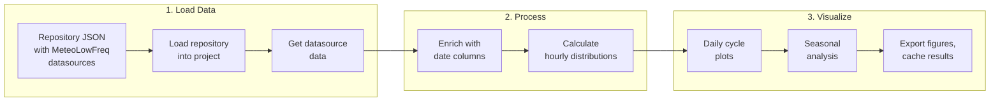
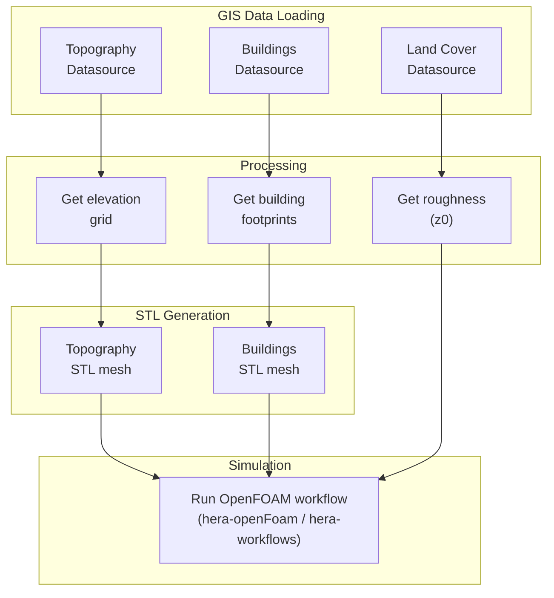
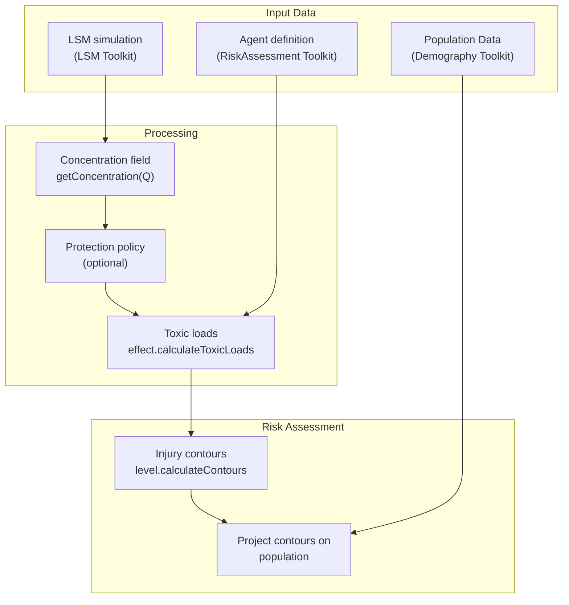

# Workflow Examples

End-to-end workflow examples demonstrating how to use multiple Hera toolkits together.

---

## Workflow 1: Meteorological Analysis Pipeline

Complete pipeline for analyzing low-frequency meteorological station data.

### Overview



### Step-by-Step Code

```python
from hera import Project, toolkitHome
from hera.utils.data.toolkit import dataToolkit
import json

# Step 1: Load repository into project
proj = Project(projectName="METEOROLOGY_ANALYSIS")

with open("meteo_repository.json") as f:
    repo_json = json.load(f)

dt = dataToolkit()
dt.loadAllDatasourcesInRepositoryJSONToProject(
    projectName="METEOROLOGY_ANALYSIS",
    repositoryJSON=repo_json,
    basedir="/path/to/repo",
    overwrite=True
)

# Step 2: Get toolkit and load data
lf = toolkitHome.getToolkit(toolkitHome.METEOROLOGY_LOWFREQ, projectName="METEOROLOGY_ANALYSIS")
df = lf.getDataSourceData("YAVNEEL").compute()  # Materialize dask DataFrame

# Step 3: Enrich with date columns (datecolumn=None uses the index)
enriched = lf.analysis.addDatesColumns(df, datecolumn="datetime")

# Step 4: Calculate hourly distributions (2D histogram of hour-of-day vs. value)
# normalization: "density" (default), "max_normalized" or "y_normalized"
x_mid, y_mid, hist_T = lf.analysis.calcHourlyDist(enriched, Field="T", normalization="density")
x_mid, y_mid, hist_RH = lf.analysis.calcHourlyDist(enriched, Field="RH", normalization="density")

# Step 5: Generate visualizations
import matplotlib.pyplot as plt

# Daily scatter plot
fig, ax = plt.subplots(figsize=(12, 6))
lf.presentation.dailyPlots.plotScatter(enriched, plotField="RH", ax=ax)
plt.savefig("daily_rh_scatter.png")

# Seasonal probability contours (one field per call)
lf.presentation.seasonalPlots.plotProbContourf_bySeason(enriched, plotField="T")
plt.savefig("seasonal_contours_T.png")

# Step 6: Save processed results to the Cache collection
# saveCacheData writes the DataFrame to <filesDirectory>/cache/ (parquet) and adds the document
proj.saveCacheData(
    name="yavneel_enriched",
    data=enriched,
    desc={"station": "YAVNEEL", "processedDate": "2024-11-20"},
    type="ProcessedStatistics"
)

print("Analysis complete!")
```

### Expected Outputs

- **Daily scatter plot** — Relative humidity by hour of day
- **Seasonal contours** — Probability distributions by season
- **Cached data** — The enriched DataFrame saved to the project cache

---

## Workflow 2: GIS + Simulation Integration

Generate STL meshes for CFD simulation from GIS data.

### Overview



### Step-by-Step Code

```python
from hera import Project, toolkitHome
from hera.utils.data.toolkit import dataToolkit
from hera.measurements.GIS import WSG84, ITM
import json

# Step 1: Load GIS repository
proj = Project(projectName="CFD_SIMULATION")

with open("gis_repository.json") as f:
    repo_json = json.load(f)

dt = dataToolkit()
dt.loadAllDatasourcesInRepositoryJSONToProject(
    projectName="CFD_SIMULATION",
    repositoryJSON=repo_json,
    basedir="/path/to/repo",
    overwrite=True
)

# Step 2: Get GIS toolkits
topo = toolkitHome.getToolkit(toolkitHome.GIS_RASTER_TOPOGRAPHY, projectName="CFD_SIMULATION")
landcover = toolkitHome.getToolkit(toolkitHome.GIS_LANDCOVER, projectName="CFD_SIMULATION")
buildings = toolkitHome.getToolkit(toolkitHome.GIS_BUILDINGS, projectName="CFD_SIMULATION")

# Step 3: Define simulation domain (WGS84)
minx, miny = 35.0, 32.0
maxx, maxy = 35.1, 32.1
dxdy = 30  # 30m resolution

# Step 4: Get elevation data (xarray)
elevation = topo.getElevation(minx, miny, maxx, maxy, dxdy=dxdy, inputCRS=WSG84)

# Step 5: Get land cover and roughness
landcover_data = landcover.getLandCover(minx, miny, maxx, maxy, dxdy=dxdy, inputCRS=WSG84)
roughness = landcover.getRoughness(minx, miny, maxx, maxy, dxdy=dxdy, inputCRS=WSG84)

# Step 6: Get building footprints (with ground elevation from the topography toolkit)
buildings_gdf = buildings.getBuildingsFromRectangle(
    minx, miny, maxx, maxy,
    inputCRS=WSG84,
    withElevation=True
)

# Step 7: Generate STL meshes
# Topography STL (returns the STL text)
topo_stl = topo.createElevationSTL(minx, miny, maxx, maxy, dxdy=dxdy, inputCRS=WSG84, solidName="Terrain")
with open("terrain.stl", "w") as f:
    f.write(topo_stl)

# Buildings STL (writes the file directly)
if len(buildings_gdf) > 0:
    buildings.buildingsGeopandasToSTLRasterTopography(
        buildings_gdf, "BLDG_HT", "elevation", "buildings.stl"
    )

print("STL files ready for the CFD case.")
```

**Step 8: Run the OpenFOAM simulation.** Simulations are driven by Hermes workflow JSON files rather than a single Python call. Put the STL files into your workflow (e.g. a `simpleFoam` template) and run it with the CLI:

```bash
hera-openFoam simpleFoam templates list --projectName CFD_SIMULATION
hera-openFoam simpleFoam executeWorkflow terrain_1.json --projectName CFD_SIMULATION
hera-workflows list workflows terrain --projectName CFD_SIMULATION
```

The workflow results are registered in the Simulations collection by the OpenFOAM toolkit. See the [CLI Reference](../cli/reference.md#hera-openfoam) and the simulation toolkit pages for details.

### Expected Outputs

- **Terrain STL** — 3D mesh of topography
- **Buildings STL** — 3D mesh of buildings
- **Roughness field** — xarray with the `z0` roughness field
- **Simulation results** — OpenFOAM workflow documents in the Simulations collection

---

## Workflow 3: Risk Assessment Pipeline

Risk assessment from an LSM dispersion simulation, an agent and population data.

### Overview



### Step-by-Step Code

```python
from hera import toolkitHome
from hera.utils import ureg
from hera.riskassessment import ProtectionPolicy

PROJECT = "RISK_ASSESSMENT"

# Step 1: Get toolkits
lsm = toolkitHome.getToolkit(toolkitHome.LSM, projectName=PROJECT)
risk = toolkitHome.getToolkit(toolkitHome.RISKASSESSMENT, projectName=PROJECT)
demo = toolkitHome.getToolkit(toolkitHome.GIS_DEMOGRAPHY, projectName=PROJECT)

# Step 2: Get an LSM simulation and its concentration field (pint-aware; Q scales the release)
sim = lsm.getSimulations()[0]
concentration = sim.getConcentration(Q=500 * ureg.kg)

# Step 3: (optional) apply a protection policy to the concentration field
policy = ProtectionPolicy()
policy.indoor(turnover=2 * ureg.hour, enter="10min", stay="3h")
protected = policy.compute(concentration.sel(z=10), C="C")

# Step 4: Load the agent and compute toxic loads
agent = risk.getAgent("Chlorine")
effect = agent[agent.effectNames[0]]
toxic_loads = effect.calculateToxicLoads(protected, field="C")

# Step 5: Injury contours for one severity level (GeoDataFrame or None)
level = effect[effect.levelNames[0]]
contours = level.calculateContours(toxic_loads, time="datetime", x="x", y="y")

# Step 6: Population data for the casualty estimate
population = demo.getDataSourceData("lamas_population")
```

For projecting the contours onto the population, casualty roses (`risk.presentation.plotCasualtiesRose(...)`) and the shortcut `risk.analysis.getRiskAreas(tenbergeCoefficient, levels, Q=..., protectionPolicy=..., LSMfile=...)`, see the worked examples in the [Risk Assessment toolkit guide](../toolkits/risk_assessment.md).

### Expected Outputs

- **Concentration field** — xarray Dataset with the `C` field
- **Toxic loads** — xarray of the time-integrated dose
- **Injury contours** — GeoDataFrame with `TotalPolygon`, `severity`, `ToxicLoad` and `datetime` columns

---

## Common Patterns

### Pattern 1: Chaining Toolkit Operations

```python
# Output of one toolkit feeds into another
topo = toolkitHome.getToolkit(toolkitHome.GIS_RASTER_TOPOGRAPHY, projectName="MY_PROJECT")
buildings = toolkitHome.getToolkit(toolkitHome.GIS_BUILDINGS, projectName="MY_PROJECT")

# Get elevation
elevation = topo.getElevation(minx, miny, maxx, maxy, dxdy=30)

# Get buildings with elevation
buildings_gdf = buildings.getBuildingsFromRectangle(
    minx, miny, maxx, maxy,
    withElevation=True  # Uses the raster topography toolkit internally
)
```

### Pattern 2: Batch Processing Multiple Datasources

```python
import pandas as pd

toolkit = toolkitHome.getToolkit(toolkitHome.METEOROLOGY_LOWFREQ, projectName="MY_PROJECT")
sources = toolkit.getDataSourceList()   # list of datasource names

results = {}
for source_name in sources:
    data = toolkit.getDataSourceData(source_name).compute()
    processed = toolkit.analysis.addDatesColumns(data)
    results[source_name] = processed

# Combine results
combined = pd.concat(results.values(), keys=results.keys())
```

### Pattern 3: Conditional Workflow Execution

```python
# Check if datasource exists before processing
if "YAVNEEL" in toolkit.getDataSourceList():
    data = toolkit.getDataSourceData("YAVNEEL")
    # Process...
else:
    print("Datasource not found, skipping...")
```

---

## See Also

- [Best Practices Guide](../guides/best_practices.md) — Workflow organization tips
- [Repository Examples](repository_examples.md) — Setting up data repositories
- [Toolkit Catalog](../toolkits/overview.md) — Available toolkit methods
