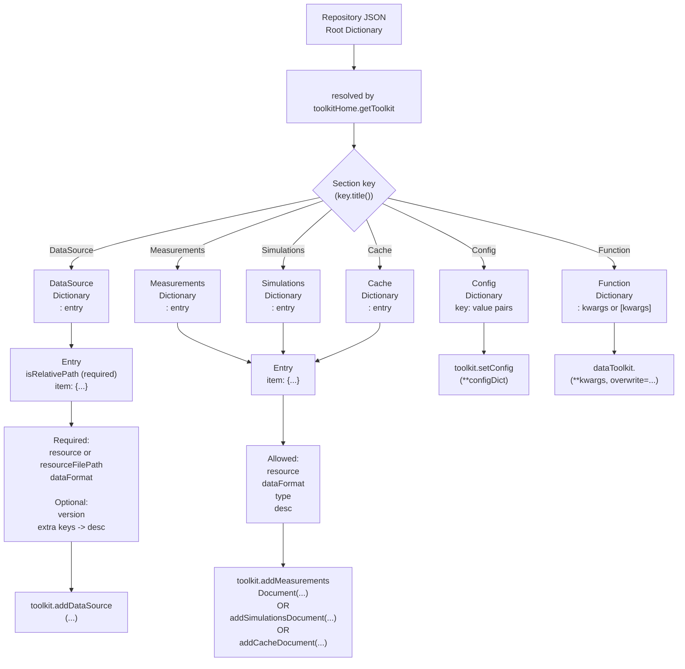

# Repository JSON Schema Reference

Complete schema documentation for repository JSON files, as interpreted by `dataToolkit.loadAllDatasourcesInRepositoryJSONToProject()` in `hera/utils/data/toolkit.py`.

---

## Top-Level Structure

A repository JSON is a dictionary mapping toolkit names to their configuration and data sections:

```json
{
    "<ToolkitName>": {
        "Config": { ... },
        "DataSource": { ... },
        "Measurements": { ... },
        "Simulations": { ... },
        "Cache": { ... },
        "Function": { ... }
    },
    "<AnotherToolkitName>": { ... }
}
```

**Rules:**
- Toolkit names must be names that `toolkitHome.getToolkit()` can resolve (case-sensitive): a built-in toolkit name (e.g. `MeteoLowFreq`, `GIS_Raster_Topography`, see the `toolkitHome.*` constants), a dynamically registered toolkit, or an experiment. Keys that cannot be resolved are **skipped** (logged at INFO level), not reported as errors.
- Each toolkit section is independent
- Section order doesn't matter
- Sections are optional (only include what you need)

---

## Section Types

### Config Section

**Purpose:** Set toolkit configuration via `toolkit.setConfig(**configDict)`

**Schema:**
```json
{
    "<ToolkitName>": {
        "Config": {
            "<key1>": "<value1>",
            "<key2>": 42,
            "<key3>": {
                "nested": "config"
            }
        }
    }
}
```

**Handler:** `_handle_Config` → Calls `toolkit.setConfig(**configDict)`. Config is always written (the `overwrite` flag does not apply); existing keys not in the section are kept.

**Example:**
```json
{
    "GIS_Raster_Topography": {
        "Config": {
            "defaultSRTM": "SRTMGL1",
            "defaultCRS": 4326
        }
    }
}
```

---

### DataSource Section

**Purpose:** Register versioned datasources accessible via `toolkit.getDataSourceData()`

**Schema:**
```json
{
    "<ToolkitName>": {
        "DataSource": {
            "<datasourceName>": {
                "isRelativePath": "True" | "False" | true | false,
                "item": {
                    "resource": "<path or value>",
                    "dataFormat": "<format constant>",
                    "version": [<major>, <minor>, <patch>],
                    "<extraKey>": "<value>"
                }
            }
        }
    }
}
```

**Handler:** `_handle_DataSource` → Calls `toolkit.addDataSource(dataSourceName=<datasourceName>, **item)`

**Required Fields:**
- `isRelativePath` (next to `item`) — must be `"True"`, `"False"`, `true` or `false`
- `resource` (or `resourceFilePath`, see below) — Path to data file or inline value
- `dataFormat` — One of the `datatypes` constants (e.g., `"parquet"`, `"geopandas"`)

**Optional Fields:**
- `version` — Version `[major, minor, patch]` (default: `[0, 0, 1]`)
- `resourceFilePath` — Instead of `resource`: path to a JSON file whose **contents** become the resource (resolved with the same `isRelativePath` rule). If both are given, `resource` wins.
- Any other key — stored as a metadata field in the document's `desc` (next to the automatic `toolkit`, `datasourceName` and `version` fields). Note that a `"desc": {...}` key is stored as a nested `desc.desc` dictionary, so put metadata keys directly in `item` if you want to query them as `desc.<key>`.

The `overwrite` value is set by the loader (`--overwrite` / `overwrite=True`); an `overwrite` key inside `item` is ignored.

**Path Resolution:**
- If `isRelativePath` is `"True"` or `true`: `resource` is joined to `basedir` (the repository JSON directory)
- If `isRelativePath` is `"False"` or `false`: `resource` is used as-is

**Example:**
```json
{
    "MeteoLowFreq": {
        "DataSource": {
            "YAVNEEL": {
                "isRelativePath": "True",
                "item": {
                    "resource": "measurements/YAVNEEL.parquet",
                    "dataFormat": "parquet",
                    "version": [0, 0, 1],
                    "stationName": "YAVNEEL",
                    "latitude": 31.7683,
                    "longitude": 35.2137
                }
            }
        }
    }
}
```

---

### Measurements Section

**Purpose:** Add raw measurement documents to the Measurements collection

**Schema:**
```json
{
    "<ToolkitName>": {
        "Measurements": {
            "<documentName>": {
                "item": {
                    "resource": "<path or value>",
                    "dataFormat": "<format constant>",
                    "type": "<document type>",
                    "desc": {
                        "<key>": "<value>",
                        ...
                    }
                }
            }
        }
    }
}
```

**Handler:** `_DocumentHandler` → Calls `toolkit.addMeasurementsDocument(**item)`

**Fields:** `item` is passed directly to `addMeasurementsDocument(resource, dataFormat, type, desc)`, so it may contain only these four keys (any other key, including `isRelativePath`, makes the call fail and the section is skipped with a logged error).
- `resource` — Path to data file or inline value
- `dataFormat` — Format constant
- `type` — Application-defined document type (e.g., `"Experiment_rawData"`)
- `desc` — Metadata dictionary

**Path Resolution:** `resource` is always joined to `basedir` (`os.path.join(basedir, resource)`), so relative paths are resolved against the repository directory and absolute paths are kept. An `isRelativePath` key next to `item` is accepted but ignored.

**Duplicate detection:** existing documents are looked up by the item's `type` and `desc`. If one exists and `overwrite` is set, its `resource`, `dataFormat` and `desc` are updated; otherwise the item is skipped with a logged error.

**Differences from DataSource:**
- No `version` field (documents are not versioned)
- Has a `type` field
- Creates a plain `Measurements` collection document (not a `ToolkitDataSource`)

**Example:**
```json
{
    "MeteoLowFreq": {
        "Measurements": {
            "raw_export_2024": {
                "item": {
                    "resource": "exports/raw_2024.parquet",
                    "dataFormat": "parquet",
                    "type": "Experiment_rawData",
                    "desc": {
                        "exportDate": "2024-12-01",
                        "source": "IMS"
                    }
                }
            }
        }
    }
}
```

---

### Simulations Section

**Purpose:** Add simulation output documents to the Simulations collection

**Schema:**
```json
{
    "<ToolkitName>": {
        "Simulations": {
            "<documentName>": {
                "item": {
                    "resource": "<path or value>",
                    "dataFormat": "<format constant>",
                    "type": "<document type>",
                    "desc": {
                        "<key>": "<value>",
                        ...
                    }
                }
            }
        }
    }
}
```

**Handler:** `_DocumentHandler` → Calls `toolkit.addSimulationsDocument(**item)`

**Same structure and rules as Measurements**, but creates documents in the `Simulations` collection.

**Example:**
```json
{
    "OpenFOAM": {
        "Simulations": {
            "wind_simulation_001": {
                "item": {
                    "resource": "simulations/wind_001.nc",
                    "dataFormat": "netcdf_xarray",
                    "type": "WindProfile",
                    "desc": {
                        "simulationDate": "2024-11-15",
                        "solver": "simpleFoam"
                    }
                }
            }
        }
    }
}
```

---

### Cache Section

**Purpose:** Add cached/computed documents to the Cache collection

**Schema:**
```json
{
    "<ToolkitName>": {
        "Cache": {
            "<documentName>": {
                "item": {
                    "resource": "<path or value>",
                    "dataFormat": "<format constant>",
                    "type": "<document type>",
                    "desc": {
                        "<key>": "<value>",
                        ...
                    }
                }
            }
        }
    }
}
```

**Handler:** `_DocumentHandler` → Calls `toolkit.addCacheDocument(**item)`

**Same structure and rules as Measurements/Simulations**, but creates documents in the `Cache` collection.

**Example:**
```json
{
    "MeteoLowFreq": {
        "Cache": {
            "processed_stats": {
                "item": {
                    "resource": "cache/statistics.json",
                    "dataFormat": "JSON_dict",
                    "type": "ProcessedStatistics",
                    "desc": {
                        "computedDate": "2024-11-20",
                        "method": "hourly_distribution"
                    }
                }
            }
        }
    }
}
```

---

### Function Section

**Purpose:** Call named methods on the `dataToolkit` instance that is loading the repository (not on the toolkit named by the key)

**Schema:** the value of each method name is the keyword-argument dictionary itself (there is no `params` wrapper):

```json
{
    "<ToolkitName>": {
        "Function": {
            "<methodName>": {
                "<param1>": "<value1>",
                "<param2>": 42
            }
        }
    }
}
```

**Or for multiple calls:**

```json
{
    "<ToolkitName>": {
        "Function": {
            "<methodName>": [
                { "<param1>": "<value1>" },
                { "<param1>": "<value2>" }
            ]
        }
    }
}
```

**Handler:** `_handle_Function` → Calls `dataToolkit.<methodName>(**kwargs, overwrite=overwrite)`

**Requirements:**
- The method must exist on `dataToolkit` (e.g. `addRepository`, `loadAllDatasourcesInRepositoryToProject`)
- The method must accept an `overwrite` keyword argument
- The value must be a dict (single call) or a list of dicts (one call per dict); any other value raises `ValueError`

**Example:**
```json
{
    "MeteoLowFreq": {
        "Function": {
            "addRepository": {
                "repositoryName": "shared_gis",
                "repositoryPath": "/data/repositories/shared_gis.json"
            }
        }
    }
}
```

---

## Path Resolution Rules

### How `basedir` is Determined

- **Registered repository** (`hera-project repository load`, `loadAllDatasourcesInRepositoryToProject`): `basedir` is the directory of the registered repository JSON file:

    ```python
    basedir = os.path.dirname(repositoryDocument.resource)
    ```

- **Direct JSON** (`loadAllDatasourcesInRepositoryJSONToProject(repositoryJSON=..., basedir=...)`): `basedir` is whatever you pass (default `""`, i.e. relative to the current working directory).

**Example:**
- Repository JSON at: `/home/user/repos/my_repo.json`
- `basedir` = `/home/user/repos`

### Relative Path Resolution

For DataSource items with `isRelativePath: "True"` or `isRelativePath: true`, and for **all** Measurements/Simulations/Cache items:

```python
absolute_path = os.path.join(basedir, resource)   # an absolute resource stays unchanged
```

**Example:**
- Repository JSON: `/home/user/repos/my_repo.json`
- `resource: "data/file.parquet"`
- `isRelativePath: "True"`
- Resolved to: `/home/user/repos/data/file.parquet`

### Absolute Path Handling

For DataSource items with `isRelativePath: "False"` or `isRelativePath: false`:

- Path is used exactly as specified
- No modification is performed
- Useful for shared network drives or fixed locations

---

## Validation Rules

### Toolkit Validation

- **Toolkit must resolve** — the key is passed to `toolkitHome.getToolkit()`; if that fails, the whole toolkit key is skipped (INFO log). No auto-registration is performed (the `auto_register_missing` argument is currently unused).

### Section Validation

- **Valid section names** — The key is title-cased (`key.title()`) and must then be one of `Config`, `Datasource`, `Measurements`, `Simulations`, `Cache`, `Function`. So `DataSource`, `Datasource` and `datasource` are all accepted.
- **Unknown section** — raises `ValueError` and stops loading the repository. (When loading all repositories with `loadAllDatasourcesInAllRepositoriesToProject`, that repository is skipped.)
- **Errors inside a section** (bad item, failing call) are caught and logged as `The error ... occured while adding *<section>* to toolkit <name>... skipping!!!`; the remaining items of that section are not loaded.

### DataSource Item Validation

- **Required fields:** `resource` (or `resourceFilePath`), `dataFormat`
- **Version format:** a list of 3 integers: `[major, minor, patch]`
- **isRelativePath:** must be `"True"`, `"False"`, `true`, or `false` (an `assert`)
- **Existing datasource:** if a datasource with that name already exists and `overwrite` is not set, the item is skipped with the logged error `Source X already exists in <project>. Use --overwrite to force update`

### Document Item Validation

- **Allowed fields:** `resource`, `dataFormat`, `type`, `desc`
- **Type field:** a string (default `""`)

### Path Validation

- Paths are **not** checked when the repository is loaded. A wrong path only fails later, when the document's `getData()` is called.

---

## Complete Schema Diagram



---

## Common Errors

| Error | Cause | Solution |
|-------|-------|----------|
| `Unkonw Handler X. The handler must be Config, Datasource, Measurements, Simulations, Cache, Function.` | Section name doesn't match a handler | Use one of: `Config`, `DataSource`, `Measurements`, `Simulations`, `Cache`, `Function` |
| `Skipping key 'X' in repository JSON – no matching toolkit...` (INFO) | Toolkit key cannot be resolved by `getToolkit` | Use a `toolkitHome.*` name or register the toolkit first (`hera-project addToolkit` / `toolkitHome.registerToolkit`) |
| `Source X already exists in <project>. Use --overwrite to force update` | Datasource/document exists and `overwrite=False` | Pass `--overwrite` (CLI) or `overwrite=True` (API) |
| `isRelativePath must be defined as 'True' or 'False'.` | Missing or invalid `isRelativePath` on a DataSource entry | Set to `"True"`, `"False"`, `true`, or `false` |
| `... got an unexpected keyword argument ...` | Extra key (e.g. `isRelativePath`) inside a Measurements/Simulations/Cache `item` | Keep only `resource`, `dataFormat`, `type`, `desc` in the item |
| File not found on `getData()` | Resolved path doesn't exist | Check path, ensure `isRelativePath` / `basedir` are correct |

---

## Implementation Details

The repository loading is implemented in `hera/utils/data/toolkit.py`:

- **`loadAllDatasourcesInRepositoryJSONToProject()`** — Main entry point
- **`loadAllDatasourcesInRepositoryToProject()`** / **`loadAllDatasourcesInAllRepositoriesToProject()`** — Load registered repositories (compute `basedir`)
- **`_handle_Config()`** — Config section handler
- **`_handle_DataSource()`** — DataSource section handler
- **`_DocumentHandler()`** — Measurements/Simulations/Cache handler
- **`_handle_Function()`** — Function section handler
- **`_makeItemPathAbsolute()`** — Path resolution for document sections
- **`resolveDataSourcePaths()`** / **`loadRepositoryFromPath()`** — Static helpers that resolve `resource` paths without MongoDB
- **`exportDocumentsToRepository()`** — The reverse direction: writes project documents into a repository JSON (`hera-project repository export`)

---

## See Also

- [Repository Examples](../examples/repository_examples.md) — Complete working examples
- [Data Layer: Repository Pipeline](../architecture/data_layer.md#repository-json-structure) — How repositories are processed
- [Best Practices: Repository Structure](../guides/best_practices.md#repository-structure) — Organization guidelines
