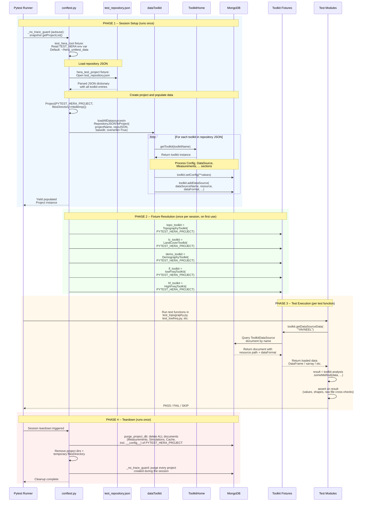
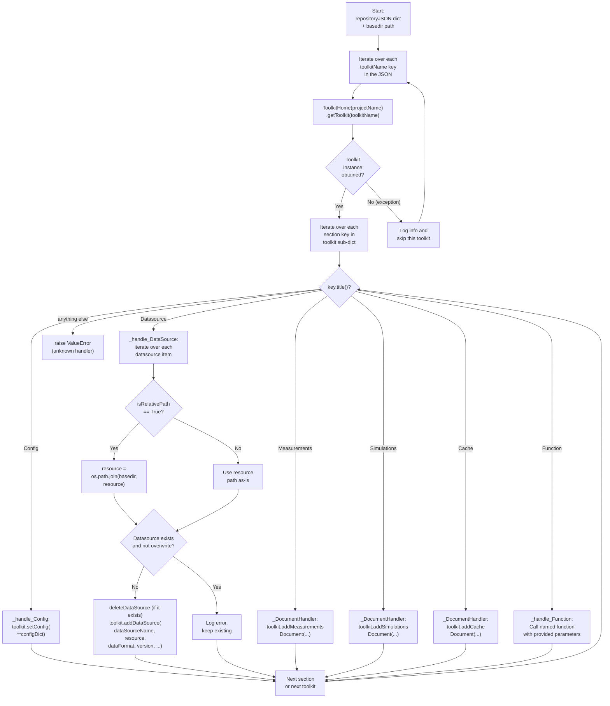
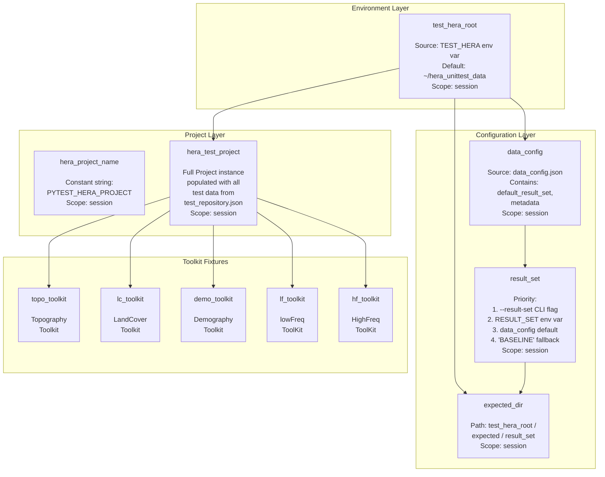
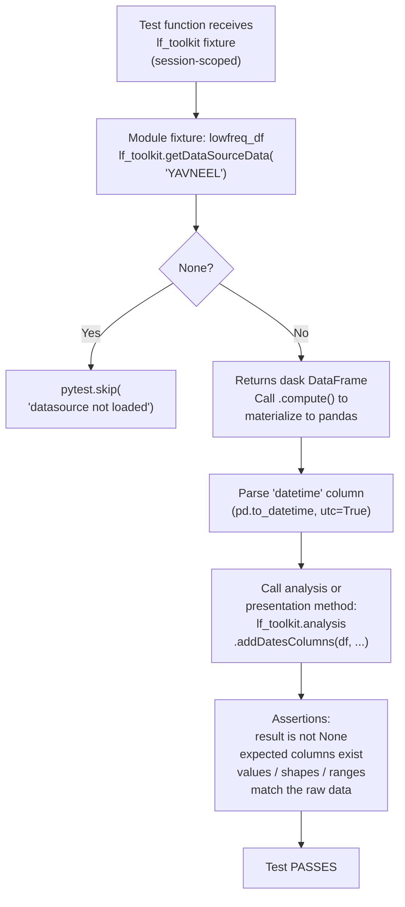
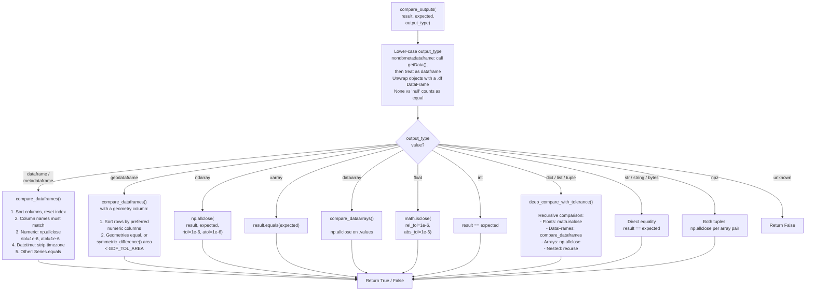

# Testing Flow

This page provides a complete technical walkthrough of the Hera test infrastructure — how tests are organized, how data flows from JSON files through MongoDB into toolkit instances, and how results can be compared against expected outputs.

---

## Overview

The Hera test suite uses **native Pytest** with a **project-based data access** pattern. The core principle:

!!! tip "The Golden Rule"
    **Toolkit tests never access files directly by path.** They interact only with the `Project` and `Toolkit` APIs, exactly as production code does. Data is loaded into MongoDB once per session, and toolkits read it back through the standard datasource mechanism.

### Test Directory Structure

```
hera/tests/
├── conftest.py                      # Session fixtures, cleanup, comparison + save/load helpers
├── test_datalayer.py                # Project / collections / datahandlers (own fixtures)
├── test_repository.py               # Repository add/get/load tests
├── test_repository_export.py        # Repository export tests
├── test_topography.py               # TopographyToolkit tests
├── test_landcover.py                # LandCoverToolkit tests
├── test_lowfreq.py                  # lowFreqToolKit tests
├── test_highfreq.py                 # HighFreqToolKit tests
├── test_demography.py               # DemographyToolkit tests
├── test_experiment.py               # experiment toolkit tests
├── test_*.py                        # risk assessment, OpenFOAM/LSM, hermes, notebooks, ...
├── unit/                            # Small DB-free regression tests
├── dynamic_loading/                 # Dummy experiment + dummy toolkit used by the pack below
├── dynamic_loading_tests_pack/      # Dynamic loading tests (own conftest.py)
├── repository/testCases/            # Test JSON data for repository tests
├── TESTING_GUIDE.md                 # Human-readable test guide
└── Hera_Tests_Simple_Guide*.md      # Short guides
```

External test data lives in a separate directory (downloaded by `make test` / `scripts/s3/bootstrap_unittest_data.sh`, see [Getting Started](getting_started.md#2-test-data-repository)):

```
~/hera_unittest_data/                # Configured via TEST_HERA env var
├── data_config.json                 # Data configuration metadata
├── test_repository.json             # Hera-format repository mapping
├── measurements/                    # Raw test data files
│   ├── GIS/raster/                  # HGT, TIF files
│   ├── GIS/vector/                  # SHP files
│   └── meteorology/                 # Parquet files
└── expected/                        # Expected output result sets
    └── BASELINE/
```

---

## Session Lifecycle — The Complete Flow



---

## Phase 1: Session Setup (conftest.py)

### The hera_test_project Fixture

This is the **single most important fixture** in the test suite. It runs once per session and populates a fresh Hera project with all test data.

```python
# Simplified from hera/tests/conftest.py

PYTEST_PROJECT_NAME = "PYTEST_HERA_PROJECT"

@pytest.fixture(scope="session")
def hera_test_project(test_hera_root):
    from hera.datalayer.project import Project
    from hera.utils.data.toolkit import dataToolkit

    # 1. Read the repository JSON (skip if missing)
    repo_json_path = test_hera_root / "test_repository.json"
    with open(repo_json_path, encoding="utf-8") as fh:
        repo_json = json.load(fh)

    # 2. Create the project, with its files directory in /tmp
    _files_tmp = tempfile.mkdtemp(prefix="hera_pytest_main_")
    proj = Project(projectName=PYTEST_PROJECT_NAME, filesDirectory=_files_tmp)

    # 3. Load ALL datasources into the project
    dt = dataToolkit()
    dt.loadAllDatasourcesInRepositoryJSONToProject(
        projectName=PYTEST_PROJECT_NAME,
        repositoryJSON=repo_json,
        basedir=str(test_hera_root),
        overwrite=True,
    )

    yield proj

    # 4. Cleanup: delete every document of the project (all collections,
    #    including the __config__ document), then the directories
    purge_project_db(PYTEST_PROJECT_NAME)
    purge_project_dirs(PYTEST_PROJECT_NAME)
    shutil.rmtree(_files_tmp, ignore_errors=True)
```

### The _no_trace_guard Fixture

An autouse, session-scoped safety net. At session start it records `getProjectList()`; at the end it calls
`purge_project()` on every project that appeared during the session, plus any project whose name matches the
test patterns (`pytest_*`, `unittest_project_dynamic_*`, `PYTEST_HERA_PROJECT`, `REPOSITORY_PROJECT_TESTING_01`).
It also removes leftover `hera_pytest_main_*`, `hera_pytest_func_*` and `hera_exp_test_*` directories in the
temp directory. Projects that existed before the session and do not match those patterns are never touched.

### What loadAllDatasourcesInRepositoryJSONToProject Does



Exceptions raised inside a section handler are logged and that section is skipped; the loader moves on to the next section.

!!! info "Overwrite Mode"
    The `overwrite=True` parameter ensures that running the test suite multiple times does not accumulate stale documents. An existing datasource with the same name is deleted before the new one is inserted.

!!! note "auto_register_missing"
    The method accepts `auto_register_missing: bool = True`, but in master the parameter is not used: a toolkit
    name that `getToolkit` cannot resolve is simply skipped.

---

## Phase 2: Fixture Resolution

### Session-Scoped Toolkit Fixtures

Each toolkit test module depends on a session-scoped fixture that instantiates the real toolkit class, connected to the test project:

| Fixture | Toolkit Class | Depends On | Data Sources |
|---------|---------------|------------|--------------|
| `topo_toolkit` | `TopographyToolkit` | `hera_test_project` | `SRTMGL1` (HGT directory) |
| `lc_toolkit` | `LandCoverToolkit` | `hera_test_project` | `lc_mcd12q1` (TIF path) |
| `demo_toolkit` | `DemographyToolkit` | `hera_test_project` | `lamas_population` (SHP -> GeoDataFrame) |
| `lf_toolkit` | `lowFreqToolKit` | `hera_test_project` | `YAVNEEL` (parquet -> dask/pandas) |
| `hf_toolkit` | `HighFreqToolKit` | `hera_test_project` | `slicedYamim_sonic`, `slicedYamim_TRH` (parquet) |

### Lightweight Fixtures

| Fixture | Scope | Description |
|---------|-------|-------------|
| `project_fixture` | function | Temporary `Project` (`pytest_temp_project`) with full cleanup |
| `data_toolkit_fixture` | session | `dataToolkit` instance |

Neither is used by a test module in master: `test_datalayer.py` defines its own `proj` / `clean_proj`
fixtures and `test_repository.py` its own `tk` fixture.

### Fixture Dependency Graph



<!-- mermaid source (for editing, paste into mermaid.live):

-->

---

## Phase 3: Test Execution

### Test Modules Overview

| Module | Toolkit | Test functions | Key Patterns |
|--------|---------|-------|--------------|
| `test_datalayer.py` | (Project / collections directly) | 96 | CRUD on 3 collections, counters, config, saveData, datahandlers, autocache, export/import |
| `test_repository.py` | `dataToolkit` | 7 | Repository add/get/load, path resolution |
| `test_repository_export.py` | `repositoryExport` | 28 | Hashing, merge, dedup, export round trip |
| `test_topography.py` | `TopographyToolkit` | 15 | Point/list/grid elevation, STL, CRS conversion |
| `test_landcover.py` | `LandCoverToolkit` | 11 | Land cover at point/area, roughness, coding map |
| `test_lowfreq.py` | `lowFreqToolKit` | 20 | Analysis, presentation, data matching, edge cases |
| `test_highfreq.py` | `HighFreqToolKit` | 35 | Sonic/TRH data, calculators, turbulence statistics |
| `test_demography.py` | `DemographyToolkit` | 54 | Population calculations, area creation, presentation plots |
| `test_experiment.py` | `experimentHome` | 38 | Experiments, trials, entities, data engines, Argos zip parsing |
| `test_toolkit_coverage.py` | several | 34 | Pure-logic paths (topography, LSM, OpenFOAM, Briggs, lowfreq) |
| `test_riskassessment_flow.py` | `RiskAssessment` | 20 | Agent, injury levels, toxic loads, mock flow |
| `test_of_lsm_flow.py` | `OFLSMToolkit` | 19 | Lagrangian particle-file parsing |
| `test_matplotlibContour.py` | (utility) | 16 | Contour to GeoDataFrame |
| `test_workflow_execution.py` | (Luigi execution) | 7 | Scheduler command construction, `dispatch_id` isolation |
| `test_hermes_workflow.py` | `hermesWorkflowToolkit` | 3 | Hermes workflow run |
| `test_logging_helpers.py` | (logging) | 1 | Default logging config |
| `test_no_invalid_escapes.py` | (all sources) | 1 per file | Parametrized over every `hera/**/*.py` |
| `test_notebooks.py` | (notebooks) | 1 per notebook | Marker `notebook`, excluded from `make test` and CI |
| `unit/` | various | 38 functions (some parametrized) | CLI import cost, `diffJSONS`, lowfreq docs vs code, `datasetToOF` |
| `dynamic_loading_tests_pack/` | dynamic loading | 5 | Toolkit `classpath` loading, experiment loading, `hera-experiment` CLI |

### Anatomy of a Toolkit Test

Here is the typical pattern, using `test_lowfreq.py` as an example:



!!! note "Dask to Pandas"
    The `parquet` data handler returns a **dask DataFrame** for lazy loading. Test fixtures call `.compute()` to materialize it into a pandas DataFrame before running assertions.

Several modules also cross-check the toolkit against the raw file (e.g. `test_topography.py` reads the HGT
tile directly, `test_landcover.py` reads the TIF with rasterio), and skip when that file is not in `$TEST_HERA`.

### Test Data Mapping (test_repository.json)

| Toolkit Key | Config Entries | Datasources |
|-------------|----------------|-------------|
| `GIS_Raster_Topography` | `defaultSRTM: SRTMGL1` | `SRTMGL1` -> `measurements/GIS/raster` (string) |
| `GIS_LandCover` | `defaultLandCover: lc_mcd12q1` | `lc_mcd12q1` -> `measurements/GIS/raster/lc_mcd12q1.tif` (string) |
| `GIS_Demography` | — | `lamas_population` -> `measurements/GIS/vector/population_lamas.shp` (geopandas) |
| `MeteoLowFreq` | — | `YAVNEEL` -> `measurements/meteorology/lowfreqdata/YAVNEEL.parquet` (parquet) |
| `MeteoHighFreq` | — | `slicedYamim_sonic` + `slicedYamim_TRH` -> `measurements/meteorology/highfreqdata/*.parquet` (parquet) |

---

## Comparison Helpers

The `conftest.py` module provides a set of comparison functions for validating test outputs against expected baselines.
They are importable with `from hera.tests.conftest import compare_outputs, ...`.

### compare_outputs Dispatcher



### compare_dataframes — Deep Comparison

The `compare_dataframes(df1, df2, rtol=1e-6, atol=1e-6)` function handles several complex scenarios:

1. **Column Alignment** — Sorts columns alphabetically and resets index; returns `False` if the column names differ
2. **Numeric Tolerance** — Uses `np.allclose(rtol, atol, equal_nan=True)` for numeric columns (NaN filled with 0 first)
3. **Datetime Handling** — Strips timezone info before comparison
4. **Geometry Handling** — When both frames have a `geometry` column, geometries match if equal or if `symmetric_difference().area` is below `GDF_TOL_AREA` (default `1e-7`)
5. **Sort Stability** — With a geometry column, rows are first sorted by preferred columns (`areaFraction`, `total_pop`, `age_*`) or, failing that, by all numeric columns

Any exception during comparison makes the function return `False`.

### deep_compare_with_tolerance — Recursive Comparison

For nested structures (dicts, lists, tuples), the `deep_compare_with_tolerance` function recursively compares:

- **Floats** — `math.isclose(rel_tol=1e-6, abs_tol=1e-6)`
- **DataFrames** — Delegates to `compare_dataframes`
- **NumPy arrays** — `np.allclose`
- **Lists/Tuples** — Length check + element-wise recursive comparison
- **Dicts** — Key-set comparison + recursive value comparison
- **Everything else** — Direct equality

---

## Expected Output Management

!!! warning "Not used by the master test suite"
    The result-set fixtures (`result_set`, `expected_dir`) and the save/load helpers below exist in
    `conftest.py`, but no test module in master currently calls `compare_outputs`, `save_expected_output`,
    `load_expected_output` or requests `expected_dir`. Tests assert directly on their results. The machinery
    is available for new tests.

### Result Sets

Expected outputs are organized into **result sets** — named directories under `$TEST_HERA/expected/`:

```
expected/
└── BASELINE/                        # Default result set
    └── ...
```

`data_config.json` may list additional result sets; only directories that actually exist can be selected
(the `expected_dir` fixture skips when the directory is missing).

### Choosing a Result Set

The active result set is determined by (in priority order):

1. **CLI option:** `pytest --result-set <NAME>`
2. **Environment variable:** `RESULT_SET=<NAME>`
3. **Config default:** `data_config.json -> default_result_set`
4. **Hardcoded fallback:** `"BASELINE"`

### Save / Load Helpers

| Function | Purpose |
|----------|---------|
| `save_expected_output(filename, data, output_type, expected_dir)` | Serialize test output to the expected directory (`None` is written as the text `null`) |
| `load_expected_output(filename, output_type, expected_dir)` | Deserialize expected output for comparison; raises `FileNotFoundError` if missing, `ValueError` for an unknown type |

!!! warning "PREPARE_EXPECTED_OUTPUT is not implemented"
    The `conftest.py` docstring describes a `PREPARE_EXPECTED_OUTPUT=1` generation mode, but no code in master
    reads this variable. To create a baseline, call `save_expected_output(...)` from the test (or a one-off
    script) and commit the file to the test data repository.

### Supported Output Formats

| output_type | Save Format | Load Method |
|-------------|-------------|-------------|
| `dataframe` | `.parquet` if the filename ends with `.parquet`, otherwise JSON (`orient="records"`) | `pd.read_parquet()` / `pd.read_json()` |
| `geodataframe` | GeoJSON | `gpd.read_file()` |
| `xarray` / `dataarray` | NetCDF | `xr.open_dataset()` / `xr.open_dataarray()` |
| `dict` / `list` | `.json` | `json.load()` |
| `float` / `int` | `.json` | `json.load()` + cast |
| `ndarray` / `npz` | `.npz` (`np.savez`; a tuple is stored as `arr0`, `arr1`, ...) | `np.load()` → array, or tuple of arrays |
| `str` / `string` | plain text | `open().read()` |

---

## Environment Variables

| Variable | Required | Default | Description |
|----------|----------|---------|-------------|
| `TEST_HERA` | No (export it; see [Getting Started](getting_started.md#4-environment-variables)) | `~/hera_unittest_data` | Path to the test data repository root |
| `RESULT_SET` | No | `default_result_set` or `BASELINE` | Name of the expected-output result set |
| `GDF_TOL_AREA` | No | `1e-7` | Tolerance for geometry comparison area |
| `MPLBACKEND` | No | (system default) | Set to `Agg` for headless matplotlib |
| `PREPARE_EXPECTED_OUTPUT` | — | — | Not implemented in master (docstring only) |

---

## Running Tests

### Quick Reference

```bash
# Activate the environment
source activate_hera.sh

# Run the suite the way CI does (downloads test data if missing)
make test

# Run all tests except notebooks, manually
pytest hera/tests/ -v -m "not notebook"

# Run a specific module
pytest hera/tests/test_lowfreq.py -v

# Run a specific test class
pytest hera/tests/test_topography.py::TestGetPointElevation -v

# Run a single test function
pytest hera/tests/test_lowfreq.py::TestLowFreqToolkitInit::test_has_analysis -v

# Choose a result set
pytest hera/tests/ --result-set BASELINE -v

# Only tests marked as unit (no external dependencies)
pytest hera/tests/ -v -m unit

# Notebook regression tests
make test-notebooks
```

### Pytest Configuration (pytest.ini)

```ini
[pytest]
testpaths = hera/tests
python_files = test_*.py
python_classes = Test*
python_functions = test_*
cache_dir = cache/test_results/.pytest_cache
addopts = -v --tb=short
markers =
    slow: marks tests as slow (deselect with '-m "not slow"')
    integration: marks tests that require MongoDB
    unit: marks tests as unit tests (no external dependencies)
    notebook: marks notebook execution tests (run with 'make test-notebooks', excluded from 'make test')
```

`hera/tests/dynamic_loading_tests_pack/` has its own `pytest.ini`, which only applies when pytest is run from inside that directory.

---

## Adding New Tests

### Step-by-Step Guide

1. **Add test data** to `$TEST_HERA/measurements/<subdir>/`
2. **Update `test_repository.json`** with a new entry under the appropriate toolkit key
3. **Add a fixture** in `conftest.py` (session-scoped, depends on `hera_test_project`)
4. **Create a test module** `hera/tests/test_<name>.py`
5. **Use the fixture** to get a real toolkit instance — no file paths in tests
6. **Mark it** with `@pytest.mark.integration` (needs MongoDB) or `@pytest.mark.unit` (no external dependencies)
7. **Optionally compare outputs** using `compare_outputs()` and expected files under `expected/<result_set>/`

### Example: Adding a New Toolkit Test

```python
# In conftest.py — add a session-scoped fixture
@pytest.fixture(scope="session")
def my_toolkit(hera_test_project):
    from hera.my_module import MyToolkit
    return MyToolkit(projectName=PYTEST_PROJECT_NAME)

# In test_my_toolkit.py
@pytest.mark.integration
class TestMyToolkit:
    def test_basic(self, my_toolkit):
        data = my_toolkit.getDataSourceData("my_datasource")
        if data is None:
            pytest.skip("my_datasource not loaded in project")
        # ... assertions ...
```

---

## Related Documentation

- [Getting Started with Tests](getting_started.md) — Prerequisites, test data download, CI, and how to run the suite
- [Environment Variables](../configuration/env_vars.md) — All test-related environment variables
