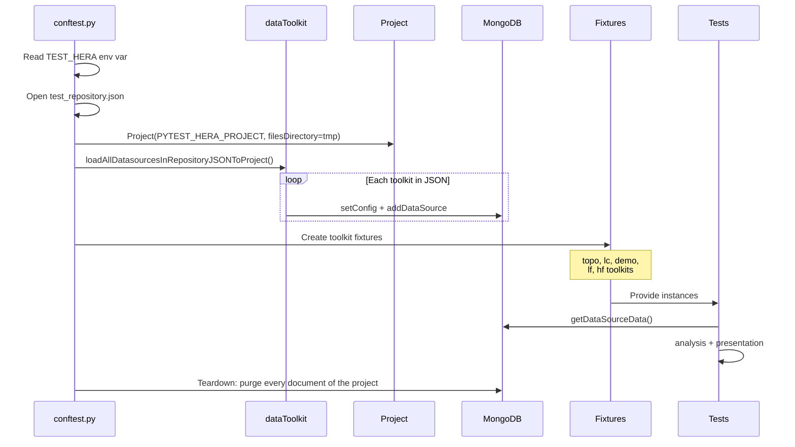

# Testing Guide — How to Run Tests

## Overview

The Hera test infrastructure uses **native Pytest** with a **Project-based data access** pattern.
All tests live under `hera/tests/` and can be executed with a single `pytest` command (or `make test`).

For the toolkit tests, data is loaded once per session into a shared Hera **Project** via `test_repository.json`,
and each toolkit test module receives a real toolkit instance backed by MongoDB —
no monkey-patching of `getConfig` / `getDataSourceData` is needed.

!!! tip "Key Principle"
    Toolkit tests do NOT know where files are stored on disk.
    They interact only with the Project and Toolkit APIs, exactly as production code does.

---

## Architecture

```
hera/                                   # repository root
├── pytest.ini                          # Pytest configuration (testpaths = hera/tests)
├── Makefile                            # test, test-setup, test-notebooks, test-ui, test-all
├── scripts/s3/bootstrap_unittest_data.sh  # Downloads the test data repository from S3
├── hera/
│   ├── utils/data/toolkit.py           # dataToolkit (repository loader + direct-load helpers)
│   └── tests/
│       ├── conftest.py                 # Session-scoped project, per-toolkit fixtures, cleanup, helpers
│       ├── test_datalayer.py           # Project / collections / datahandlers (MongoDB)
│       ├── test_repository.py          # Repository add/get/load, path resolution
│       ├── test_repository_export.py   # Project documents -> repository JSON export
│       ├── test_topography.py          # TopographyToolkit tests
│       ├── test_landcover.py           # LandCoverToolkit tests
│       ├── test_demography.py          # DemographyToolkit (analysis + presentation)
│       ├── test_lowfreq.py             # lowFreqToolKit + analysis + presentation
│       ├── test_highfreq.py            # HighFreqToolKit + calculators + turbulence
│       ├── test_experiment.py          # experiment toolkit (experimentHome)
│       ├── test_*.py                   # further modules, see "Other test modules" below
│       ├── unit/                       # Small DB-free regression tests
│       ├── dynamic_loading/            # Dummy experiment + dummy toolkit fixtures data
│       ├── dynamic_loading_tests_pack/ # Dynamic toolkit/experiment loading tests (own conftest.py)
│       └── repository/testCases/       # Test JSON data for test_repository.py
└── ~/hera_unittest_data/               # External test data repository ($TEST_HERA)
    ├── data_config.json                # Data configuration metadata (default_result_set, ...)
    ├── test_repository.json            # Hera-format repository mapping all test data
    ├── measurements/                   # Raw test data files
    │   ├── GIS/raster/                 # HGT, TIF files
    │   ├── GIS/vector/                 # SHP files
    │   └── meteorology/                # Parquet files (lowfreqdata/, highfreqdata/)
    └── expected/                       # Expected output result sets
        └── BASELINE/
```

### Data Flow



---

## Prerequisites

### 1. Python Environment

The test dependencies (`pytest`, `nbclient`, `nbformat`, `ipykernel`) are pinned in `requirements.txt`,
so the standard Hera environment is enough:

```bash
make install-env          # creates ~/.pyhera/environment and installs requirements.txt + hera (editable)
source activate_hera.sh   # activates it and puts the repository on PYTHONPATH
```

See [Installation & Setup](../user_guide/installation.md) for the full procedure. CI runs the suite on **Python 3.11**.

Some modules need packages that are not pip-installable and are only importable when their clone is on `PYTHONPATH`:

- `hermes` (KaplanOpenSource/hermes) — `test_hermes_workflow.py`, `test_of_lsm_flow.py`, part of `test_workflow_execution.py`
- `argos` (KaplanOpenSource/pyargos) — parts of `test_experiment.py` and the dynamic-loading pack

These tests skip (`pytest.importorskip` / `skipif`) when the package is missing.

### 2. Test Data Repository

The toolkit tests rely on external data files stored in `$TEST_HERA` (default `~/hera_unittest_data/`).
This directory must contain:

- `data_config.json` — metadata about paths, assets, and result sets (`default_result_set`)
- `test_repository.json` — Hera-format repository mapping all test datasources to their toolkits
- `measurements/` — raw data files (HGT, TIF, SHP, Parquet, etc.)
- `expected/` — expected output files organized by result set

`make test` downloads it automatically when `$TEST_HERA/test_repository.json` does not exist, by running:

```bash
./scripts/s3/bootstrap_unittest_data.sh --target-dir ~/hera_unittest_data
# optional: --base-url URL  (default https://s3.eu-west-1.amazonaws.com/hera.kaplanopensource.co.il)
```

The script reads `latest.json` and `manifest.json` from the public bucket, downloads every listed file and
verifies its SHA-256.

!!! warning "The published snapshot is a subset"
    At the time of writing, the snapshot in the bucket (`poc-manual-20260413-v1`) contains only
    `data_config.json`, `test_repository.json`, one HGT tile (`N31E034.hgt`), `YAVNEEL.parquet` and an empty
    `expected/BASELINE/`. Tests whose data file is missing skip themselves, so with this snapshot the
    landcover, demography and highfreq tests, and some topography tests, are skipped (locally and in CI).

`make test-setup` only creates an **empty** skeleton (`measurements/...`, `expected/BASELINE/`, a minimal
`data_config.json` and `{}` as `test_repository.json`). Because `test_repository.json` then exists,
`make test` will no longer bootstrap from S3 — delete the skeleton first if you want the download.

### 3. MongoDB

The toolkit, datalayer and repository tests require a running MongoDB instance reachable through
`~/.pyhera/config.json` (see [MongoDB setup](../user_guide/installation.md#step-5-mongodb-setup)).
Locally, `make mongo-up` starts a `mongo:5.0` container on `127.0.0.1:27017`.

The session-scoped project fixture loads data into MongoDB at startup and purges it on teardown.
`test_datalayer.py` and `test_experiment.py` probe MongoDB at import time and skip their DB tests when it is unreachable.

### 4. Environment Variables

| Variable | Required | Default | Description |
|----------|----------|---------|-------------|
| `TEST_HERA` | No (but see note) | `~/hera_unittest_data` | Path to the test data repository root |
| `RESULT_SET` | No | `default_result_set` from `data_config.json`, else `BASELINE` | Name of the expected-output result set |
| `GDF_TOL_AREA` | No | `1e-7` | Area tolerance for geometry comparison in `compare_dataframes` |
| `MPLBACKEND` | No | (system default) | Set to `Agg` for headless runs (CI does) |
| `PREPARE_EXPECTED_OUTPUT` | — | — | **Not implemented in master.** It is mentioned in the `conftest.py` docstring, but no code reads it |

!!! note "`TEST_HERA` and the landcover tests"
    `conftest.py` falls back to `~/hera_unittest_data` when `TEST_HERA` is unset, but `test_landcover.py`
    builds its data path from `TEST_HERA` alone and skips the whole module when the variable is unset.
    Export `TEST_HERA` explicitly (`make test` does this for you).

See also: [Environment Variables Reference](../configuration/env_vars.md)

---

## How to Run Tests

### Run All Tests

```bash
make test
```

This bootstraps the test data if needed and then runs
`PYTHONPATH=. TEST_HERA=$(TEST_HERA) pytest hera/tests/ -v -m "not notebook"`.
`TEST_HERA` can be overridden: `make test TEST_HERA=/data/hera_unittest_data`.

Equivalent manual invocation:

```bash
source activate_hera.sh
export TEST_HERA=~/hera_unittest_data
pytest hera/tests/ -v -m "not notebook"
```

!!! note
    Running plain `pytest hera/tests/` without `-m "not notebook"` also executes `test_notebooks.py`,
    which runs every notebook in the repository and is slow.

### Other Make Targets

| Target | What it runs |
|--------|--------------|
| `make test-setup` | Creates the empty test data skeleton at `$(TEST_HERA)` |
| `make test-notebooks` | `pytest hera/tests/test_notebooks.py -v` (every `*.ipynb` in the repo, in a fresh kernel) |
| `make test-ui` | `npm install && npm run test:all` in `ui/client/` |
| `make test-all` | `test`, then `test-notebooks`, then `test-ui` |

### Run a Specific Test Module

```bash
pytest hera/tests/test_datalayer.py -v
pytest hera/tests/test_repository.py -v
pytest hera/tests/test_topography.py -v
pytest hera/tests/test_landcover.py -v
pytest hera/tests/test_lowfreq.py -v
pytest hera/tests/test_highfreq.py -v
pytest hera/tests/test_demography.py -v
```

### Run a Specific Test Class or Function

```bash
# Run all tests in a class
pytest hera/tests/test_topography.py::TestGetPointElevation -v

# Run a single test
pytest hera/tests/test_topography.py::TestGetPointElevation::test_basic -v
```

### Select by Marker

The markers registered in `pytest.ini` are `slow`, `integration` (requires MongoDB), `unit` (no external
dependencies) and `notebook`.

```bash
pytest hera/tests/ -v -m unit              # only tests explicitly marked unit
pytest hera/tests/ -v -m "not integration"
pytest hera/tests/ -v -m "not notebook"    # what make test and CI run
```

Not every test carries a marker, so `-m unit` selects a subset of the DB-free tests. No test in master is
currently marked `slow`, so `-m "not slow"` deselects nothing.

### Choose a Result Set

```bash
# Via CLI option (defined in conftest.py)
pytest hera/tests/ --result-set BASELINE -v

# Via environment variable
export RESULT_SET=BASELINE
pytest hera/tests/ -v
```

The result set only selects the directory returned by the `expected_dir` fixture; no test in master
currently compares against expected files (see [Expected Output Management](flow.md#expected-output-management)).

### Run with Short Traceback

`pytest.ini` already sets `addopts = -v --tb=short`. Use `--tb=long` for full tracebacks.

### Parallel Workers

`pytest-xdist` is not in `requirements.txt`. The session fixture always uses the fixed project name
`PYTEST_HERA_PROJECT` and purges it on teardown, so parallel workers would share (and delete) the same project.

---

## Continuous Integration

`.github/workflows/ci.yml` runs on every pull request to `master`. The Python job (`test`):

- Ubuntu, **Python 3.11**, `libgdal-dev gdal-bin`, `pip install -r requirements.txt` and `pip install -e . --no-deps`
- A `mongo:latest` service on port 27017 (root user `hera` / `heracles`); a step writes `~/.pyhera/config.json` for the runner user (database `hera_ci`)
- Checks out `KaplanOpenSource/hermes` and `KaplanOpenSource/pyargos` into `_vendor/` and puts them on `PYTHONPATH`
- `TEST_HERA=/home/runner/hera_unittest_data`; the data is cached by the version in the bucket's `latest.json` and fetched with `bootstrap_unittest_data.sh` on a cache miss
- Runs `pytest hera/tests/ -v -m "not notebook"` with `MPLBACKEND=Agg` (and `JUPYTER_PLATFORM_DIRS=1` to silence a jupyter_client warning)

The same workflow has three UI jobs: `ui-client` (`npx tsc --noEmit`, `npm run test`, `vite build`),
`ui-server` (`pytest tests` in `ui/server/`) and `ui-integration` (vitest integration tests against a MongoDB service).
Notebook tests are not run in CI.

---

## `test_repository.json` — Test Data Mapping

The file `$TEST_HERA/test_repository.json` maps test data files to Hera toolkit datasources
using the standard Hera repository JSON format. All entries use `"isRelativePath": "True"`, and the
session fixture passes `$TEST_HERA` as `basedir`, so paths are relative to the test data root.

| Toolkit Key | Config | DataSources |
|-------------|--------|-------------|
| `GIS_Raster_Topography` | `defaultSRTM: SRTMGL1` | `SRTMGL1` → `measurements/GIS/raster` (directory, format: string) |
| `GIS_LandCover` | `defaultLandCover: lc_mcd12q1` | `lc_mcd12q1` → `measurements/GIS/raster/lc_mcd12q1.tif` (format: string) |
| `GIS_Demography` | — | `lamas_population` → `measurements/GIS/vector/population_lamas.shp` (format: geopandas) |
| `MeteoLowFreq` | — | `YAVNEEL` → `measurements/meteorology/lowfreqdata/YAVNEEL.parquet` (format: parquet) |
| `MeteoHighFreq` | — | `slicedYamim_sonic.parquet` + `slicedYamim_TRH.parquet` → `measurements/meteorology/highfreqdata/` (format: parquet) |

To add new test data, add entries to this JSON and they will automatically be loaded into the test project.

See also: [Repository Examples](../examples/repository_examples.md) and [Repository Schema Reference](../reference/repository_schema.md)

---

## Test Modules — Detailed Description

### `test_datalayer.py`

Tests for `hera.datalayer` against a real MongoDB (96 tests). It does **not** use the shared session project:
it defines its own fixtures `proj` (module-scoped, project `pytest_datalayer_comprehensive`) and `clean_proj`
(function-scoped, project `pytest_datalayer_func`). DB tests are skipped when MongoDB is unreachable.

| Area | Test classes |
|------|--------------|
| CRUD on the three collections | `TestMeasurementsCRUD`, `TestSimulationsCRUD`, `TestCacheCRUD`, `TestSimulationsCacheAsDict` |
| Queries | `TestNestedQueries`, `TestGetAllDocuments`, `TestGetDocumentByID`, `TestGetMetadata`, `TestAddDocumentFromDict`, `TestEmptyProjectEdgeCases` |
| Counters and config | `TestCounters`, `TestConfiguration`, `TestProjectProperties` |
| Saving data and handlers | `TestSaveData`, `TestSaveDataAutoDetect`, `TestDataHandlers`, `TestDatatypes`, `TestGuessHandler` |
| Collections and metadata frames | `TestCollectionDirect`, `TestMetadataFrame`, `TestNonDBMetadataFrame` |
| Other | `TestAutoCache`, `TestExportImport`, `TestModuleFunctionsDB`, `TestModuleFunctionsLocal`, `TestParseConnectionString`, `TestConfigFileManagement` |

**Requires:** MongoDB connection for the classes marked `integration`

---

### `test_repository.py`

Tests for `hera.utils.data.toolkit.dataToolkit` (repository management). Uses its own module-scoped `tk` fixture.

| Test | Description |
|------|-------------|
| `test_add_repository` | Register a repository JSON via `addRepository` |
| `test_get_repository` | Retrieve and verify loaded JSON content |
| `test_load_datasources_to_project` | Full round-trip: load repository JSON, assert correct document count |
| `test_resolve_relative_paths` | Verify `isRelativePath` handling produces absolute paths |
| `test_absolute_paths_unchanged` | Verify absolute paths are not modified |
| `test_load_repository_from_path` | Test the direct-load method (no MongoDB) |
| `test_load_repository_nonexistent` | Verify FileNotFoundError for missing files |

**Requires:** MongoDB connection (for add/get/load tests), test JSON in `repository/testCases/`

---

### `test_topography.py`

Tests for `hera.measurements.GIS.raster.topography.TopographyToolkit`.
Uses the `topo_toolkit` fixture from conftest (backed by project datasource `SRTMGL1`).

| Test | Description |
|------|-------------|
| `test_basic` (getPointElevation) | Single point elevation lookup |
| `test_second_file` | Elevation from a different HGT tile |
| `test_matches_hgt_file` | Verify toolkit result matches raw HGT binary read |
| `test_basic` (getPointListElevation) | Elevation for multiple points |
| `test_matches_hgt_files` | Multi-point comparison against raw HGT data |
| `test_basic` (getElevationOfXarray) | Elevation grid via xarray Dataset |
| `test_matches_hgt_file` (xarray) | Xarray grid comparison against raw HGT data |
| `test_basic` (getElevation) | Area elevation via bounding box |
| `test_matches_hgt_file` (area) | Area elevation comparison against raw HGT data |
| `test_basic` (convertPointsCRS) | CRS conversion (WGS84 -> ITM) |
| `test_single_point_no_deprecation_warning` | Single-point conversion emits no deprecation warning |
| `test_single_point_matches_multi_point_conversion` | Single-point and multi-point conversions agree |
| `test_basic` (createElevationSTL) | STL string generation |
| `test_basic` (getElevationSTL) | STL from existing Dataset |
| `test_basic` (calculateStatistics) | Mean, min, max statistics |

**Data source:** `SRTMGL1` (HGT directory path via `getDataSourceData`). Tests skip when the required tile is missing.

---

### `test_landcover.py`

Tests for `hera.measurements.GIS.raster.landcover.LandCoverToolkit`.
Uses the `lc_toolkit` fixture from conftest (backed by project datasource `lc_mcd12q1`).
The whole module is skipped when `$TEST_HERA/measurements/GIS/raster/lc_mcd12q1.tif` does not exist.

| Test | Description |
|------|-------------|
| `test_basic` (getLandCoverAtPoint) | Land cover value at a single point |
| `test_against_raster` | Compare toolkit result with raw rasterio read |
| `test_basic` (getLandCover) | Land cover map for a bounding box |
| `test_map_vs_raster` | Sampled map values vs. raster file |
| `test_at_point` (roughness) | Roughness at a point |
| `test_area` (roughness) | Roughness map for a bounding box |
| `test_values_in_range` | Verify roughness values are within expected range |
| `test_roughnesslength2sandgrainroughness` | Conversion function |
| `test_known_landcover` | Known land cover value -> expected roughness |
| `test_out_of_bounds` | IndexError for out-of-bounds coordinates |
| `test_get_coding_map` | Coding map structure and values |

**Data source:** `lc_mcd12q1` (file path via `getDataSourceData`, opened with rasterio by toolkit)

---

### `test_lowfreq.py`

Tests for `hera.measurements.meteorology.lowfreqdata.toolkit.lowFreqToolKit`.
Uses the `lf_toolkit` fixture from conftest (backed by project datasource `YAVNEEL`).

| Category | Tests |
|----------|-------|
| Toolkit Init | `test_has_analysis`, `test_has_presentation`, `test_has_docType`, `test_docType_value` |
| Analysis | `test_basic` (addDatesColumns), `test_max_normalized`, `test_density`, `test_y_normalized_behaviour`, `test_basic` (resampleSecondMoments) |
| Presentation | `test_plotScatter`, `test_dateLinePlot`, `test_plotProbContourf`, `test_plotProbContourf_bySeason` |
| Data Matching | `test_dateLinePlot_matches_data`, `test_plotScatter_matches_data` |
| Edge Cases | `test_scatter_empty_dataframe`, `test_scatter_nan_and_outliers`, `test_scatter_WS_field` |
| Distribution | `test_contourf_distribution_ranges` |
| Save | `test_scatter_creates_non_empty_image` |

**Data source:** `YAVNEEL` (parquet via `getDataSourceData`, returns dask DataFrame → `.compute()`)

---

### `test_highfreq.py`

Tests for `hera.measurements.meteorology.highfreqdata` toolkit, analysis calculators, and turbulence statistics.
Uses the `hf_toolkit` fixture from conftest (backed by datasources `slicedYamim_sonic` and `slicedYamim_TRH`).

| Category | Tests |
|----------|-------|
| Toolkit | `test_docType_property` |
| Data Reading | `test_read_sonic_data`, `test_read_trh_data`, `test_read_nonexistent_datasource` |
| Time Range | `test_sonic_time_range`, `test_trh_time_range` |
| Specific Points | `test_sonic_first_row`, `test_trh_first_row` |
| Error Paths | `test_campbelToParquet_nonexistent`, `test_asciiToParquet_nonexistent` |
| AbstractCalculator | `test_init_basic`, `test_sampling_window`, `test_compute_methods_exist`, `test_set_save_properties` |
| MeanDataCalculator | `test_calculate_mean`, `test_hour_and_timeWithinDay`, `test_horizontalSpeed`, `test_sigma_sigmaH`, `test_Ustar_and_uStarOverWindSpeed`, `test_compute_returns_dataframe` |
| Advanced MeanData | `test_TKE`, `test_MOLength` |
| RawdataAnalysis | `test_singlePointTurbulenceStatistics_returns_instance`, `test_singlePointTurbulenceStatistics_raises_on_invalid`, `test_AveragingCalculator`, `test_AveragingCalculator_raises_on_invalid` |
| Turbulence Stats | `test_instantiation`, `test_invalid_input_type`, `test_fluctuations`, `test_secondMoments`, `test_sigma`, `test_horizontalSpeed`, `test_Ustar`, `test_TKE`, `test_MOLength_Sonic` |

**Data sources:** `slicedYamim_sonic`, `slicedYamim_TRH` (parquet via `getDataSourceData`). Skipped when the files are missing.

---

### `test_demography.py`

Tests for `hera.measurements.GIS.vector.demography.DemographyToolkit` (54 tests).
DB-backed tests use the `demo_toolkit` fixture from conftest (backed by project datasource `lamas_population`);
others use synthetic GeoDataFrames.

| Test class | Covers |
|------------|--------|
| `TestDemographyToolkitInit` | `analysis` / `presentation` properties, population types |
| `TestSetDefaultDirectory` | Directory creation and path assignment, error when missing and `create=False` |
| `TestCalculatePopulationInPolygon` | Full/partial/no intersection, invalid datasource, known values, GeoDataFrame input, population types |
| `TestCreateNewArea` | New area creation and total population |
| `TestPlotPopulationDensity`, `TestPlotPopulation`, `TestPlotPopulationByType`, `TestPlotPopulationInPolygon`, `TestPlotArea`, `TestPlotPopulationOnMap` | Presentation layer plots and their options |
| `TestEdgeCases` | Empty GeoDataFrame, single polygon, no overlap |

**Data source:** `lamas_population` (geopandas via `getDataSourceData`). DB-backed tests skip when the shapefile is missing.

---

### Other test modules

| Module | What it covers | Needs |
|--------|----------------|-------|
| `test_repository_export.py` | `hera.utils.data.repositoryExport`: content hashes, document → repository item, merge, dedup, round trip | DB-free, except `TestExportFacade` / `TestRoundTrip` (temporary project in MongoDB) |
| `test_experiment.py` | `experimentHome`, trials, entity types, data engines, analysis/presentation, Argos zip parsing | MongoDB, `argos` for some tests |
| `test_toolkit_coverage.py` | Pure-logic paths of Topography, LSM template params, OFToolkit, Briggs rural sigmas, lowfreq `addDatesColumns` | None (`unit`) |
| `test_riskassessment_flow.py` | Risk assessment agent, injury levels, toxic loads, full mock flow | None (`unit`) |
| `test_matplotlibContour.py` | `hera.utils.matplotlibCountour` contour → GeoDataFrame conversion | None (`unit`) |
| `test_of_lsm_flow.py` | `OFLSMToolkit` Lagrangian particle-file parsing | `hermes`; `blockMesh` for the full OpenFOAM test |
| `test_hermes_workflow.py` | Running a hermes workflow through `hermesWorkflowToolkit` | `hermes`, `luigi` |
| `test_workflow_execution.py` | Luigi command construction and `dispatch_id` output isolation | `hermes`, `luigi` for the integration test |
| `test_logging_helpers.py` | Default logging config creation | None |
| `test_no_invalid_escapes.py` | Every `hera/**/*.py` compiles without invalid-escape warnings | None |
| `test_notebooks.py` | Executes every repository notebook (marker `notebook`) | Jupyter kernel; excluded from `make test` and CI |
| `unit/` | `test_cli_import_cost.py`, `test_diffJSONS.py`, `test_lowfreq_docs_match_code.py`, `test_openfoam_dataset2of.py` | None |
| `dynamic_loading_tests_pack/` | Dynamic toolkit loading via `classpath` (data in `dynamic_loading/`), dynamic experiment loading, `hera-experiment` CLI shortcuts | MongoDB, the `hera-experiment` script on `PATH` and `argos` for the experiment tests |

---

## Shared Fixtures (conftest.py)

### Session-Scoped Project Fixtures

| Fixture | Description |
|---------|-------------|
| `test_hera_root` | Validated path to `$TEST_HERA` (default `~/hera_unittest_data`); skips if missing |
| `data_config` | Parsed `data_config.json` dict |
| `result_set` | Active result-set name |
| `expected_dir` | Path to `expected/<result_set>/`; skips if missing |
| `hera_test_project` | **The shared Hera Project** with all test data loaded from `test_repository.json` |
| `hera_project_name` | The string `"PYTEST_HERA_PROJECT"` |
| `_no_trace_guard` | Autouse. Snapshots the project list at session start and purges every project (DB documents and directories) created during the session, plus leftovers matching test name patterns |

### Per-Toolkit Fixtures (session-scoped)

| Fixture | Toolkit Class | Data Sources |
|---------|---------------|--------------|
| `topo_toolkit` | `TopographyToolkit` | SRTMGL1 (HGT directory) |
| `lc_toolkit` | `LandCoverToolkit` | lc_mcd12q1 (TIF path) |
| `demo_toolkit` | `DemographyToolkit` | lamas_population (SHP → GeoDataFrame) |
| `lf_toolkit` | `lowFreqToolKit` | YAVNEEL (parquet → dask/pandas) |
| `hf_toolkit` | `HighFreqToolKit` | slicedYamim_sonic, slicedYamim_TRH (parquet) |

### Lightweight Fixtures

| Fixture | Scope | Description |
|---------|-------|-------------|
| `project_fixture` | function | Temporary Project `pytest_temp_project` with cleanup |
| `data_toolkit_fixture` | session | `dataToolkit` instance |

These two are available but not used by any test module in master (`test_datalayer.py` and
`test_repository.py` define their own fixtures).

### Cleanup Helpers

`purge_project(projectName)` (= `purge_project_db` + `purge_project_dirs`) deletes every document of a project
in all three collections, including the hidden config document, and removes `~/.hera/<projectName>`.
Use it in fixtures that create their own projects.

---

## Comparison Helpers

Available in `conftest.py` for use in tests:

```python
from hera.tests.conftest import compare_dataframes, compare_dataarrays, compare_outputs

# DataFrame comparison with numeric tolerance
assert compare_dataframes(result_df, expected_df, rtol=1e-6, atol=1e-6)

# DataArray comparison
assert compare_dataarrays(result_da, expected_da)

# Type-based comparison (supports: dataframe, geodataframe, xarray, float, dict, etc.)
assert compare_outputs(result, expected, "dataframe")
```

For more details on the comparison system, see [Test Flow](flow.md).

---

## `dataToolkit` Helper Methods

Two static methods on `hera.utils.data.toolkit.dataToolkit` support direct loading without MongoDB:

### `loadRepositoryFromPath(json_path)` (static)

```python
from hera.utils.data.toolkit import dataToolkit

repo = dataToolkit.loadRepositoryFromPath("/path/to/repository.json")
# Returns dict with all relative resource paths resolved to absolute
```

### `resolveDataSourcePaths(repositoryJSON, basedir)` (static)

```python
resolved = dataToolkit.resolveDataSourcePaths(repo_dict, basedir="/data/root")
# Deep-copies the dict and resolves all relative resource paths
```

---

## Troubleshooting

### Tests are skipped

- **"TEST_HERA directory not found"** — Set `TEST_HERA` env var or run `make test` to download the data
- **"test_repository.json not found"** / **"data_config.json not found"** — The data directory is incomplete; re-run `./scripts/s3/bootstrap_unittest_data.sh`
- **"Skipping landcover tests — data file not found"** — `TEST_HERA` is unset or the TIF is not in the snapshot
- **"... data file missing in TEST_HERA"** / **"Required elevation tile missing"** — The file is not part of the downloaded snapshot (see the warning under Test Data Repository)
- **"datasource not loaded in project"** — Verify MongoDB is running and the repository JSON is valid
- **"MongoDB not reachable"** — See below

### MongoDB connection errors

All toolkit tests (topography, landcover, demography, lowfreq, highfreq) require an active MongoDB instance.
The session-scoped `hera_test_project` fixture loads data into MongoDB at startup and purges it on teardown.
Check `~/.pyhera/config.json` and `make mongo-status`.

### Matplotlib backend issues

Presentation tests (plots) may require a non-interactive backend:

```bash
export MPLBACKEND=Agg
pytest hera/tests/test_lowfreq.py -v
```

See also: [Troubleshooting](../troubleshooting.md)

---

## Adding New Test Data

1. Place the data file under `$TEST_HERA/measurements/<appropriate_subdir>/`
2. Add an entry to `$TEST_HERA/test_repository.json` under the appropriate toolkit key
3. The data will be automatically loaded into the test project on the next test run
4. In your test module, access the data via `toolkit.getDataSourceData("your_datasource_name")`

The copy in the S3 bucket is what CI and `make test` download; a file that exists only on your machine
makes the dependent tests skip elsewhere.

---

## Adding New Tests

### Step-by-Step Guide

1. **Add test data** to `$TEST_HERA/measurements/<subdir>/`
2. **Update `test_repository.json`** with a new entry under the appropriate toolkit key
3. **Add a fixture** in `conftest.py` (session-scoped, depends on `hera_test_project`)
4. **Create a test module** `hera/tests/test_<name>.py`
5. **Use the fixture** to get a real toolkit instance — no file paths in tests
6. **Skip, don't fail, on missing data** — follow the existing modules (`pytest.skip` when `getDataSourceData` returns `None` or the file is absent)
7. **Optionally compare outputs** using `compare_outputs()` and files under `expected/<result_set>/`

### Example: Adding a New Toolkit Test

```python
# In conftest.py — add a session-scoped fixture
@pytest.fixture(scope="session")
def my_toolkit(hera_test_project):
    from hera.my_module import MyToolkit
    return MyToolkit(projectName=PYTEST_PROJECT_NAME)

# In test_my_toolkit.py
class TestMyToolkit:
    def test_basic(self, my_toolkit):
        data = my_toolkit.getDataSourceData("my_datasource")
        assert data is not None
        # ... assertions ...
```

---

## Related Documentation

- [Test Flow](flow.md) — Deep dive into the Pytest session lifecycle and comparison system
- [Installation & Setup](../user_guide/installation.md) — Environment, MongoDB and `config.json`
- [Repository Examples](../examples/repository_examples.md) — Examples of `test_repository.json` structure
- [Repository Schema Reference](../reference/repository_schema.md) — Complete schema documentation
- [Environment Variables](../configuration/env_vars.md) — All test-related environment variables
