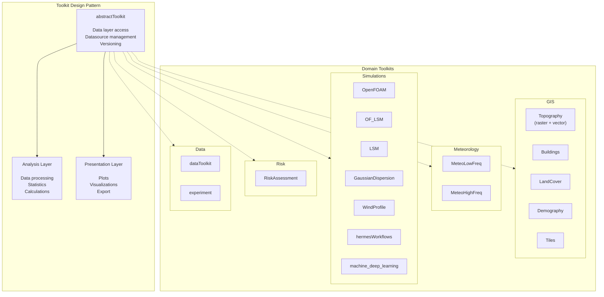
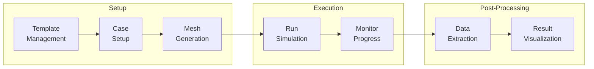
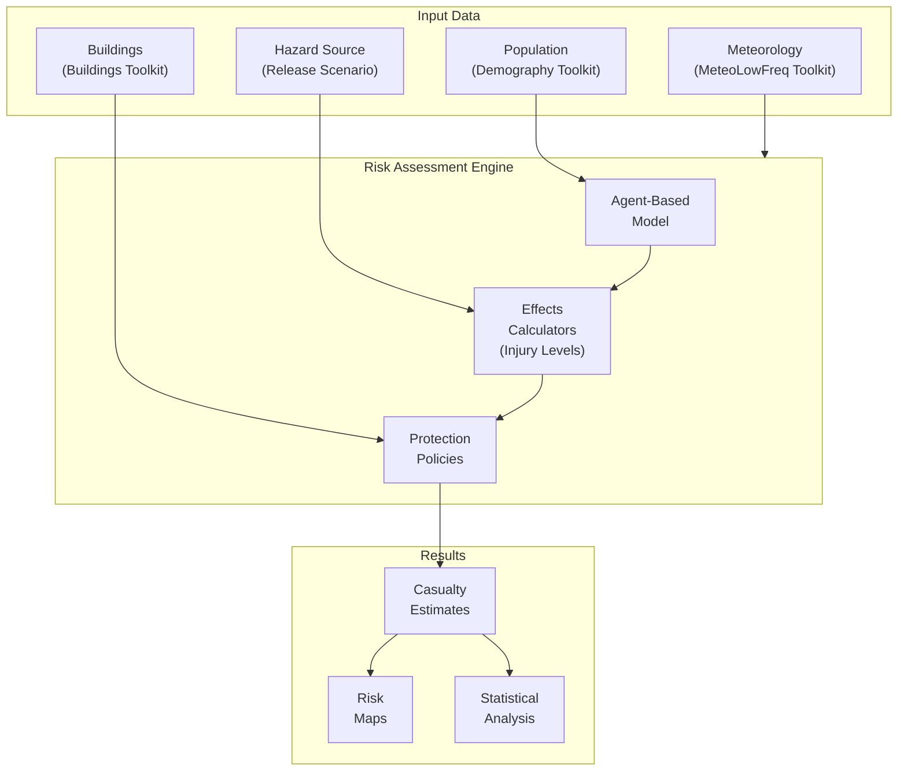

# Toolkit Catalog

This page provides a comprehensive overview of all built-in toolkits in Hera, organized by domain. Each section describes the toolkit's purpose, key methods, and its analysis/presentation pipeline.

---

## Toolkit Architecture

Every toolkit inherits from `abstractToolkit`, which itself inherits from `Project`. This means every toolkit has full data layer access plus domain-specific analysis and presentation capabilities.



The table lists every toolkit in the static registry of `ToolkitHome` (`hera/toolkit.py`). The *registry name* is what you pass to `getToolkit`; the *internal name* is the `toolkitName` the instance reports, and the value its datasources are tagged with in the database.

| Constant | Registry name | Category | Class | Internal name | Description |
|----------|---------------|----------|-------|---------------|-------------|
| `toolkitHome.GIS_RASTER_TOPOGRAPHY` | `"GIS_Raster_Topography"` | GIS | `hera.measurements.GIS.raster.topography.TopographyToolkit` | `TopographyToolkit` | Elevation from SRTM tiles, elevation grids, STL generation |
| `toolkitHome.GIS_VECTOR_TOPOGRAPHY` | `"GIS_Vector_Topography"` | GIS | `hera.measurements.GIS.vector.topography.TopographyToolkit` | `Topography` | Height contours to grid, STL, DEM |
| `toolkitHome.GIS_BUILDINGS` | `"GIS_Buildings"` | GIS | `hera.measurements.GIS.vector.buildings.toolkit.BuildingsToolkit` | `Buildings` | Building footprints, urban morphology, 3D STL meshes for CFD |
| `toolkitHome.GIS_DEMOGRAPHY` | `"GIS_Demography"` | GIS | `hera.measurements.GIS.vector.demography.DemographyToolkit` | `Demography` | Population data from census shapefiles |
| `toolkitHome.GIS_LANDCOVER` | `"GIS_LandCover"` | GIS | `hera.measurements.GIS.raster.landcover.LandCoverToolkit` | `LandCoverToolkit` | Land cover classification, surface roughness |
| `toolkitHome.GIS_TILES` | `"GIS_Tiles"` | GIS | `hera.measurements.GIS.raster.tiles.TilesToolkit` | `Tiles` | Map tiles from a tile server, stitched into images |
| `toolkitHome.METEOROLOGY_LOWFREQ` | `"MeteoLowFreq"` | Meteorology | `hera.measurements.meteorology.lowfreqdata.toolkit.lowFreqToolKit` | `lowFreqMeteorology` | Hourly/daily station data, analysis, visualization |
| `toolkitHome.METEOROLOGY_HIGHFREQ` | `"MeteoHighFreq"` | Meteorology | `hera.measurements.meteorology.highfreqdata.toolkit.HighFreqToolKit` | `highFreqMeteorology` | High-frequency sonic anemometer and TRH data, turbulence statistics |
| `toolkitHome.SIMULATIONS_OPENFOAM` | `"OpenFOAM"` | Simulations | `hera.simulations.openFoam.toolkit.OFToolkit` | `OFworkflowToolkit` | OpenFOAM CFD simulation lifecycle management |
| — | `"OF_LSM"` | Simulations | `hera.simulations.openFoam.lagrangian.LSM.toolkit.OFLSMToolkit` | `OF_LSM` | OpenFOAM Lagrangian (particle cloud) dispersion output |
| `toolkitHome.LSM` | `"LSM"` | Simulations | `hera.simulations.LSM.toolkit.LSMToolkit` | `LSM.old` | Legacy Lagrangian Stochastic Model for dispersion |
| `toolkitHome.GAUSSIANDISPERSION` | `"GaussianDispersion"` | Simulations | `hera.simulations.gaussian.toolkit.gaussianToolkit` | `gaussianToolkit` | Gaussian gas-cloud dispersion model |
| `toolkitHome.WINDPROFILE` | `"WindProfile"` | Simulations | `hera.simulations.windProfile.toolkit.WindProfileToolkit` | `WindProfileToolkit` | Vertical wind profile modeling |
| `toolkitHome.SIMULATIONS_WORKFLOWS` | `"hermesWorkflows"` | Simulations | `hera.simulations.hermesWorkflowToolkit.hermesWorkflowToolkit` | `hermesWorkflowToolkit` | Hermes (Luigi) workflow management |
| `toolkitHome.MACHINELEARNING_DEEPLEARNING` | `"machine_deep_learning"` | Simulations | `hera.simulations.machineLearningDeepLearning.toolkit.machineLearningDeepLearningToolkit` | `machineLearningDeepLearningToolkit` | Storing ML/DL models and hyper-parameters, train/test helpers |
| `toolkitHome.RISKASSESSMENT` | `"RiskAssessment"` | Risk | `hera.riskassessment.riskToolkit.RiskToolkit` | `RiskAssessment` | Agent-based risk assessment framework |
| `toolkitHome.EXPERIMENT` | `"experiment"` | Data | `hera.measurements.experiment.experiment.experimentHome` | `experimentToolKit` | Experimental data workflow management |

`toolkitHome.DATA` (`"heraData"`) is a constant but **not** part of the static registry: `getToolkit(toolkitHome.DATA)` only succeeds if a toolkit of that name was registered dynamically. Use the repository toolkit directly instead:

```python
from hera.utils.data.toolkit import dataToolkit
dt = dataToolkit()    # always works on the default project; internal name "heradata"
```

Besides the static registry, `getToolkit` also resolves toolkits registered dynamically with `toolkitHome.registerToolkit(toolkit_name, toolkit_path)` (see [Understanding Toolkits](understanding_toolkits.md)). `toolkitHome.getToolkitTable()` lists both.

Use the constant instead of the string to avoid typos:

```python
from hera import toolkitHome

# Recommended: use the constant
# Tip: if you created the project with `hera-project project create`, you can omit projectName
topo = toolkitHome.getToolkit(toolkitHome.GIS_RASTER_TOPOGRAPHY, projectName="MY_PROJECT")

# Also works, but error-prone:
topo = toolkitHome.getToolkit("GIS_Raster_Topography", projectName="MY_PROJECT")
```

---

## GIS Toolkits

### GIS_Raster_Topography

**Class:** `hera.measurements.GIS.raster.topography.TopographyToolkit`

Provides elevation data access from SRTM (`.hgt`) tiles. See [Topography (Raster)](measurements/gis/topography_raster.md).

| Method | Description |
|--------|-------------|
| `getPointElevation(lat, long, dataSourceName=None)` | Elevation at a single WGS84 point |
| `getPointListElevation(pointList, dataSourceName=None, inputCRS=WSG84)` | Elevations for a DataFrame of `lat`/`lon` points |
| `getElevation(minx, miny, maxx, maxy, dxdy=30, inputCRS=WSG84, dataSourceName=None)` | Gridded elevation as an xarray Dataset (for WGS84, `minx`/`maxx` are latitudes) |
| `getElevationOfXarray(xarray_dataset, dataSourceName=None)` | Add elevation to an existing `lat`/`lon` grid |
| `createElevationSTL(minx, miny, maxx, maxy, dxdy=30, ..., solidName="Topography")` | STL string for a bounding box |
| `getElevationSTL(elevation, shiftx=0, shifty=0, solidName="Topography")` | STL string from an elevation grid |
| `convertPointsCRS(points, inputCRS, outputCRS)` | Transform coordinates between CRS |

**Analysis methods:** `calculateStastics(elevation)` (spelled this way in the code) — domain size, min/max/mean elevation, standard deviation.

```python
from hera import toolkitHome

topo = toolkitHome.getToolkit(toolkitHome.GIS_RASTER_TOPOGRAPHY, projectName="MY_PROJECT")

# Single point elevation
elev = topo.getPointElevation(lat=32.5, long=35.2)

# Grid elevation (WGS84: minx/maxx = latitude, miny/maxy = longitude; dxdy in meters)
ds = topo.getElevation(minx=32.0, miny=35.0, maxx=32.1, maxy=35.1, dxdy=30)

# Generate an STL string for CFD simulations
stl = topo.getElevationSTL(ds, solidName="Terrain")
```

---

### GIS_Vector_Topography

**Class:** `hera.measurements.GIS.vector.topography.TopographyToolkit`

Works with vector topography (height contour lines). See [Topography (Vector)](measurements/gis/topography_vector.md).

| Method | Description |
|--------|-------------|
| `geoPandasToSTL(gpandas, dxdy=50, solidName="Topography")` | STL string from a contour GeoDataFrame |
| `toDEM(regionNameOrData, dxdy=50)` | DEM-format string from a contour GeoDataFrame |
| `cutRegionFromSource(shapeDataOrName, datasourceName, isBounds=False, crs=None)` | Clip contours to a shape — broken in master |
| `regionToSTL(shapeDataOrName, dxdy, datasourceName, crs=None)` | Clip + STL — broken in master |

---

### GIS_Buildings

**Class:** `hera.measurements.GIS.vector.buildings.toolkit.BuildingsToolkit`

Manages building footprint data (typically from OpenStreetMap or cadastral sources) and converts them to 3D STL meshes for CFD simulations. See [Buildings](measurements/gis/buildings.md).

| Method | Description |
|--------|-------------|
| `getBuildingsFromRectangle(minx, miny, maxx, maxy, dataSourceName=None, inputCRS=WGS84, withElevation=False)` | Building footprints in a bounding box |
| `getBuildingHeightFromRasterTopographyToolkit(buildingData)` | Add ground elevation from the raster topography toolkit |
| `buildingsGeopandasToSTLRasterTopography(buildingData, buildingHeightColumn, buildingElevationColumn, outputFileName, ...)` | Write buildings as a 3D STL file |
| `get_buildings_height(gdf)` | Static: height from a GeoDataFrame (uses `building:levels * 3` if `height` is missing) |
| `analysis.LambdaFromBuildingData(windMeteorologicalDirection, resolution, buildingsData)` | Urban morphology (λp, λf, hc) per block |

---

### GIS_Demography

**Class:** `hera.measurements.GIS.vector.demography.DemographyToolkit`

Population data analysis from census shapefiles (e.g., LAMAS Israel population data). See [Demography](measurements/gis/demography.md).

| Method | Description |
|--------|-------------|
| `analysis.calculatePopulationInPolygon(shapelyPolygon, dataSourceOrData, dataSourceVersion=None, populationTypes=None)` | Population within a polygon |
| `analysis.createNewArea(shapeNameOrData, dataSourceOrData, ...)` | Create a new area GeoDataFrame from a polygon |
| `loadData(regionaName, dataOrFileName, version=(0, 0, 1), metadata=dict(), overwrite=False)` | Register a population datasource |
| `setDefaultDirectory(fileDirectory, create=True)` | Set the default data directory |

```python
demo = toolkitHome.getToolkit(toolkitHome.GIS_DEMOGRAPHY, projectName="MY_PROJECT")
pop = demo.analysis.calculatePopulationInPolygon(my_polygon, "lamas_population")
```

---

### GIS_LandCover

**Class:** `hera.measurements.GIS.raster.landcover.LandCoverToolkit`

Land cover classification data from MODIS MCD12Q1 and similar datasets. Provides surface roughness estimation for atmospheric simulations. See [Land Cover](measurements/gis/landcover.md).

| Method | Description |
|--------|-------------|
| `getLandCoverAtPoint(lon, lat, inputCRS=WSG84, dataSourceName=None)` | Land cover class at a single point |
| `getLandCover(minx, miny, maxx, maxy, dxdy=30, inputCRS=WSG84, dataSourceName=None)` | Gridded land cover classification |
| `getRoughnessAtPoint(lon, lat, inputCRS=WSG84, dataSourceName=None)` | Roughness length (z0) at a point |
| `getRoughness(minx, miny, maxx, maxy, dxdy=30, ...)` | Gridded aerodynamic roughness length (z0), optionally from buildings for urban areas |

---

### GIS_Tiles

**Class:** `hera.measurements.GIS.raster.tiles.TilesToolkit`

Downloads map tiles from a tile server and stitches them into a georeferenced image (`getImageFromCorners`), with a `presentation.plot` helper. See [Tiles](measurements/gis/tiles.md).

---

## Meteorology Toolkits

### MeteoLowFreq

**Class:** `hera.measurements.meteorology.lowfreqdata.toolkit.lowFreqToolKit`

Manages low-frequency meteorological station data (hourly, daily). See [MeteoLowFreq](measurements/meteorology/lowfreq.md).

#### Analysis Layer (`toolkit.analysis`)

| Method | Description |
|--------|-------------|
| `addDatesColumns(data, datecolumn=None, monthcolumn=None)` | Add `yearonly`, `monthonly`, `dayonly`, `timeonly` and `season` columns to a DataFrame |
| `calcHourlyDist(data, Field, bins=30, normalization="density")` | Hourly distribution of a variable |
| `resampleSecondMoments(data, SamplingWindow, fieldsFirstMoments, fieldsSecondMoments)` | Resample second-moment statistics |

**Seasons:** Winter (DJF), Spring (MAM), Summer (JJA), Autumn (SON)

#### Presentation Layer (`toolkit.presentation`)

The presentation layer has two sub-layers:

- **`dailyPlots`** — Daily cycle visualizations
    - `plotScatter(data, plotField)` — Scatter plot of a variable against the hour of day
    - `dateLinePlot(data, plotField, date)` — Line plot of a single day
    - `plotProbContourf(data, plotField)` — Probability contour plot of the daily cycle

- **`seasonalPlots`** — Seasonal analysis plots
    - `plotProbContourf_bySeason(data, plotField)` — Probability contour plot per season

```python
lf = toolkitHome.getToolkit(toolkitHome.METEOROLOGY_LOWFREQ, projectName="MY_PROJECT")

# Load data (needs a 'datetime' column or index)
df = lf.getDataSourceData("YAVNEEL")

# Enrich with date columns
enriched = lf.analysis.addDatesColumns(df)

# Create visualizations
ax = lf.presentation.dailyPlots.plotScatter(enriched, plotField="RH")
ax = lf.presentation.seasonalPlots.plotProbContourf_bySeason(enriched, plotField="RH")
```

---

### MeteoHighFreq

**Class:** `hera.measurements.meteorology.highfreqdata.toolkit.HighFreqToolKit`

Manages high-frequency (10-20 Hz) sonic anemometer and TRH sensor data. See [MeteoHighFreq](measurements/meteorology/highfreq.md).

| Method | Description |
|--------|-------------|
| `parseData(path, fromTime=None, toTime=None, parser="auto")` | Parse Campbell binary / TOA5 files into DataFrames |
| `loadData(name, path, outputDirectory, ...)` | Parse, save as parquet and register as a datasource |

#### Analysis Layer (`toolkit.analysis`)

The analysis layer (`RawdataAnalysis`) creates chainable calculators:

- `singlePointTurbulenceStatistics(sonicData, samplingWindow, start, end, height, buildingHeight, averagedHeight, ...)` — fluctuations, second/third moments, structure functions
- `AveragingCalculator(deviceNameOrData, samplingWindow, start, end, height, buildingHeight, averagedHeight, ...)` — averaged (e.g. TRH) quantities
- `MeanDataCalculator(TurbCalcOrData=None, ..., AverageCalcOrData=None, ...)` — friction velocity, TKE, Monin-Obukhov length, stability

```python
hf = toolkitHome.getToolkit(toolkitHome.METEOROLOGY_HIGHFREQ, projectName="MY_PROJECT")

turb = hf.analysis.singlePointTurbulenceStatistics(
    sonicData="sonic_station_A", samplingWindow="30min",
    start="2024-03-15 00:00", end="2024-03-16 00:00",
    height=10, buildingHeight=5, averagedHeight=7,
)
turb.fluctuations().secondMoments()
stats = turb.compute()
```

---

## Simulation Toolkits

### OpenFOAM

**Class:** `hera.simulations.openFoam.toolkit.OFToolkit`

Full lifecycle management for OpenFOAM CFD simulations. See [OpenFOAM](simulations/openfoam.md).



| Phase | Step | Description |
|-------|------|-------------|
| Setup | Template Management | Save, load, and manage OpenFOAM case templates |
| Setup | Case Setup | Configure boundary conditions, solver settings |
| Setup | Mesh Generation | blockMesh, snappyHexMesh integration |
| Execution | Run Simulation | Run cases, parallel execution (MPI) |
| Execution | Monitor Progress | Track solver convergence and residuals |
| Post-Processing | Data Extraction | Extract fields, probes, sample data |
| Post-Processing | Visualization | Generate plots and ParaView-ready output |

---

### OF_LSM

**Class:** `hera.simulations.openFoam.lagrangian.LSM.toolkit.OFLSMToolkit`

Reads and analyses the particle-cloud output of OpenFOAM Lagrangian stochastic dispersion runs. There is no `toolkitHome` constant; use the string `"OF_LSM"`.

!!! warning "Broken in master"
    `OFLSMToolkit.__init__` calls `toolkitHome.GIS_TOPOGRAPHY`, which does not exist (`hera/simulations/openFoam/lagrangian/LSM/toolkit.py:97`), so `getToolkit("OF_LSM")` raises `AttributeError`.

---

### LSM

**Class:** `hera.simulations.LSM.toolkit.LSMToolkit`

Legacy Lagrangian Stochastic Model (LSM) for atmospheric dispersion simulations. See [LSM](simulations/lsm.md).

| Capability | Description |
|------------|-------------|
| Model Setup | Configure particle release, domain, meteorology |
| Simulation Runs | Execute LSM computations |
| Analysis | Concentration statistics, plume characteristics |
| Presentation | Concentration maps, particle trajectories |

---

### GaussianDispersion

**Class:** `hera.simulations.gaussian.toolkit.gaussianToolkit`

Gaussian dispersion modeling for atmospheric pollutant transport. See [Gaussian Dispersion](simulations/gaussian.md).

| Capability | Description |
|------------|-------------|
| Cloud Dispersion | Gaussian gas-cloud model (`getGasCloud`) with selectable sigma types (`listSigmaTypes`) |
| Meteorology Integration | Vertical wind profiles and stability class (`getMeteorologyFromU10`, `getMeteorologyFromURefHeight`) |
| Concentration Estimation | Concentration and dosage over time and distance (presentation layer) |

---

### WindProfile

**Class:** `hera.simulations.windProfile.toolkit.WindProfileToolkit`

Vertical wind profile modeling and analysis. See [Wind Profile](simulations/windprofile.md).

---

### hermesWorkflows

**Class:** `hera.simulations.hermesWorkflowToolkit.hermesWorkflowToolkit`

Base toolkit for Hermes (Luigi-based) workflows: stores workflows in groups, lists and compares them, and executes them (`addWorkflowToGroup`, `listWorkflows`, `compareWorkflows`, `executeWorkflowFromDB`). `OFToolkit` builds on it. See [Hermes Workflows](simulations/workflows.md).

---

### machine_deep_learning

**Class:** `hera.simulations.machineLearningDeepLearning.toolkit.machineLearningDeepLearningToolkit`

Stores machine-learning / deep-learning models and their hyper-parameters in the project and provides simple helpers such as train/test splitting. PyTorch models require `torch`; scikit-learn models require `scikit-learn`.

---

## Risk Assessment

### RiskAssessment

**Class:** `hera.riskassessment.riskToolkit.RiskToolkit`

Agent-based risk assessment modeling framework. See [Risk Assessment](risk_assessment.md).



| Component | Description |
|-----------|-------------|
| **Agents** | Hazardous agents (e.g. toxic gases) defined by their effects |
| **Effects** | Toxic-load calculators (`CalculatorHaber`, `CalculatorTenBerge`, `CalculatorMaxConcentration`) and injury levels (threshold, lognormal dose-response, exponential) |
| **Protection Policies** | Protective actions such as sheltering indoors (`ActionIndoor`) and masks (`ActionMasks`) |
| **Analysis** | Casualty statistics, risk quantification |
| **Presentation** | Casualty roses (`plotCasualtiesRose`) and casualty projections (`plotCasualtiesProjection`) |

---

## Data & Utility Toolkits

### dataToolkit

**Class:** `hera.utils.data.toolkit.dataToolkit`

The special repository management toolkit. It is not in the `getToolkit` registry; instantiate it directly (see above). See [Data Layer](../architecture/data_layer.md) for full documentation.

### experiment

**Class:** `hera.measurements.experiment.experiment.experimentHome`

Manages experimental data workflows — organizing raw data files into structured experiments with metadata tracking. See [Experiment](measurements/experiment.md).
