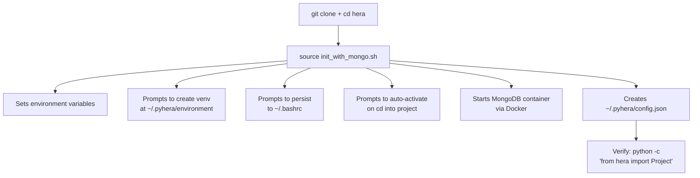
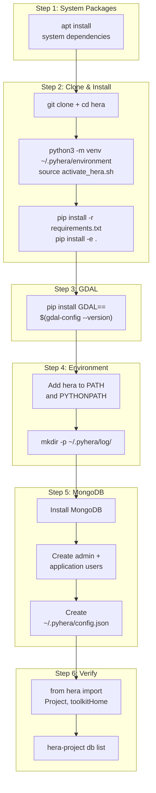

# Installation & Setup

This guide walks you through installing Hera and configuring the required services. There are two paths: a **Quick Install** using the provided scripts and Docker, or a **Manual Installation** for full control over each step.

---

## Prerequisites

| Requirement | Minimum Version | Notes |
|-------------|----------------|-------|
| **OS** | Ubuntu 22.04 LTS | Linux only (`setup.py` classifier); the Docker image is built on Ubuntu 22.04 |
| **Python** | 3.9+ | `setup.py` requires `>=3.9`. CI and the Docker image use **Python 3.11** (recommended) |
| **Git** | 2.x | For cloning the repository |
| **pip** | 21+ | For installing Python packages |
| **Docker** | 20+ | Required for the quick install (MongoDB runs in a container) |

---

## Quick Install (recommended)

The fastest way to get Hera running. Uses Docker for MongoDB and scripts to automate environment setup.

### Installation Flow



### Steps

1. **Clone the repository:**

    ```bash
    git clone https://github.com/KaplanOpenSource/hera
    cd hera
    ```

2. **Run the initialization script:**

    ```bash
    source init_with_mongo.sh
    ```

    This single script will interactively:

    - Set up Hera environment variables (`HERA_REPO_ROOT`, `PYHERA_DIR`, `PYTHONPATH`)
    - Prompt to create a Python virtual environment at `~/.pyhera/environment` (installs `requirements.txt`, then `pip install -e .`)
    - Prompt to persist the environment to `~/.bashrc`
    - Prompt to auto-activate the Hera environment when you `cd` into the project directory
    - Pull and start a `mongo:5.0` Docker container named `hera-mongo` on `127.0.0.1:27017`, with data in `~/mongo-db-datadir`
    - Create the MongoDB users from `mongo-init.d/50-create-users.js` on first start: an admin user (`MathAdmin`/`MathAdmin`) and a Hera user (`hera`/`heracles`) with `readWrite` on the `olymp` database
    - Create `~/.pyhera/config.json` for your OS user, pointing at `127.0.0.1` / `olymp` (skipped if the file already exists)

    After running, everything is ready to use.

    !!! note "Credentials"
        `MONGO_HERA_USER` / `MONGO_HERA_PWD` override the user name and password written to `config.json`, but `init_with_mongo.sh` does not pass them into the container, so the user created in MongoDB stays `hera`/`heracles`. If you change them, create the matching user in MongoDB yourself.

    !!! tip "Alternative: Make targets"
        Instead of the interactive script you can run `make install-env` (creates the venv at `~/.pyhera/environment` and installs everything) followed by `make install` (starts MongoDB). `make install` does **not** write `~/.pyhera/config.json`; create it as shown in [Step 5](#step-5-mongodb-setup).

    !!! tip "Alternative: Docker Compose (full stack)"
        `docker compose up` starts MongoDB plus the Hera UI server (API on `127.0.0.1:8000`, Jupyter on `127.0.0.1:8888`) using `docker-compose.yml`. Add `--profile work` for the Vite dev client and `--profile ai` for an Ollama container.

3. **Install system dependencies and third-party tools (optional):**

    ```bash
    make install-deps       # System packages (libcairo, GDAL, etc.) + GDAL Python binding
    make install-paraview   # ParaView 5.11.0
    make install-freecad    # FreeCad Python3 bindings
    make install-openfoam   # OpenFOAM 10
    make install-deps-all   # All of the above
    ```

    `make install-deps` runs `pip install GDAL==$(gdal-config --version)` in whatever Python is active, so activate the Hera venv first (`source activate_hera.sh`). GDAL is not in `requirements.txt` because its version must match the system `libgdal`.

4. **Load the registered data repositories (optional):**

    ```bash
    make populate                       # hera-project project populate --overwrite (all projects)
    make populate-project PROJECT=name  # a single project
    ```

### Helper Scripts

| Script | Purpose |
|---|---|
| `source set_hera_environment.sh` | Set environment variables, create venv, configure `.bashrc` (called automatically by `init_with_mongo.sh`) |
| `source activate_hera.sh` | Activate the Hera venv and environment in the current shell |
| `source init_with_mongo.sh` | Full initialization: environment setup + MongoDB via Docker + `config.json` |
| `./serve_docs.sh` | Start local MkDocs preview server (renders diagrams first) |
| `python render_diagrams.py` | Render Mermaid diagrams to SVG using Docker (incremental) |

### Managing MongoDB with Make

After initial setup, use the Makefile to manage the MongoDB container:

```bash
make mongo-up              # Start MongoDB (data at ~/mongo-db-datadir)
make mongo-down            # Stop MongoDB
make mongo-status          # Check container status
make mongo-logs            # Tail container logs
make mongo-clean           # Remove container and delete all data
make mongo-up MONGO_DATA=/path/to/data   # Override data directory
```

### Running Tests

```bash
make test                  # Run pytest (requires MongoDB); downloads test data first if missing
make test-ui               # Run the UI client tests (ui/client)
make test-all              # Python tests, notebook tests, then UI tests
make test-setup            # Create an empty test data skeleton at ~/hera_unittest_data
```

`make test` looks for `$TEST_HERA/test_repository.json` (default `~/hera_unittest_data`). If it is missing, it runs `scripts/s3/bootstrap_unittest_data.sh` to download the test data from the public S3 bucket, then runs `pytest hera/tests/ -m "not notebook"`.

### Building Documentation

The documentation site can be built and previewed locally. Diagram images are pre-rendered using a Docker-based Mermaid CLI (pulled automatically on first build).

```bash
make docs-deps             # Install docs/requirements-docs.txt
make docs-build            # Full build: render diagrams + build MkDocs site
make docs-build-strict     # Same, with mkdocs build --strict
make docs-serve            # Render diagrams + start local preview at localhost:8000
make docs-deploy           # Render diagrams + deploy to GitHub Pages
```

Diagram rendering is incremental — only new or changed diagrams are re-rendered (~2s each). Unchanged diagrams are skipped instantly.

```bash
make render-diagrams       # Render new/changed diagrams only
make render-diagrams-force # Re-render ALL diagrams from scratch
make docs-clean            # Remove built site/
```

Run `make help` to see all available targets.

---

## Manual Installation

If you prefer not to use Docker or need more control over each step, follow these instructions.

### Installation Flow



### Step 1: System Packages

```bash
sudo apt install libcairo2-dev pkg-config python3-dev libgirepository1.0-dev libgdal-dev gdal-bin python3-gdal
```

### Step 2: Clone and Install

```bash
git clone https://github.com/KaplanOpenSource/hera
cd hera

# Create the virtual environment where the helper scripts expect it (Python 3.11 recommended)
python3.11 -m venv ~/.pyhera/environment
source activate_hera.sh          # activates the venv, sets HERA_REPO_ROOT/PYTHONPATH, adds hera/bin to PATH
pip install --upgrade pip setuptools wheel

# Install the pinned runtime dependencies
pip install -r requirements.txt

# Install Hera in development mode
pip install -e .
```

`make install-env` performs the same venv creation and installation in one step (then `source activate_hera.sh`).

`setup.py` itself declares only a minimal set of dependencies (pandas, numpy, mongoengine, pymongo, pint, scipy, xarray, dask, geopandas, shapely, deprecated); `requirements.txt` holds the full pinned environment, so install it first. The optional AI search dependencies are an extra: `pip install -e .[rag]` (see [AI Search](ai_search.md)).

Some packages are not on PyPI and are installed separately (see the comment block at the end of `requirements.txt`): GDAL (Step 3), ParaView, FreeCAD, and OpenFOAM (`make install-paraview`, `make install-freecad`, `make install-openfoam`). The OpenFOAM workflows also need the `Hermes` package, which is a git submodule of this repository (`git submodule update --init Hermes`, then add the `Hermes` directory to `PYTHONPATH`).

!!! tip "Development Mode"
    Using `pip install -e .` installs Hera in **editable mode**, meaning changes to the source code take effect immediately without reinstalling.

If `pip install -r requirements.txt` fails, reinstall `setuptools` first:

```bash
pip install --upgrade --force-reinstall setuptools
pip install -r requirements.txt
```

### Step 3: Install GDAL Python Binding

Use `gdalinfo --version` to obtain your OS GDAL version, then:

```bash
pip install GDAL==`gdal-config --version`
```

### Step 4: Set Up PATH and Environment

Add the following to your shell profile (`~/.bashrc`, `~/.zshrc`, etc.):

```bash
export HERA_REPO_ROOT=/path/to/hera
export PYTHONPATH=$PYTHONPATH:/path/to/hera
export PATH=$PATH:/path/to/hera/hera/bin
```

Create required directories (Hera writes its log files to `~/.pyhera/log/`):

```bash
mkdir -p ~/.pyhera/log/
```

!!! tip "Use the setup script instead"
    You can also run `source set_hera_environment.sh` to configure environment variables interactively, even if you're doing the rest manually.

#### Environment Variables

These variables are optional but useful for testing and advanced configurations:

| Variable | Required | Default | Description |
|----------|----------|---------|-------------|
| `HOME` | Yes (OS) | OS default | Location of `~/.pyhera/config.json` and `~/.pyhera/log/` (the path is fixed; it cannot be moved with an env var) |
| `HERA_REPO_ROOT` | No | unset | Hera checkout root. Used as a fallback base for relative toolkit paths when registering dynamic toolkits/experiments. Set by `set_hera_environment.sh` / `activate_hera.sh` |
| `PYHERA_DIR` | No | `~/.pyhera` | Set by the setup scripts and used only by them (venv location, `config.json` creation); the Python code does not read it |
| `MONGO_HERA_USER` / `MONGO_HERA_PWD` | No | `hera` / `heracles` | Credentials written to `config.json` by `init_with_mongo.sh` and used by `mongo-init.d/50-create-users.js` |
| `TEST_HERA` | No | `~/hera_unittest_data` | Root directory for test data |
| `RESULT_SET` | No | `BASELINE` | Name of the expected-output result set for tests |
| `MPLBACKEND` | No | system default | Set to `Agg` for headless matplotlib (no display) |
| `GDF_TOL_AREA` | No | `1e-7` | Tolerance for geometry comparison in tests |
| `HERA_FULL_LOGGING_TESTS` | No | unset | Set to enable full logging during tests |

See the [Environment Variables Reference](../configuration/env_vars.md) for complete details.

### Step 5: MongoDB Setup

Install MongoDB following the [official instructions](https://www.mongodb.com/docs/manual/tutorial/install-mongodb-on-ubuntu/) and ensure it runs on port 27017. The Docker setup uses `mongo:5.0`; CI runs against `mongo:latest`.

Start MongoDB with `mongosh` and create users. Create them in the `admin` database: Hera authenticates with `authenticationSource='admin'`.

```javascript
use admin

db.createUser(
  {
    user: "Admin",
    pwd: "Admin",
    roles: [ { role: "userAdminAnyDatabase", db: "admin" } , "readWriteAnyDatabase"]
  }
)

use admin
db.createUser(
  {
    user: "{username}",
    pwd:  "{password}",
    roles: [ { role: "readWrite", db: "{dbName}" } ]
  }
)
```

Then create `~/.pyhera/config.json` (or let the CLI write the entry for you: `hera-project db create <connectionName> --username ... --password ... --IP ... --databaseName ...`; this requires the file to already exist):

```json
{
    "{username}": {
        "dbIP": "{host}",
        "dbName": "{database name}",
        "password": "{password}",
        "username": "{username}"
    }
}
```

#### Config File Format

| Field | Type | Description |
|-------|------|-------------|
| `connectionName` | `str` (top-level key) | A name for this connection. Hera uses the entry whose key is your OS username when no `connectionName` is given, so you need at least that entry. |
| `username` | `str` | MongoDB username |
| `password` | `str` | MongoDB password |
| `dbIP` | `str` | MongoDB server address (`hostname` or `hostname:port`; port defaults to 27017) |
| `dbName` | `str` | Name of the MongoDB database to use |

!!! note "Multiple Connections"
    You can define multiple connection entries in the same config file. Each entry is a top-level key. When creating a `Project`, you can specify which connection to use via `connectionName`:

    ```python
    from hera import Project
    proj = Project(projectName="MY_PROJECT", connectionName="production")
    ```

    If `connectionName` is not provided, Hera uses the current OS username as the key.

#### What Happens on First Run

`import hera` does not touch the database; connections are opened lazily on the first database access (for example `Project(...)`). If `~/.pyhera/config.json` does not exist at that point, Hera will:

1. Automatically create the directory `~/.pyhera/`
2. Generate a template `config.json` with one entry for your OS username and placeholder values (`{username}`, `{password}`, `{databaseIP}`, `{databaseName}`)
3. Raise an `IOError` asking you to fill in the connection details. The CLI (`hera-project db list`) shows this message directly; from the Python API the error is swallowed during lazy connection setup, and you get `KeyError: user <name> not found` instead.

Fill in the template and restart the Python session.

### Step 6: Verify Installation

#### Python API

```python
from hera import Project, toolkitHome

# Create or connect to a project
proj = Project(projectName="MY_PROJECT")
print(f"Project: {proj.projectName}")
print(f"Files directory: {proj.FilesDirectory}")

# List available toolkits
table = toolkitHome.getToolkitTable("MY_PROJECT")
print(table)
```

#### CLI Tools

```bash
# List database connections
hera-project db list

# List projects
hera-project project list

# List the dynamic toolkit datasources registered in a project
hera-project project measurements list --project MY_PROJECT --shortcut ds
```

!!! warning
    `hera-project db list` prints the full connection details, including passwords. Use `hera-project db list --onlyName` to show only the connection names.

#### Expected Output

If everything is configured correctly, you should see:

- No `IOError` / `KeyError` about missing config entries
- A list of database connections
- A table of toolkits from `getToolkitTable` (the built-in toolkits are always listed; dynamic ones may be empty for a new project)

---

## Troubleshooting Installation

| Problem | Cause | Solution |
|---------|-------|----------|
| `IOError: The config file doesn't exist in the default directory` | Missing `~/.pyhera/config.json` | Fill in the template Hera just created with valid MongoDB connection details |
| `KeyError: user <name> not found. Must be one of: ...` | No `config.json` entry for your OS username (or the file was missing/invalid) | Add an entry keyed by your username, or pass `connectionName=` to `Project` |
| `ServerSelectionTimeoutError` / connection refused | MongoDB not running | Start MongoDB: `sudo systemctl start mongod` or `make mongo-up` |
| `ModuleNotFoundError: No module named 'hera'` | Package not installed | Run `pip install -e .` from the hera root |
| `command not found: hera-project` | `hera/bin/` not in PATH | Run `source activate_hera.sh` or add to PATH manually |
| `ImportError: mongoengine` | Missing dependencies | Run `pip install -r requirements.txt` |

See the [Troubleshooting](../troubleshooting.md) page for more common errors and solutions.
